# RBAC + SSO POC on AWS — 從開源元件遷移到 AWS 原生服務的完整實戰教學

> 本 repo 由 [ChunPingWang/rbac-sso-poc](https://github.com/ChunPingWang/rbac-sso-poc)（Keycloak + OpenLDAP + Spring Cloud Gateway + Kind/K8s）延伸而來，
> 把開源元件替換為 AWS 技術棧、實際部署到 AWS 帳號、以自動化腳本驗證 RBAC / 多租戶 / 稽核行為，並在驗證後清除所有計費資源。
> **原專案的全部程式碼、腳本、K8s / Docker 部署檔都保留**，原始文件移至 [`docs/original/`](docs/original/)。

## 成果摘要

| 項目 | 結果 |
|---|---|
| 部署環境 | AWS 帳號（us-east-1），全程透過 Console + CloudShell，部署者為最小權限 IAM User `rbac-poc-deployer` |
| 單元測試（在 AWS CodeBuild 執行） | **144 tests, 0 failures** |
| 端到端驗證（`aws/scripts/50-verify.sh`） | **52 passed, 0 failed, 1 skipped**（詳見 [驗證報告](docs/verify-report.md)） |
| 修正原專案既有缺陷 | 4 項（F1 跨租戶 by-id 存取、F2 缺少例外處理器導致 500、F3 gradle-wrapper.jar 未進版控、F5 `@EnableJpaRepositories` 讓 22 個 Controller 測試失敗），見 [§1.2](#12-評估時發現的問題已在本-repo-修正) |
| 部署過程踩到並修正的問題 | 12 項，全部記錄在 [§10](#10-疑難排解實際踩到的坑) 與 [`docs/deployment-log.md`](docs/deployment-log.md) |
| 截圖 | 29 張，位於 [`docs/images/`](docs/images/) |
| 計費資源 | 驗證完成後**全部清除並逐項確認為空**（2026-11-12 13:23 UTC，見 [§12.1](#121-本次實際清除結果2026-11-12)） |


---

## 目錄

1. [專案評估：原架構盤點與發現](#1-專案評估原架構盤點與發現)
2. [開源元件 → AWS 服務對照與選型理由](#2-開源元件--aws-服務對照與選型理由)
3. [目標架構](#3-目標架構)
4. [身分、群組、角色、權限的關聯與目的](#4-身分群組角色權限的關聯與目的)
5. [AWS 最佳實踐對照](#5-aws-最佳實踐對照)
6. [程式碼改造說明](#6-程式碼改造說明)
7. [基礎設施即程式碼（CloudFormation 00–60）](#7-基礎設施即程式碼cloudformation-0060)
8. [Step-by-Step 部署（含截圖）](#8-step-by-step-部署含截圖)
9. [驗證結果](#9-驗證結果)
10. [疑難排解（實際踩到的坑）](#10-疑難排解實際踩到的坑)
11. [成本估算](#11-成本估算)
12. [清除所有計費資源](#12-清除所有計費資源)
13. [走向 Production 的強化建議](#13-走向-production-的強化建議)
14. [Repo 結構](#14-repo-結構)

---

## 1. 專案評估：原架構盤點與發現

### 1.1 原專案組成

| 層 | 原元件 | 說明 |
|---|---|---|
| 身分來源 | OpenLDAP (`osixia/openldap`) | 使用者、群組目錄 |
| SSO / IdP | Keycloak 24 + PostgreSQL | LDAP User Federation、Realm Roles、OIDC Token |
| API Gateway | Spring Cloud Gateway (`gateway-service`) | 路由 `/api/products/**`、`/api/users/**`，JWT 驗證 |
| 微服務 | `product-service`（Hexagonal + DDD + CQRS）、`user-service` | Spring Boot 3.3 / Java 17 |
| 共用函式庫 | `security-lib`、`tenant-lib`、`audit-lib`、`common-lib` | JWT→角色、租戶 Context、AOP 稽核 |
| 資料庫 | H2（服務）/ PostgreSQL（Keycloak） | |
| 執行平台 | Docker Compose、Kind (K8s) | |
| 東西向安全 | cert-manager + Spring Boot SSL Bundle（mTLS） | |

### 1.2 評估時發現的問題（已在本 repo 修正）

| # | 問題 | 影響 | 修正 |
|---|---|---|---|
| F1 | **多租戶隔離只做在「列表查詢」**。`GET/PUT/DELETE /api/products/{id}` 沒有檢查租戶 | 任何租戶只要知道 ID 就能讀取、修改他租戶商品（違反原專案 `multi-tenant.feature`：「租戶無法存取其他租戶的商品 → 資源不存在」） | 新增 `TenantAccessGuard`：非 `system` 租戶存取他租戶資料一律回 **404**（不洩漏資源存在與否），取不到租戶時 fail-closed |
| F2 | **沒有任何 `@ControllerAdvice`** | `ResourceNotFoundException` 變成 HTTP 500 | 新增 `GlobalExceptionHandler`（404 / 400 / 409），刻意不攔截 `AccessDeniedException`，讓 Spring Security 維持 401/403 |
| F3 | `gradle-wrapper.jar` 被 `.gitignore` 的 `*.jar` 排除 | clone 後無法執行 `./gradlew` | 補回 wrapper jar 並修正 `.gitignore` |
| F4 | 角色只從 Keycloak 專屬 claim（`realm_access`）解析 | 換 IdP 就失效 | `CompositeRoleConverter` 同時支援 Keycloak 與 Cognito（`cognito:groups`），本地 / K8s / AWS 共用同一份程式碼 |
| F5 | `ProductServiceApplication` 上的 `@EnableJpaRepositories` / `@EntityScan` 讓所有 `@WebMvcTest` slice 測試啟動失敗（22 個 Controller 測試 fail；原 README 宣稱 100% 通過已不成立） | CI 無法作為品質閘門 | 移到 `config/JpaConfig`（於 AWS CodeBuild 首次建置時發現） |


---

## 2. 開源元件 → AWS 服務對照與選型理由

| 原開源元件 | AWS 取代 | 選型理由 / 取捨 |
|---|---|---|
| OpenLDAP（使用者目錄） | **Amazon Cognito User Pool** | 全託管、免維運；`custom:tenant_id` 取代 LDAP 屬性 |
| Keycloak Realm Roles | **Cognito User Pool Groups**（`ADMIN`/`TENANT_ADMIN`/`AUDITOR`/`USER`/`VIEWER`） | Group 名稱直接出現在 token 的 `cognito:groups` |
| Keycloak Protocol Mapper | **Cognito Pre Token Generation Lambda（V2_0）** | 把 `tenant_id`、email、姓名注入 **access token**（Cognito 預設不放 custom 屬性） |
| Keycloak OIDC / SSO 登入頁 | **Cognito Hosted UI + OAuth2 Authorization Code + PKCE** | 瀏覽器端 SSO；測試腳本則用伺服器端 `ADMIN_USER_PASSWORD_AUTH` |
| Spring Cloud Gateway | **Amazon API Gateway HTTP API + JWT Authorizer** | 邊界驗證、節流、存取日誌全託管；細粒度 RBAC 仍留在服務內（縱深防禦） |
| K8s Service / NodePort | **內部 Application Load Balancer**（Path-based routing） | 只能經由 API Gateway VPC Link 進入 |
| Kind / K8s Deployment | **Amazon ECS on AWS Fargate** | 無伺服器容器；不選 EKS 是因 control plane 每月約 US$73 起、POC 不需要 K8s API |
| PostgreSQL / H2 | **Amazon RDS for PostgreSQL 16** | 加密、強制 TLS、密碼由 **Secrets Manager** 託管（`ManageMasterUserPassword`） |
| Docker build / registry | **AWS CodeBuild + Amazon ECR** | 在 AWS 內跑單元測試 → 打包 → 建 image；ECR 不可變 tag + 推送即掃描 |
| docker logs / kubectl logs | **Amazon CloudWatch Logs**、Container Insights、VPC Flow Logs | |
| cert-manager mTLS（東西向） | **未部署**（見 [§13](#13-走向-production-的強化建議)） | AWS Private CA 一般模式每月約 US$400；POC 以 Security Group 鏈 + 私有子網路取代，正式環境可用 VPC Lattice / Service Connect TLS |
| Spring Cloud Gateway 的 CORS | API Gateway `CorsConfiguration` | |

---

## 3. 目標架構

### 3.1 整體架構圖

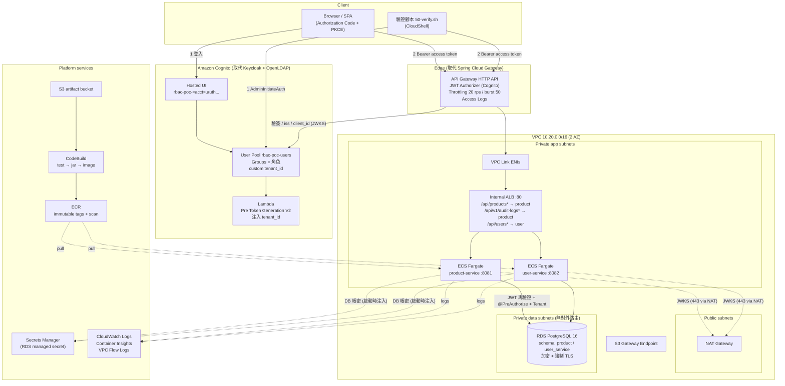

### 3.2 一次 API 請求的完整流程

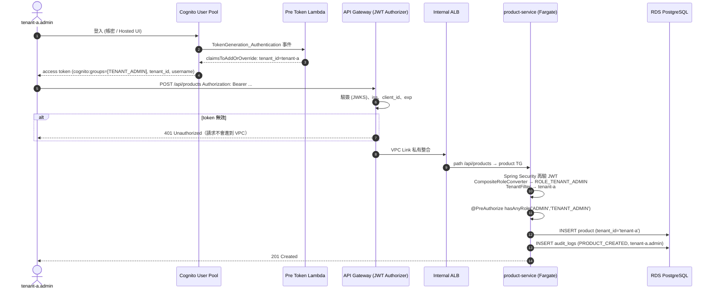

### 3.3 網路與 Security Group 鏈

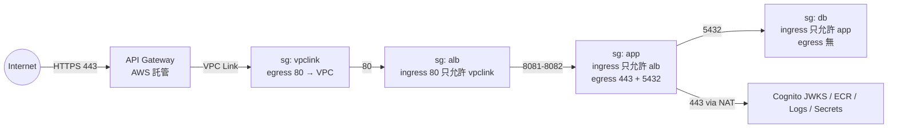

| 子網路 | CIDR | 路由 | 放什麼 |
|---|---|---|---|
| public-a / b | 10.20.0.0/24、10.20.1.0/24 | 0.0.0.0/0 → IGW | 只有 NAT Gateway |
| app-a / b | 10.20.4.0/24、10.20.5.0/24 | 0.0.0.0/0 → NAT、S3 Gateway Endpoint | VPC Link ENI、內部 ALB、Fargate tasks（**無 public IP**） |
| data-a / b | 10.20.8.0/24、10.20.9.0/24 | **只有 local** | RDS |

---

## 4. 身分、群組、角色、權限的關聯與目的

本 POC 有 **兩個完全分離的身分平面**，教學時最容易混淆，務必分清楚：

| 平面 | 管什麼 | 身分來源 | 授權機制 |
|---|---|---|---|
| **A. AWS 管理平面** | 誰能「建置／部署／維運」AWS 資源 | AWS IAM | IAM Policy、Permissions Boundary、Service Role |
| **B. 應用程式平面** | 誰能「呼叫業務 API」（商品、使用者、稽核） | Amazon Cognito | JWT（`cognito:groups`、`tenant_id`）→ Spring Security `@PreAuthorize` + TenantFilter |

### 4.1 AWS 管理平面（IAM）

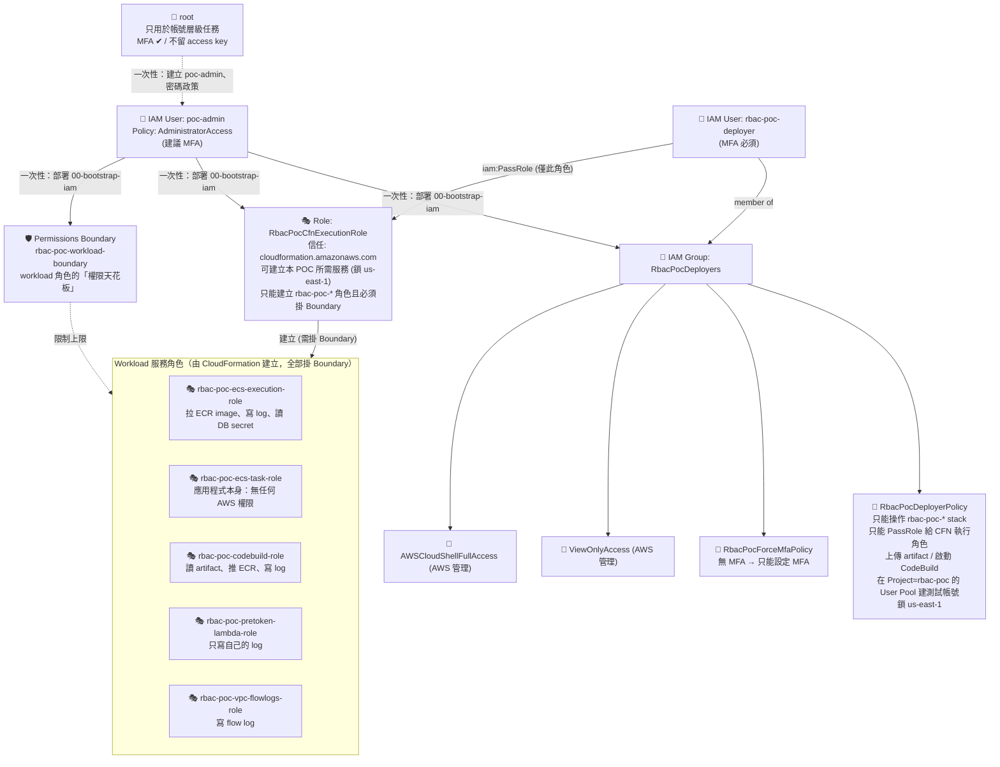

| 身分 / 物件 | 類型 | 目的 | 為什麼這樣設計（最佳實踐） |
|---|---|---|---|
| root | 帳號根使用者 | 只做「必須用 root」的事 | AWS 建議 root 不做日常操作；開 MFA、刪除 access key |
| `poc-admin` | IAM User + `AdministratorAccess` | 一次性部署 IAM bootstrap（建角色、政策、群組） | 讓建立 IAM 這種高權限動作與日常部署分離 |
| `rbac-poc-deployer` | IAM User（無 access key，只用 Console + CloudShell） | 日常部署、驗證、清除 | **最小權限**：本身不能直接建 VPC/RDS/ECS，只能透過 CloudFormation 執行角色 |
| `RbacPocDeployers` | IAM Group | 權限掛在群組而非個人 | 人員異動只要調整群組成員 |
| `RbacPocDeployerPolicy` | Customer managed policy | 限制 stack 名稱、PassRole 對象、Region、Cognito pool tag；可讀取本專案 ECR 掃描結果與 CodeBuild 測試報表 | 避免部署者動到其他專案資源；讀取權限也限定在 `rbac-poc*` 資源 |
| `RbacPocForceMfaPolicy` | Customer managed policy | 沒有 MFA 時拒絕所有動作 | 強制 MFA |
| `RbacPocCfnExecutionRole` | Service role（CloudFormation） | 實際建立所有資源 | **職責分離**：人只有「交給 CFN」的權限；所有變更都有 stack 紀錄可追蹤、可回滾 |
| `rbac-poc-workload-boundary` | Permissions Boundary | 所有 workload 角色的權限上限 | 防止「透過建立高權限角色提權」：CFN 執行角色若建立不掛 Boundary 的角色會被 IAM 拒絕 |
| ECS execution role | Service role | ECS agent 拉 image、寫 log、取 DB secret | 與 task role 分離 |
| ECS task role | Service role | 應用程式本身的 AWS 權限 | 本應用不呼叫 AWS API → **零權限** |
| CodeBuild role | Service role | 讀 S3 原始碼、推 ECR | 只能推到兩個 repo |
| Pre-token Lambda role | Service role | 只寫自己的 log group | |

### 4.2 應用程式平面（Cognito → RBAC → 多租戶）

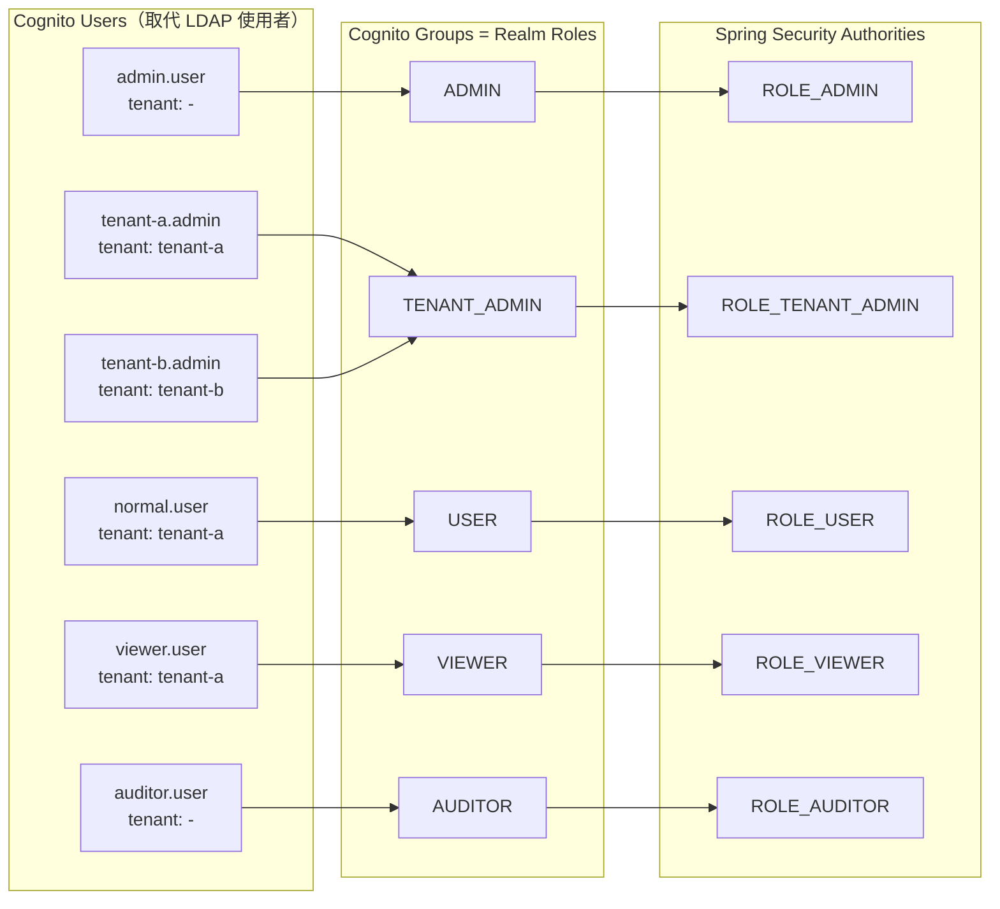

**Token → 權限的轉換鏈**

| 步驟 | 元件 | 輸入 | 輸出 |
|---|---|---|---|
| 1 | Cognito | 使用者所屬 Group | access token `cognito:groups: ["TENANT_ADMIN"]` |
| 2 | Pre Token Lambda | `custom:tenant_id` 屬性 | access token `tenant_id: "tenant-a"` |
| 3 | API Gateway JWT Authorizer | token | 驗簽、`iss`、`client_id`、`exp`；失敗回 401 |
| 4 | `CompositeRoleConverter` | `cognito:groups` / `realm_access` | `ROLE_TENANT_ADMIN` |
| 5 | `SecurityConfig.resolvePrincipalName` | `username` / `preferred_username` / `sub` | `auth.getName() = "tenant-a.admin"`（稽核紀錄用） |
| 6 | `TenantFilter` | `tenant_id`；無 tenant 且為 ADMIN → `system` | `TenantContext = tenant-a` |
| 7 | `@PreAuthorize` | authorities | 允許 / 403 |
| 8 | `ProductQueryService` / `TenantAccessGuard` | TenantContext | 只看得到自己租戶的資料，他租戶 → 404 |

**權限對照表（本次在 AWS 上逐項驗證）**

| 端點 | ADMIN | TENANT_ADMIN | USER | VIEWER | AUDITOR | 無 token |
|---|:-:|:-:|:-:|:-:|:-:|:-:|
| `GET /api/products` | ✅ 全部租戶 | ✅ 本租戶 | ✅ 本租戶 | ✅ 本租戶 | — | 401 |
| `GET /api/products/{id}` | ✅ | ✅ 本租戶（他租戶 404） | ✅ 本租戶 | ✅ 本租戶 | — | 401 |
| `POST /api/products` | ✅ | ✅ | 403 | 403 | — | 401 |
| `PUT /api/products/{id}` | ✅ | ✅ 本租戶 | 403 | 403 | — | 401 |
| `DELETE /api/products/{id}` | ✅ | 403 | 403 | 403 | — | 401 |
| `GET /api/users/me` | ✅ | ✅ | ✅ | ✅ | ✅ | 401 |
| `GET /api/v1/audit-logs` | ✅ | 403 | 403 | 403 | ✅ | 401 |

**兩個 App Client 的目的**

| App Client | 允許的流程 | 用途 | 為什麼 |
|---|---|---|---|
| `rbac-poc-web` | SRP、Refresh、OAuth2 Code + PKCE、Hosted UI | 瀏覽器 / 行動 App | 公開 client 不放 secret；密碼不以明文送出（SRP） |
| `rbac-poc-test-harness` | `ADMIN_USER_PASSWORD_AUTH`、Refresh | 自動化驗證腳本 | `AdminInitiateAuth` **需要 IAM 權限**，網際網路上的人無法用這個 client 暴力猜密碼 |

> `custom:tenant_id` **不在任何 App Client 的 WriteAttributes 內**：使用者無法自行把自己改到別的租戶（驗證案例 G1）。


---

## 5. AWS 最佳實踐對照

依 AWS Well-Architected Framework（以安全支柱為主）逐項對照本 POC 的做法：

| 面向 | 最佳實踐 | 本 POC 做法 | 對應檔案 |
|---|---|---|---|
| 身分 | 不使用 root 做日常操作、root 開 MFA、不留 root access key | root 只用來建立 `poc-admin` 與密碼政策；建議刪除 root access key | §8 Step 0 |
| 身分 | 人員使用最小權限、強制 MFA | `rbac-poc-deployer` 只拿到 `RbacPocDeployerPolicy` + `RbacPocForceMfaPolicy` | `00-bootstrap-iam.yaml` |
| 身分 | 職責分離、可稽核的變更 | 所有資源只透過 `RbacPocCfnExecutionRole` 由 CloudFormation 建立 | `env.sh::cfn_deploy` |
| 身分 | 防止透過建立角色提權 | Permissions Boundary + `iam:PermissionsBoundary` 條件 | `00-bootstrap-iam.yaml` |
| 身分 | 不使用長期金鑰 | 部署者沒有 access key（只用 Console + CloudShell）；workload 全部用 IAM Role | |
| 身分 | 密碼政策 | 14 碼、大小寫數字符號、90 天、不可重用 12 次 | §8 Step 0 |
| 偵測 | 集中日誌、保存期限 | API GW access log、ECS log、CodeBuild log、Lambda log、VPC Flow Logs（REJECT），保留 14 天 | 10/40/50/60 |
| 偵測 | 應用層稽核 | `audit-lib` 寫入 RDS `audit_logs`，帳號為 Cognito `username` | `audit-lib` |
| 基礎設施 | HTTP desync 防護 | ALB `desync_mitigation_mode=defensive`、丟棄無效 header | `50-services.yaml` |
| 基礎設施 | 分層網路、最小暴露面 | 3 層子網路；ALB 為 internal；Fargate 無 public IP；RDS 子網路無對外路由 | `10-network.yaml` |
| 基礎設施 | Security Group 鏈（以 SG 參照而非 CIDR） | vpclink → alb → app → db | `10-network.yaml` |
| 基礎設施 | 邊界驗證 + 縱深防禦 | API GW JWT Authorizer 擋未驗證流量，服務內仍再驗 JWT 並做 RBAC | `60-api.yaml`、`security-lib` |
| 基礎設施 | 節流 | API GW 20 rps / burst 50 | `60-api.yaml` |
| 資料 | 靜態加密 | RDS `StorageEncrypted`、ECR AES256、S3 SSE | 20/40/00 |
| 資料 | 傳輸加密 | RDS `rds.force_ssl=1` + JDBC `sslmode=require`；S3 bucket policy 拒絕非 TLS | 20、`application-aws.yml` |
| 資料 | 祕密管理 | RDS 主密碼由 Secrets Manager 產生與託管，ECS 以 `secrets` 注入，template / 腳本 / git 皆無密碼 | 20、50 |
| 資料 | 租戶隔離 | token `tenant_id` + 服務層過濾 + by-id 存取檢查 | `TenantAccessGuard` |
| 應用 | 容器強化 | 非 root（UID 65532）、唯讀 root filesystem、`/tmp` 為 ephemeral volume | `Dockerfile.*`、`50-services.yaml` |
| 應用 | 供應鏈 | Base image 來自 Amazon ECR Public（Corretto）；ECR 不可變 tag + 推送即掃描；CodeBuild 先跑單元測試才推 image | `buildspec.yml` |
| 可靠性 | 部署保護 | ECS Deployment Circuit Breaker + 自動 rollback；ALB health check | `50-services.yaml` |
| 成本 | POC 成本最佳化 | 單一 NAT（參數可切 2 個）、`db.t4g.micro`、Fargate 0.5 vCPU、S3 Gateway Endpoint 省 NAT 流量費、log 保留 14 天、ECR 保留 10 個 image | 各 template |
| 成本 | 用完即清 | `99-cleanup.sh` 依相依順序刪除所有 stack | §12 |

---

## 6. 程式碼改造說明

> 原則：**同一份程式碼同時支援 Keycloak（本地 / Docker / K8s）與 Cognito（AWS）**，以 Spring Profile 切換，不破壞原有部署方式。

| 檔案 | 類型 | 變更 |
|---|---|---|
| `libs/security-lib/.../converter/CognitoGroupsRoleConverter.java` | 新增 | `cognito:groups` → `ROLE_*` |
| `libs/security-lib/.../converter/CompositeRoleConverter.java` | 新增 | 合併 Keycloak 與 Cognito 角色 |
| `libs/security-lib/.../config/SecurityConfig.java` | 修改 | 使用 Composite converter；principal 名稱依序取 `username` → `preferred_username` → `sub` |
| `libs/tenant-lib/.../filter/TenantFilter.java` | 修改 | ADMIN 判斷支援 `cognito:groups` |
| `services/user-service/.../UserProfileService.java` | 修改 | `groups` 為空時改讀 `cognito:groups` |
| `services/product-service/.../TenantAccessGuard.java` | 新增 | **修正 F1**：by-id 操作檢查租戶 |
| `services/product-service/.../GlobalExceptionHandler.java` | 新增 | **修正 F2**：404 / 400 / 409 |
| `services/*/src/main/resources/application-aws.yml` | 新增 | RDS PostgreSQL（schema-per-service）、Cognito issuer、關閉 H2 console |
| 測試 | 新增 | `CognitoGroupsRoleConverterTest`、`SecurityConfigPrincipalTest`、跨租戶 / fail-closed / 404 測試 |

### 6.1 角色轉換（重點程式碼）

```java
// SecurityConfig.java
@Bean
public Converter<Jwt, AbstractAuthenticationToken> jwtAuthenticationConverter() {
    JwtAuthenticationConverter delegate = new JwtAuthenticationConverter();
    delegate.setJwtGrantedAuthoritiesConverter(
        new CompositeRoleConverter(new KeycloakRoleConverter(), new CognitoGroupsRoleConverter()));
    return jwt -> {
        AbstractAuthenticationToken token = delegate.convert(jwt);
        return new JwtAuthenticationToken(jwt, token.getAuthorities(), resolvePrincipalName(jwt));
    };
}
```

> 為什麼要處理 principal 名稱？Cognito access token 的 `sub` 是 UUID，若不處理，稽核紀錄的使用者會變成一串 UUID。

### 6.2 租戶存取檢查（修正 F1）

```java
static Product requireAccessible(Product product, UUID requestedId) {
    String currentTenant = TenantContext.getCurrentTenant();
    if ("system".equals(currentTenant)) return product;                       // ADMIN
    if (currentTenant == null || !currentTenant.equals(product.getTenantId()))
        throw new ResourceNotFoundException("Product", requestedId);          // 404, fail-closed
    return product;
}
```

### 6.3 AWS Profile

```yaml
spring:
  datasource:
    url: jdbc:postgresql://${DB_HOST}:${DB_PORT:5432}/${DB_NAME:rbacpoc}?currentSchema=product&sslmode=require
    username: ${DB_USERNAME}     # ECS 從 Secrets Manager 注入
    password: ${DB_PASSWORD}
  flyway: { schemas: product, create-schemas: true }     # audit_logs 由 audit-lib 的 Flyway 建立
  security.oauth2.resourceserver.jwt.issuer-uri: ${COGNITO_ISSUER_URI}
```

---

## 7. 基礎設施即程式碼（CloudFormation 00–60）

| Stack | 檔案 | 部署者 | 主要資源 | 時間 |
|---|---|---|---|---|
| `rbac-poc-00-bootstrap-iam` | `00-bootstrap-iam.yaml` | **poc-admin**（一次性） | CFN 執行角色、Boundary、部署者群組 / 政策、artifact bucket | ~1 分 |
| `rbac-poc-10-network` | `10-network.yaml` | deployer | VPC、6 子網路、NAT、S3 endpoint、4 個 SG、Flow Logs | ~3 分 |
| `rbac-poc-20-data` | `20-data.yaml` | deployer | RDS PostgreSQL 16、參數群組（force_ssl） | ~10 分 |
| `rbac-poc-30-identity` | `30-identity.yaml` | deployer | User Pool、5 Groups、2 App Clients、Hosted UI domain、Pre-token Lambda | ~1 分 |
| `rbac-poc-40-build` | `40-build.yaml` | deployer | 2 ECR repo、CodeBuild project | ~1 分 |
| `rbac-poc-50-services` | `50-services.yaml` | deployer | ECS cluster、2 task def / service、internal ALB、listener rules | ~5 分 |
| `rbac-poc-60-api` | `60-api.yaml` | deployer | HTTP API、VPC Link、JWT Authorizer、route、stage | ~2 分 |

Stack 之間以 **CloudFormation Exports / ImportValue** 串接（例如 `rbac-poc-issuer-uri`、`rbac-poc-db-secret-arn`），刪除時需反向順序。

### 7.1 腳本

| 腳本 | 執行身分 | 作用 |
|---|---|---|
| `aws/scripts/env.sh` | — | 共用設定；`cfn_deploy` 一律帶 `--role-arn RbacPocCfnExecutionRole` |
| `00-bootstrap-iam.sh` | poc-admin | 部署 IAM bootstrap；偵測到 deployer user 已存在時只加入群組；拒絕 root 執行 |
| `01-preflight.sh` | deployer | 身分、region、bootstrap 輸出、template 驗證 |
| `10-deploy-foundation.sh` | deployer | network → (data ∥ identity → build) |
| `20-build-images.sh` | deployer | 打包原始碼 → S3 → CodeBuild（單元測試 + image）→ 取得 image tag |
| `30-deploy-services.sh` | deployer | ECS + ALB → API Gateway → 等待 service stable |
| `40-seed-users.sh` | deployer | 建立 6 個測試帳號；**隨機密碼只存在 CloudShell `~/.rbac-poc/test-users.env`（600）** |
| `50-verify.sh` | deployer | 端到端驗證並輸出 Markdown 報告 |
| `99-cleanup.sh [--all]` | deployer / poc-admin | 反向刪除 stack；`--all` 另刪 artifact bucket 與 IAM bootstrap |
| `deploy-all.sh` | deployer | 01 → 50 一次跑完 |


---

## 8. Step-by-Step 部署（含截圖）

> 全程在瀏覽器裡完成：**AWS Console + CloudShell**，本機不需要安裝 AWS CLI、JDK 或 Docker，也不需要建立任何 access key。
> 截圖都在 [`docs/images/`](docs/images/)，完整時間軸見 [`docs/deployment-log.md`](docs/deployment-log.md)。

### Step 0：帳號準備（root，一次性）

**為什麼**：root 擁有無法被限制的權限。AWS 建議 root 只做帳號層級任務，日常改用 IAM 身分。

1. 以 root 登入，開啟 CloudShell（右上角 `>_` 圖示）。

   

2. 在 IAM Console 建立兩個 IAM User（都啟用主控台存取、**不要**建立 access key）：
   - `poc-admin`：之後掛 `AdministratorAccess`
   - `rbac-poc-deployer`：**不要掛任何權限**，由 Step 1 的 bootstrap 加入群組

   > ⚠️ 不要手動建立 `RbacPocDeployers` 群組，否則 Step 1 會因同名衝突失敗（見 §10-1）。

3. 檢查目前狀態（唯讀）：

   ```bash
   for u in poc-admin rbac-poc-deployer; do
     printf '%-18s policies=[%s] groups=[%s] mfa=[%s] keys=[%s]\n' $u \
       "$(aws iam list-attached-user-policies --user-name $u --query 'AttachedPolicies[].PolicyName' --output text)" \
       "$(aws iam list-groups-for-user --user-name $u --query 'Groups[].GroupName' --output text)" \
       "$(aws iam list-mfa-devices --user-name $u --query 'length(MFADevices)' --output text)" \
       "$(aws iam list-access-keys --user-name $u --query 'length(AccessKeyMetadata)' --output text)"
   done
   echo "root: MFA=$(aws iam get-account-summary --query SummaryMap.AccountMFAEnabled --output text) AccessKeys=$(aws iam get-account-summary --query SummaryMap.AccountAccessKeysPresent --output text)"
   ```

   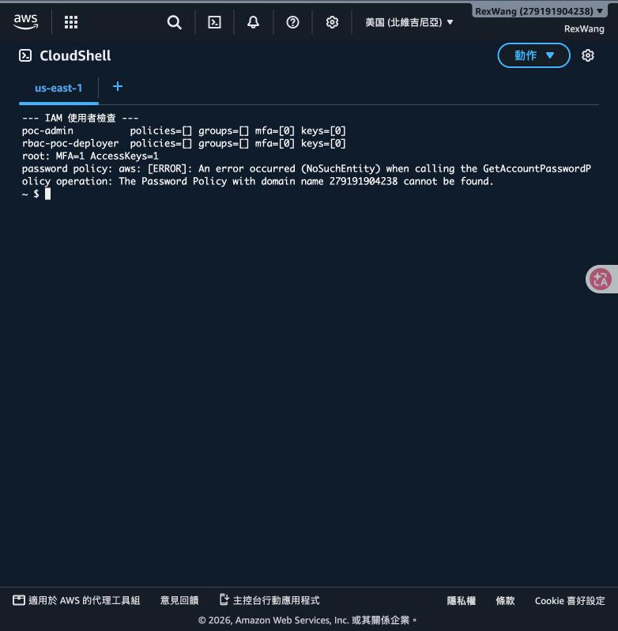

4. 給 `poc-admin` 管理權限、設定帳號密碼政策：

   ```bash
   aws iam attach-user-policy --user-name poc-admin --policy-arn arn:aws:iam::aws:policy/AdministratorAccess
   aws iam update-account-password-policy --minimum-password-length 14 --require-symbols --require-numbers \
     --require-uppercase-characters --require-lowercase-characters --allow-users-to-change-password \
     --max-password-age 90 --password-reuse-prevention 12
   ```

   
   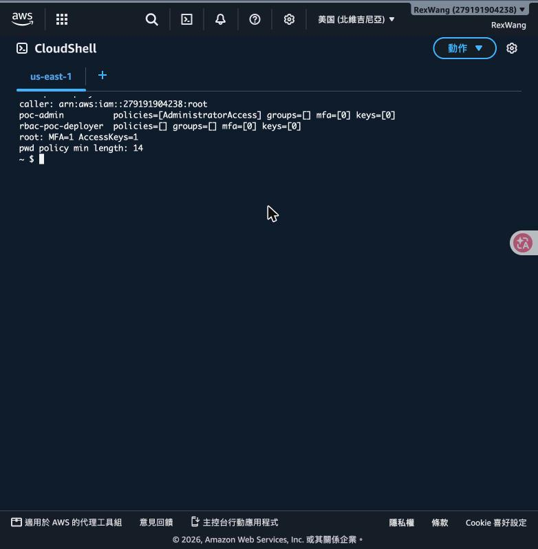

5. 替 `poc-admin`、`rbac-poc-deployer` 指派 MFA 裝置（IAM → 使用者 → 安全憑證 → 指派 MFA）。
6. 若 root 有 access key：先「停用」，確認沒有程式依賴後再「刪除」：

   ```bash
   K=$(aws iam list-access-keys --query 'AccessKeyMetadata[0].AccessKeyId' --output text)
   aws iam get-access-key-last-used --access-key-id $K --output table
   aws iam update-access-key --access-key-id $K --status Inactive
   aws iam delete-access-key --access-key-id $K      # 不可復原
   ```

7. 登出 root，使用 `https://<帳號ID>.signin.aws.amazon.com/console` 以 `poc-admin` 登入。

### Step 1：IAM Bootstrap（poc-admin）

1. 把程式碼放進 CloudShell：
   - 方法 A：`git clone https://github.com/ChunPingWang/rbac-poc-on-aws-tutorial.git`
   - 方法 B（離線 / 私有 repo）：本機 `git bundle create rbac-poc.bundle main`，CloudShell「動作 → 上傳檔案」上傳後 `git clone rbac-poc.bundle rbac-poc-on-aws-tutorial`

   
   

2. 執行 bootstrap：

   ```bash
   cd ~/rbac-poc-on-aws-tutorial
   ./aws/scripts/00-bootstrap-iam.sh
   ```

   腳本會：拒絕 root 執行 → 偵測 `rbac-poc-deployer` 是否已存在（已存在則只加入群組）→ 部署 `rbac-poc-00-bootstrap-iam`。

   

3. 驗證群組與政策：

   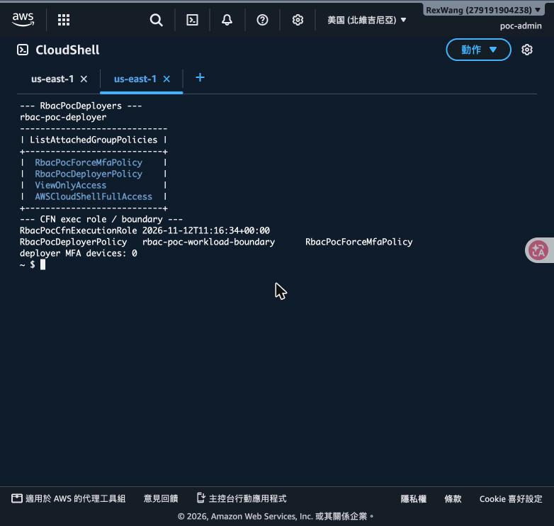

### Step 2：以 deployer 登入並 preflight

```bash
# 以 rbac-poc-deployer（含 MFA）登入 → us-east-1 → CloudShell
# 每個 IAM User 的 CloudShell 家目錄是獨立的，需重新 clone / 上傳
./aws/scripts/01-preflight.sh
```


### Step 3：基礎設施（network → data ∥ identity → build）

```bash
./aws/scripts/10-deploy-foundation.sh
```


### Step 4：在 CodeBuild 測試、建置、推送 image

```bash
./aws/scripts/20-build-images.sh
```

CodeBuild 依序執行：`security-lib` / `tenant-lib` / `product-service` / `user-service` 單元測試 → `bootJar` → `docker build`（Corretto 17 from ECR Public）→ 推送 ECR（不可變 tag，例如 `20261112114918-3`）。測試失敗不會推送 image。

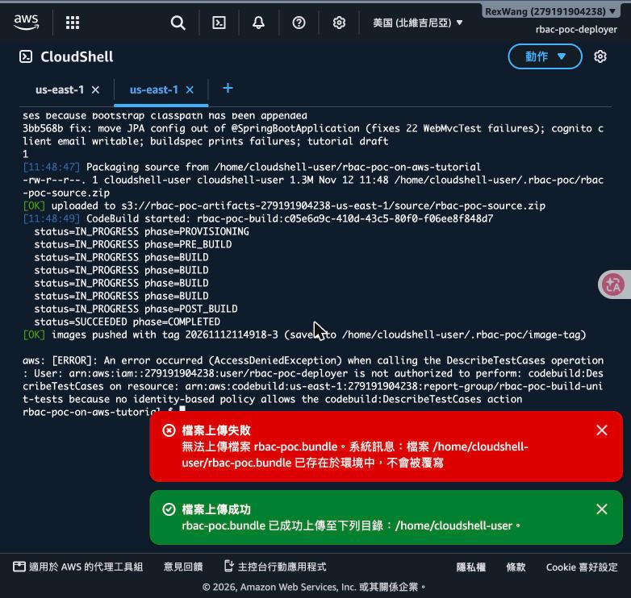

### Step 5：部署 ECS、ALB、API Gateway

```bash
./aws/scripts/30-deploy-services.sh
```


### Step 6：建立測試帳號

```bash
./aws/scripts/40-seed-users.sh
```

密碼由腳本以 `openssl rand` 產生，只存在 CloudShell 的 `~/.rbac-poc/test-users.env`（權限 600），不會進 git、不會印在畫面上。

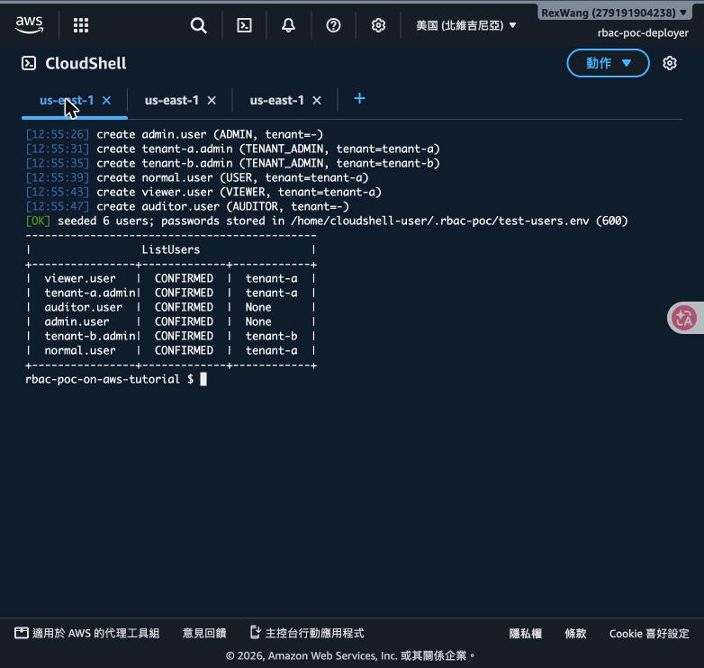

### Step 7：端到端驗證

```bash
./aws/scripts/50-verify.sh
```

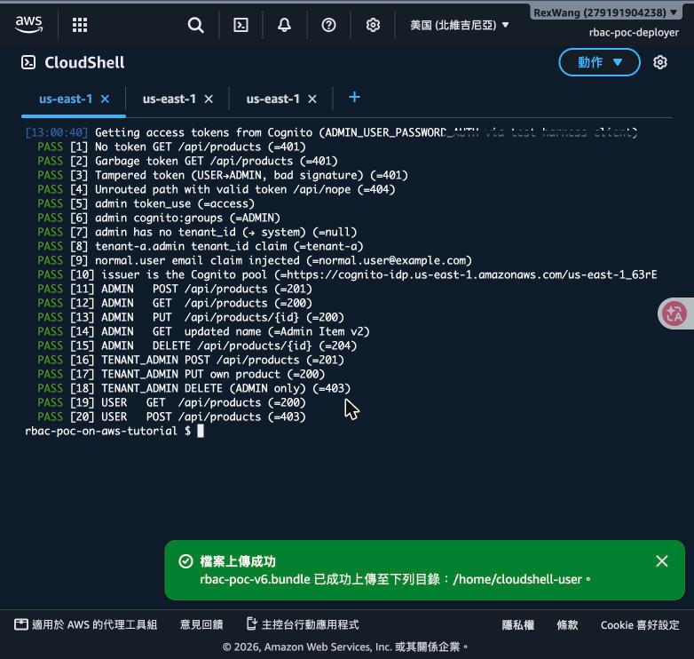
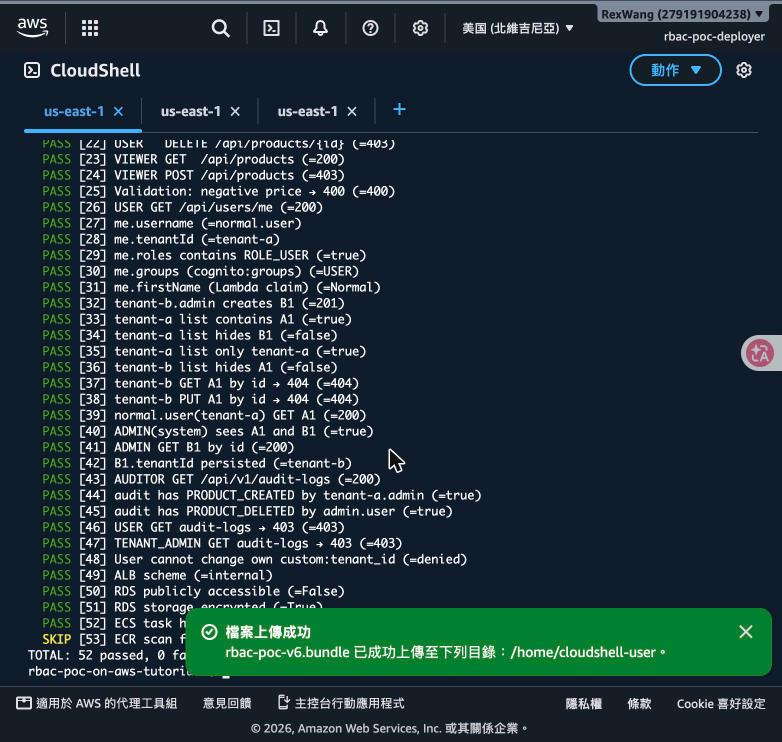


---

## 9. 驗證結果

最終結果：**52 passed, 0 failed, 1 skipped**（2026-11-12 13:00 UTC，`rbac-poc-deployer` 於 CloudShell 執行）。完整報告見 [`docs/verify-report.md`](docs/verify-report.md)。

| 區塊 | 驗證內容 | 案例數 | 結果 |
|---|---|:-:|:-:|
| A. 邊界驗證 | 無 token / 亂碼 token / **竄改 payload（USER→ADMIN）** 皆被 API Gateway 以 401 擋下；未定義路徑 404 | 4 | ✅ |
| B. Token 內容 | `token_use=access`、`cognito:groups`、Lambda 注入的 `tenant_id` / email、issuer | 6 | ✅ |
| C. RBAC 矩陣 | ADMIN 全 CRUD；TENANT_ADMIN 不能刪；USER / VIEWER 只能讀；輸入驗證 400 | 15 | ✅ |
| D. user-service | `/api/users/me` 的 username、tenant、roles、groups、firstName 皆來自 Cognito token | 6 | ✅ |
| E. 多租戶隔離 | 列表只見本租戶；**他租戶 by-id GET / PUT 回 404**（F1 修正生效）；ADMIN 跨租戶可見；tenant_id 寫入 RDS | 11 | ✅ |
| F. 稽核 | `audit_logs` 記錄 PRODUCT_CREATED / PRODUCT_DELETED 與 Cognito 使用者名稱；只有 ADMIN / AUDITOR 可查 | 5 | ✅ |
| G. 安全態勢 | 使用者**無法自行修改 `custom:tenant_id`**；ALB 為 internal；RDS 非公開且加密；Fargate task 無 public IP | 5 | ✅ |
| G. ECR 掃描 | deployer 當時沒有讀取掃描結果的權限 → SKIP（`00-bootstrap-iam.yaml` 已補上唯讀權限） | 1 | ⏭️ |

> **驗證的意義**：A 證明未驗證流量根本進不了 VPC；C + E 證明授權在服務內仍然生效（縱深防禦，不只靠 API Gateway）；E-37/38 證明本次修正的跨租戶漏洞在雲端環境確實被堵住；G-48 證明「租戶身分」無法被使用者自行竄改。


---

## 10. 疑難排解（實際踩到的坑）

以下都是本次實際部署時遇到、已修正並寫回 template / 程式的問題，依發生順序排列：

| # | 階段 | 症狀 | 根因 | 修正 |
|---|---|---|---|---|
| 10-1 | Step 1 bootstrap | `AWS::IAM::Group 'RbacPocDeployers' already exists` → ROLLBACK_COMPLETE | 事先在 Console 手動建立了同名空群組 | 刪除空的 stack 與空群組後重跑；**IAM 資源一律交給 IaC 建立** |
| 10-2 | Step 3 identity | `Invalid write attributes specified while creating a client` | User Pool 的**必填屬性（email）必須在 App Client 的 WriteAttributes 內** | WriteAttributes 改為 `[email, given_name, family_name]`；`custom:tenant_id` 仍不可寫 |
| 10-3 | Step 4 CodeBuild | product-service 128 個測試中 22 個失敗，`NoSuchBeanDefinitionException` | 原專案在 `@SpringBootApplication` 類別上加了 `@EnableJpaRepositories`，所有 `@WebMvcTest` slice 都被迫建立 JPA Repository（**原專案既有回歸**，由 git 歷史確認：該註解晚於 Controller 測試加入） | 移到獨立的 `config/JpaConfig` |
| 10-4 | Step 4 CodeBuild | deployer 執行 `describe-test-cases` 被拒 | 最小權限：`RbacPocDeployerPolicy` 未授權讀取 CodeBuild 報表 | 不放寬權限，改由 buildspec 在 log 中輸出 `TEST SUMMARY` 與失敗細節 |
| 10-5 | Step 4 CloudShell | 上傳同名檔案失敗：「已存在於環境中，不會被覆寫」 | CloudShell 上傳不覆寫既有檔案 | 每次用不同檔名（`rbac-poc-v3.bundle`），或先 `rm` |
| 10-6 | Step 5 ECS | Task 反覆重啟：`Unable to create tempDir. java.io.tmpdir is set to /tmp` / `AccessDeniedException` | Fargate 的 ephemeral bind volume 為 `root:root 0755`，非 root（UID 65532）容器無法寫入 | 加入 **init container**（以 root 執行 `chmod 1777 /tmp` 後結束），app 容器 `DependsOn: SUCCESS`；仍維持非 root + 唯讀 root FS |
| 10-7 | Step 5 ECS | 失敗後 stack 進入 ROLLBACK_COMPLETE | ECS Deployment Circuit Breaker 在 3 個 task 失敗後判定部署失敗，CloudFormation 回滾（**這正是預期的保護機制**） | `delete-stack` 後重新部署 |
| 10-8 | 重新部署前 | `aws cloudformation wait stack-rollback-complete` 一直等不到 | 該 waiter 只認 `UPDATE_ROLLBACK_COMPLETE`；**建立失敗**的回滾狀態是 `ROLLBACK_COMPLETE` | 直接 `describe-stacks` 檢查狀態後 `delete-stack` |
| 10-9 | Step 5 ECS | init container 成功（`tmp-ready`）後，app 啟動失敗：`Unable to determine source type <S> and target type <T> for your Converter` | **本次改造引入的錯誤**：把 JWT converter 寫成 lambda `@Bean`；Spring MVC 會把所有 `Converter` bean 註冊進 conversion service，lambda 的泛型無法解析。slice 測試不載入 SecurityConfig，所以單元測試沒抓到 | 改為具名類別 `PrincipalAwareJwtAuthenticationConverter`，並新增「可註冊進 conversion service」的回歸測試 |
| 10-10 | Step 5 ECS | user-service log：`syntax error at or near "user"`（`alter table if exists user.audit_logs ...`） | schema-per-service 把 user-service 的 schema 取名為 `user`，**`user` 是 PostgreSQL 保留字**，Hibernate 產生的 DDL / SQL 沒有加引號 | schema 改名為 `user_service`。連帶影響：`audit-lib` 的 `AuditHealthIndicator` 查詢 `user.audit_logs` 失敗 → `/actuator/health` 回 DOWN(503) → ALB 判定 unhealthy → Circuit Breaker 回滾 |
| 10-11 | Step 7 驗證 | 所有 **GET** 回 `400 Bad Request`，回應 header 為 `server: awselb/2.0`；POST/PUT/DELETE 正常 | ALB 設了 `routing.http.desync_mitigation_mode=strictest`：API Gateway 轉送的 GET 被 ALB 歸類為「acceptable」而非「compliant」，strictest 模式只放行 compliant | 改回 AWS 預設 `defensive`（仍會防護 HTTP desync） |
| 10-12 | Step 7 驗證 | 驗證腳本 curl 出現 `option -X: blank argument` | **腳本 bug**：`local m="$1" ... args=(... -X "$m")` 寫在同一行時，`$m` 在賦值前就被展開 | 拆成兩個 `local` 宣告 |


**通用除錯指令**

```bash
# 某個 stack 失敗的原因
aws cloudformation describe-stack-events --stack-name <stack> \
  --query "StackEvents[?contains(ResourceStatus,'FAILED')].[LogicalResourceId,ResourceStatusReason]" --output text
# ECS 部署狀態
aws ecs describe-services --cluster rbac-poc-cluster --services rbac-poc-product-service rbac-poc-user-service \
  --query 'services[].[serviceName,runningCount,deployments[0].rolloutState,deployments[0].failedTasks]' --output text
# 應用程式 log
aws logs tail /rbac-poc/product-service --since 10m --follow
# API Gateway access log（含 JWT authorizer 錯誤）
aws logs tail /rbac-poc/api-gateway-access --since 10m
```

---

## 11. 成本估算

> ⚠️ 以下為依 us-east-1 公開定價的**估算**（本次撰寫時未逐項以 AWS Pricing Calculator 驗證，實際以帳單為準）。

| 資源 | 規格 | 約略單價 | 每日約 |
|---|---|---|---|
| NAT Gateway | 1 個 | ~US$0.045 / 小時 + 流量 | ~US$1.1 |
| NAT 的 Public IPv4 | 1 個 | ~US$0.005 / 小時 | ~US$0.12 |
| Internal ALB | 1 個 | ~US$0.0225 / 小時 + LCU | ~US$0.55 |
| ECS Fargate | 2 task × 0.5 vCPU / 1 GB | ~US$0.025 / task-小時 | ~US$1.2 |
| RDS PostgreSQL | db.t4g.micro + 20 GB gp3 | ~US$0.016 / 小時 | ~US$0.45 |
| API Gateway HTTP API | 測試流量 | ~US$1 / 百萬次 | ≈ 0 |
| Cognito Essentials | 6 個測試使用者 | 免費額度內 | ≈ 0 |
| CodeBuild | general1.medium，每次約 3 分鐘 | ~US$0.01 / 分 | 每次 ~US$0.03 |
| CloudWatch Logs / Container Insights / Secrets Manager / ECR | 少量 | | < US$0.3 |
| **合計** | | | **約 US$3.5 / 天** |

**最大宗是 NAT Gateway 與 Fargate**。POC 結束務必執行 [§12](#12-清除所有計費資源)。

---

## 12. 清除所有計費資源

```bash
# (1) deployer：反向刪除 60 → 10（ECR 設 EmptyOnDelete，image 一併刪除）
./aws/scripts/99-cleanup.sh

# (2) poc-admin：清空並刪除 artifact bucket（含所有版本）、刪除 IAM bootstrap
./aws/scripts/99-cleanup.sh --all
```

刪除順序與原因：

| 順序 | Stack | 為什麼要這個順序 |
|---|---|---|
| 1 | 60-api | 參照 ALB listener、Cognito、子網路 |
| 2 | 50-services | 參照 ECR、RDS、Cognito、網路 |
| 3 | 40-build | ECR repo（`EmptyOnDelete: true`） |
| 4 | 30-identity | User Pool、Lambda |
| 5 | 20-data | RDS（`DeletionPolicy: Delete`，POC 不留 snapshot） |
| 6 | 10-network | NAT、EIP、VPC |
| 7 | 00-bootstrap-iam | 需 admin；先清空 versioned bucket |

清除後的確認清單（全部應為空）：

```bash
aws cloudformation list-stacks --stack-status-filter CREATE_COMPLETE UPDATE_COMPLETE ROLLBACK_COMPLETE \
  --query "StackSummaries[?starts_with(StackName,'rbac-poc')].StackName" --output text
aws ec2 describe-nat-gateways --filter Name=state,Values=available,pending --query 'NatGateways[].NatGatewayId' --output text
aws ec2 describe-addresses --query 'Addresses[].PublicIp' --output text
aws rds describe-db-instances --query "DBInstances[?starts_with(DBInstanceIdentifier,'rbac-poc')].DBInstanceIdentifier" --output text
aws elbv2 describe-load-balancers --query "LoadBalancers[?starts_with(LoadBalancerName,'rbac-poc')].LoadBalancerName" --output text
aws ecs list-clusters --query "clusterArns[?contains(@,'rbac-poc')]" --output text
aws ecr describe-repositories --query "repositories[?starts_with(repositoryName,'rbac-poc')].repositoryName" --output text
aws logs describe-log-groups --log-group-name-prefix /rbac-poc --query 'logGroups[].logGroupName' --output text
```

> IAM User（`poc-admin`、`rbac-poc-deployer`）與帳號密碼政策**不計費**，由帳號擁有者決定是否保留。

### 12.1 本次實際清除結果（2026-11-12）

| 階段 | 身分 | 時間 (UTC) | 結果 |
|---|---|---|---|
| `99-cleanup.sh` | rbac-poc-deployer | 13:02 – 13:12 | 60 → 10 共 6 個 stack 刪除完成 |
| 殘留檢查 | rbac-poc-deployer | 13:13 | 剩 bootstrap stack、artifact bucket、兩個 **由 AWS 服務自行建立** 的 log group（`/aws/rds/instance/rbac-poc-postgres/postgresql`、`/aws/ecs/containerinsights/rbac-poc-cluster/performance`）—— 不屬於任何 stack，刪 stack 不會帶走 |
| `99-cleanup.sh --all` | poc-admin | 13:21 – 13:22 | 清空 versioned bucket、刪除兩個 log group、刪除 IAM bootstrap |
| 最終檢查 | poc-admin | 13:23 | stacks / NAT / EIP / VPC / RDS / RDS snapshots / ALB / ECS / ECR / Cognito / API Gateway / Lambda / CodeBuild / S3 / Secrets / Log groups / IAM roles **全部為空** |

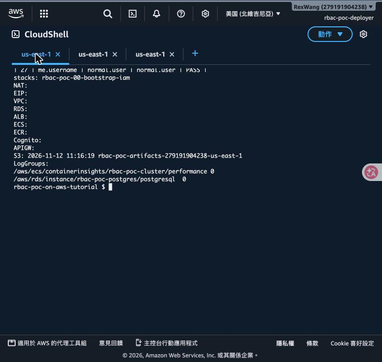
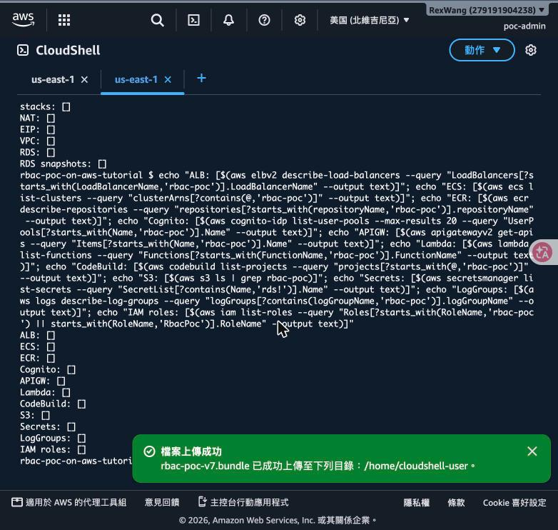

> 保留項目（不計費）：IAM User `poc-admin`、`rbac-poc-deployer`，以及帳號密碼政策。

---

## 13. 走向 Production 的強化建議

| 項目 | POC 現況 | Production 建議 |
|---|---|---|
| 人員身分 | IAM User + MFA | **IAM Identity Center**（SSO、短期憑證、Permission Set）；多帳號 Landing Zone（Control Tower） |
| API → ALB | VPC Link 後為 HTTP | ALB 掛 ACM 憑證改 HTTPS（需自有網域） |
| WAF | HTTP API 不支援直接掛 WAF | 前置 CloudFront + WAF，或改用 REST API + WAF |
| 東西向 mTLS | 未部署（SG 鏈取代） | VPC Lattice（IAM auth）或 ECS Service Connect TLS + AWS Private CA（short-lived 模式較便宜） |
| Token 型別 | 服務端接受任何同 issuer token | 加 `token_use == access` 驗證（自訂 `JwtDecoder` validator） |
| 威脅防護 | Cognito Essentials | Cognito Plus：threat protection（自適應驗證、外洩密碼偵測） |
| 資料庫 | 單 AZ、備份 1 天、DeletionPolicy Delete | Multi-AZ 或 Aurora、備份 ≥ 7 天、Snapshot / Retain、Deletion protection、IAM DB auth |
| 秘密輪換 | RDS 託管（預設 7 天自動輪換） | 應用程式支援連線重建；監控輪換失敗 |
| 網路 | 單一 NAT | 每 AZ 一個 NAT（參數 `NatGatewayCount=2`）或 VPC Endpoints |
| 偵測 | CloudWatch Logs | GuardDuty、Security Hub、CloudTrail（多 Region、log file validation）、AWS Config |
| CI/CD | 手動執行腳本 | CodePipeline / GitHub Actions + OIDC（不使用長期金鑰）、image 簽章 |
| 擴展 | DesiredCount 1 | ECS Service Auto Scaling、多 AZ task 分散 |

---

## 14. Repo 結構

```
rbac-poc-on-aws-tutorial/
├── README.md                      ← 本教學
├── aws/                           ← ★ AWS 版本新增
│   ├── cloudformation/            00-bootstrap-iam … 60-api
│   ├── codebuild/buildspec.yml
│   ├── docker/Dockerfile.{product,user}-service
│   ├── lambda/pre-token-generation/index.js
│   └── scripts/                   env / 00 / 01 / 10 / 20 / 30 / 40 / 50 / 99 / deploy-all
├── docs/
│   ├── images/                    ← 部署過程截圖
│   ├── deployment-log.md          ← 實際部署時間軸
│   ├── verify-report.md           ← 驗證報告（自動產生）
│   └── original/                  ← 原專案 README / PRD / TECH / INFRA
├── libs/                          security-lib / tenant-lib / audit-lib / common-lib
├── services/                      product-service / user-service / gateway-service（保留）
├── apps/rbac-demo/                （保留）
├── deploy/                        docker / k8s / scripts（原專案，全部保留）
├── specs/                         原專案 spec-kit
└── tests/scenario-tests/          Cucumber BDD（保留）
```


