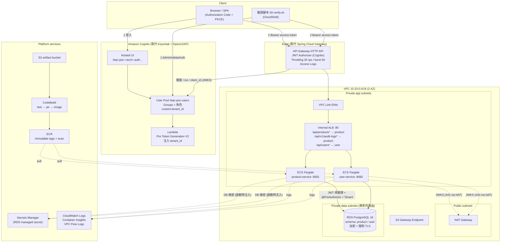
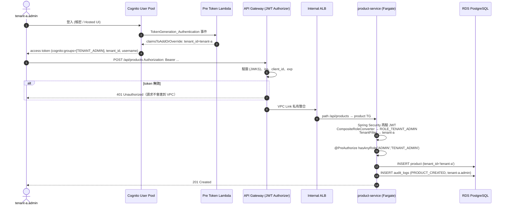
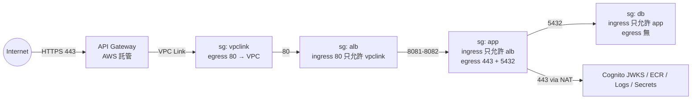
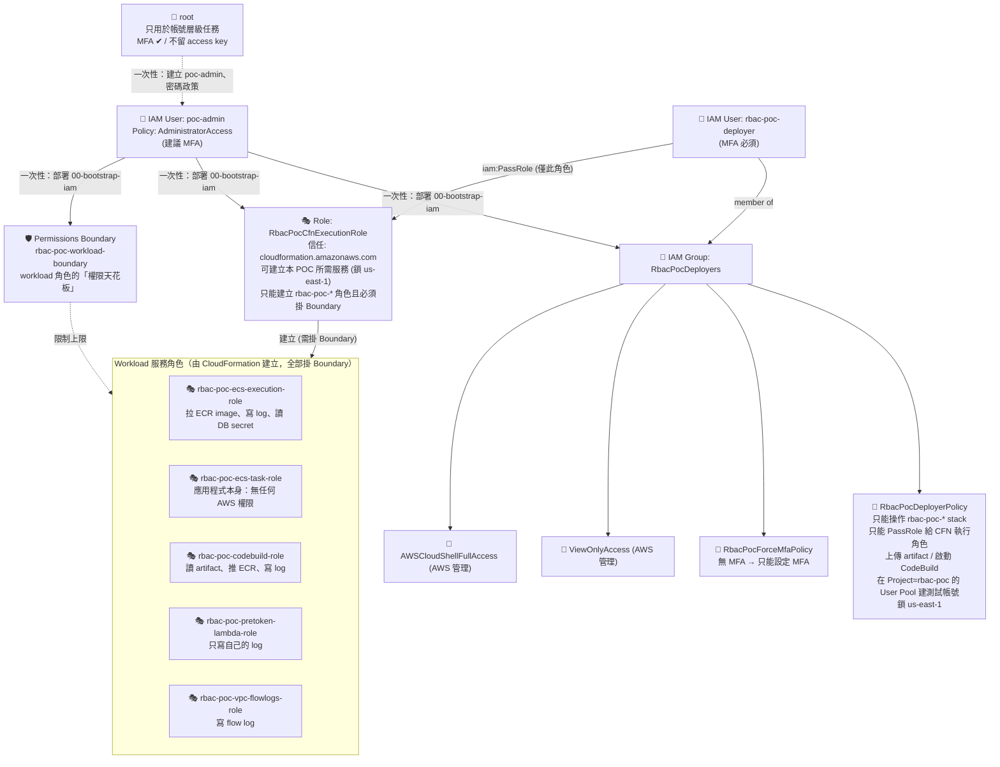
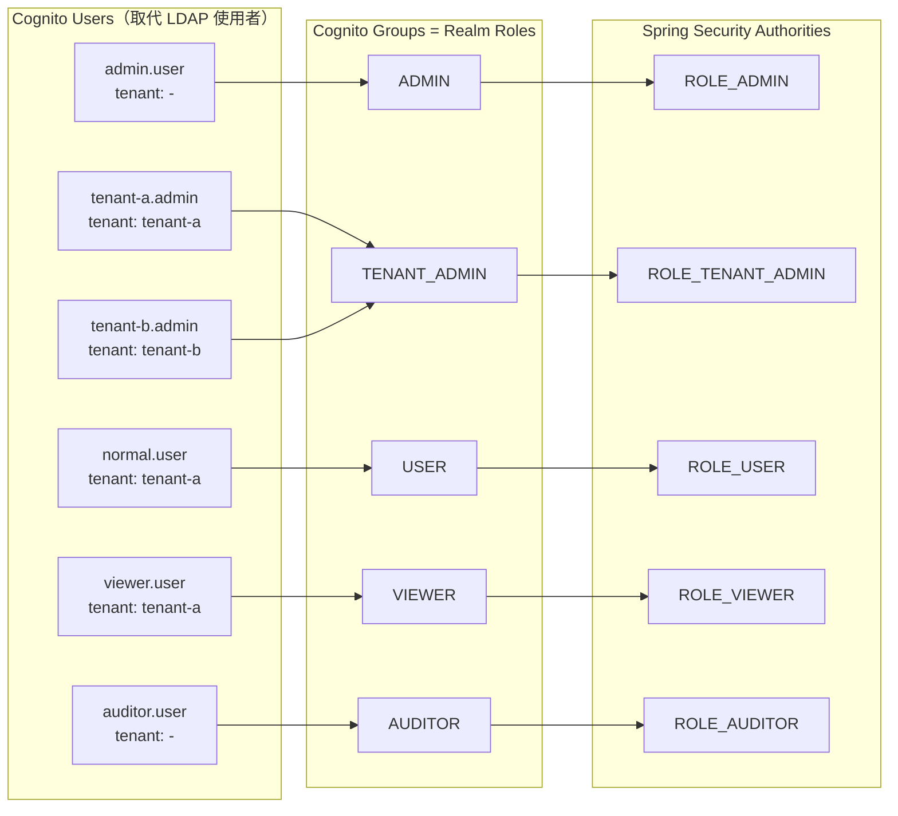

# RBAC + SSO POC on AWS — 從開源元件遷移到 AWS 原生服務的完整實戰教學

> 本 repo 由 [ChunPingWang/rbac-sso-poc](https://github.com/ChunPingWang/rbac-sso-poc)（Keycloak + OpenLDAP + Spring Cloud Gateway + Kind/K8s）延伸而來，
> 把開源元件替換為 AWS 技術棧、實際部署到 AWS 帳號、以自動化腳本驗證 RBAC / 多租戶 / 稽核行為，並在驗證後清除所有計費資源。
> **原專案的全部程式碼、腳本、K8s / Docker 部署檔都保留**，原始文件移至 [`docs/original/`](docs/original/)。

<!-- RESULT-SUMMARY -->

---

## 目錄

1. [專案評估：原架構盤點與發現](#1-專案評估原架構盤點與發現)
2. [開源元件 → AWS 服務對照與選型理由](#2-開源元件--aws-服務對照與選型理由)
3. [目標架構](#3-目標架構)
4. [身分、群組、角色、權限的關聯與目的](#4-身分群組角色權限的關聯與目的)
5. [AWS 最佳實踐對照](#5-aws-最佳實踐對照)
6. [程式碼改造說明](#6-程式碼改造說明)
7. [基礎設施即程式碼（CloudFormation 00–60）](#7-基礎設施即程式碼cloudformation-0060)
8. [Step-by-Step 部署（含截圖）](#8-step-by-step-部署含截圖)
9. [驗證結果](#9-驗證結果)
10. [疑難排解（實際踩到的坑）](#10-疑難排解實際踩到的坑)
11. [成本估算](#11-成本估算)
12. [清除所有計費資源](#12-清除所有計費資源)
13. [走向 Production 的強化建議](#13-走向-production-的強化建議)
14. [Repo 結構](#14-repo-結構)

---

## 1. 專案評估：原架構盤點與發現

### 1.1 原專案組成

| 層 | 原元件 | 說明 |
|---|---|---|
| 身分來源 | OpenLDAP (`osixia/openldap`) | 使用者、群組目錄 |
| SSO / IdP | Keycloak 24 + PostgreSQL | LDAP User Federation、Realm Roles、OIDC Token |
| API Gateway | Spring Cloud Gateway (`gateway-service`) | 路由 `/api/products/**`、`/api/users/**`，JWT 驗證 |
| 微服務 | `product-service`（Hexagonal + DDD + CQRS）、`user-service` | Spring Boot 3.3 / Java 17 |
| 共用函式庫 | `security-lib`、`tenant-lib`、`audit-lib`、`common-lib` | JWT→角色、租戶 Context、AOP 稽核 |
| 資料庫 | H2（服務）/ PostgreSQL（Keycloak） | |
| 執行平台 | Docker Compose、Kind (K8s) | |
| 東西向安全 | cert-manager + Spring Boot SSL Bundle（mTLS） | |

### 1.2 評估時發現的問題（已在本 repo 修正）

| # | 問題 | 影響 | 修正 |
|---|---|---|---|
| F1 | **多租戶隔離只做在「列表查詢」**。`GET/PUT/DELETE /api/products/{id}` 沒有檢查租戶 | 任何租戶只要知道 ID 就能讀取、修改他租戶商品（違反原專案 `multi-tenant.feature`：「租戶無法存取其他租戶的商品 → 資源不存在」） | 新增 `TenantAccessGuard`：非 `system` 租戶存取他租戶資料一律回 **404**（不洩漏資源存在與否），取不到租戶時 fail-closed |
| F2 | **沒有任何 `@ControllerAdvice`** | `ResourceNotFoundException` 變成 HTTP 500 | 新增 `GlobalExceptionHandler`（404 / 400 / 409），刻意不攔截 `AccessDeniedException`，讓 Spring Security 維持 401/403 |
| F3 | `gradle-wrapper.jar` 被 `.gitignore` 的 `*.jar` 排除 | clone 後無法執行 `./gradlew` | 補回 wrapper jar 並修正 `.gitignore` |
| F4 | 角色只從 Keycloak 專屬 claim（`realm_access`）解析 | 換 IdP 就失效 | `CompositeRoleConverter` 同時支援 Keycloak 與 Cognito（`cognito:groups`），本地 / K8s / AWS 共用同一份程式碼 |

<!-- F-EXTRA -->

---

## 2. 開源元件 → AWS 服務對照與選型理由

| 原開源元件 | AWS 取代 | 選型理由 / 取捨 |
|---|---|---|
| OpenLDAP（使用者目錄） | **Amazon Cognito User Pool** | 全託管、免維運；`custom:tenant_id` 取代 LDAP 屬性 |
| Keycloak Realm Roles | **Cognito User Pool Groups**（`ADMIN`/`TENANT_ADMIN`/`AUDITOR`/`USER`/`VIEWER`） | Group 名稱直接出現在 token 的 `cognito:groups` |
| Keycloak Protocol Mapper | **Cognito Pre Token Generation Lambda（V2_0）** | 把 `tenant_id`、email、姓名注入 **access token**（Cognito 預設不放 custom 屬性） |
| Keycloak OIDC / SSO 登入頁 | **Cognito Hosted UI + OAuth2 Authorization Code + PKCE** | 瀏覽器端 SSO；測試腳本則用伺服器端 `ADMIN_USER_PASSWORD_AUTH` |
| Spring Cloud Gateway | **Amazon API Gateway HTTP API + JWT Authorizer** | 邊界驗證、節流、存取日誌全託管；細粒度 RBAC 仍留在服務內（縱深防禦） |
| K8s Service / NodePort | **內部 Application Load Balancer**（Path-based routing） | 只能經由 API Gateway VPC Link 進入 |
| Kind / K8s Deployment | **Amazon ECS on AWS Fargate** | 無伺服器容器；不選 EKS 是因 control plane 每月約 US$73 起、POC 不需要 K8s API |
| PostgreSQL / H2 | **Amazon RDS for PostgreSQL 16** | 加密、強制 TLS、密碼由 **Secrets Manager** 託管（`ManageMasterUserPassword`） |
| Docker build / registry | **AWS CodeBuild + Amazon ECR** | 在 AWS 內跑單元測試 → 打包 → 建 image；ECR 不可變 tag + 推送即掃描 |
| docker logs / kubectl logs | **Amazon CloudWatch Logs**、Container Insights、VPC Flow Logs | |
| cert-manager mTLS（東西向） | **未部署**（見 [§13](#13-走向-production-的強化建議)） | AWS Private CA 一般模式每月約 US$400；POC 以 Security Group 鏈 + 私有子網路取代，正式環境可用 VPC Lattice / Service Connect TLS |
| Spring Cloud Gateway 的 CORS | API Gateway `CorsConfiguration` | |

---

## 3. 目標架構

### 3.1 整體架構圖



### 3.2 一次 API 請求的完整流程



### 3.3 網路與 Security Group 鏈



| 子網路 | CIDR | 路由 | 放什麼 |
|---|---|---|---|
| public-a / b | 10.20.0.0/24、10.20.1.0/24 | 0.0.0.0/0 → IGW | 只有 NAT Gateway |
| app-a / b | 10.20.4.0/24、10.20.5.0/24 | 0.0.0.0/0 → NAT、S3 Gateway Endpoint | VPC Link ENI、內部 ALB、Fargate tasks（**無 public IP**） |
| data-a / b | 10.20.8.0/24、10.20.9.0/24 | **只有 local** | RDS |

---

## 4. 身分、群組、角色、權限的關聯與目的

本 POC 有 **兩個完全分離的身分平面**，教學時最容易混淆，務必分清楚：

| 平面 | 管什麼 | 身分來源 | 授權機制 |
|---|---|---|---|
| **A. AWS 管理平面** | 誰能「建置／部署／維運」AWS 資源 | AWS IAM | IAM Policy、Permissions Boundary、Service Role |
| **B. 應用程式平面** | 誰能「呼叫業務 API」（商品、使用者、稽核） | Amazon Cognito | JWT（`cognito:groups`、`tenant_id`）→ Spring Security `@PreAuthorize` + TenantFilter |

### 4.1 AWS 管理平面（IAM）



| 身分 / 物件 | 類型 | 目的 | 為什麼這樣設計（最佳實踐） |
|---|---|---|---|
| root | 帳號根使用者 | 只做「必須用 root」的事 | AWS 建議 root 不做日常操作；開 MFA、刪除 access key |
| `poc-admin` | IAM User + `AdministratorAccess` | 一次性部署 IAM bootstrap（建角色、政策、群組） | 讓建立 IAM 這種高權限動作與日常部署分離 |
| `rbac-poc-deployer` | IAM User（無 access key，只用 Console + CloudShell） | 日常部署、驗證、清除 | **最小權限**：本身不能直接建 VPC/RDS/ECS，只能透過 CloudFormation 執行角色 |
| `RbacPocDeployers` | IAM Group | 權限掛在群組而非個人 | 人員異動只要調整群組成員 |
| `RbacPocDeployerPolicy` | Customer managed policy | 限制 stack 名稱、PassRole 對象、Region、Cognito pool tag | 避免部署者動到其他專案資源 |
| `RbacPocForceMfaPolicy` | Customer managed policy | 沒有 MFA 時拒絕所有動作 | 強制 MFA |
| `RbacPocCfnExecutionRole` | Service role（CloudFormation） | 實際建立所有資源 | **職責分離**：人只有「交給 CFN」的權限；所有變更都有 stack 紀錄可追蹤、可回滾 |
| `rbac-poc-workload-boundary` | Permissions Boundary | 所有 workload 角色的權限上限 | 防止「透過建立高權限角色提權」：CFN 執行角色若建立不掛 Boundary 的角色會被 IAM 拒絕 |
| ECS execution role | Service role | ECS agent 拉 image、寫 log、取 DB secret | 與 task role 分離 |
| ECS task role | Service role | 應用程式本身的 AWS 權限 | 本應用不呼叫 AWS API → **零權限** |
| CodeBuild role | Service role | 讀 S3 原始碼、推 ECR | 只能推到兩個 repo |
| Pre-token Lambda role | Service role | 只寫自己的 log group | |

### 4.2 應用程式平面（Cognito → RBAC → 多租戶）



**Token → 權限的轉換鏈**

| 步驟 | 元件 | 輸入 | 輸出 |
|---|---|---|---|
| 1 | Cognito | 使用者所屬 Group | access token `cognito:groups: ["TENANT_ADMIN"]` |
| 2 | Pre Token Lambda | `custom:tenant_id` 屬性 | access token `tenant_id: "tenant-a"` |
| 3 | API Gateway JWT Authorizer | token | 驗簽、`iss`、`client_id`、`exp`；失敗回 401 |
| 4 | `CompositeRoleConverter` | `cognito:groups` / `realm_access` | `ROLE_TENANT_ADMIN` |
| 5 | `SecurityConfig.resolvePrincipalName` | `username` / `preferred_username` / `sub` | `auth.getName() = "tenant-a.admin"`（稽核紀錄用） |
| 6 | `TenantFilter` | `tenant_id`；無 tenant 且為 ADMIN → `system` | `TenantContext = tenant-a` |
| 7 | `@PreAuthorize` | authorities | 允許 / 403 |
| 8 | `ProductQueryService` / `TenantAccessGuard` | TenantContext | 只看得到自己租戶的資料，他租戶 → 404 |

**權限對照表（本次在 AWS 上逐項驗證）**

| 端點 | ADMIN | TENANT_ADMIN | USER | VIEWER | AUDITOR | 無 token |
|---|:-:|:-:|:-:|:-:|:-:|:-:|
| `GET /api/products` | ✅ 全部租戶 | ✅ 本租戶 | ✅ 本租戶 | ✅ 本租戶 | — | 401 |
| `GET /api/products/{id}` | ✅ | ✅ 本租戶（他租戶 404） | ✅ 本租戶 | ✅ 本租戶 | — | 401 |
| `POST /api/products` | ✅ | ✅ | 403 | 403 | — | 401 |
| `PUT /api/products/{id}` | ✅ | ✅ 本租戶 | 403 | 403 | — | 401 |
| `DELETE /api/products/{id}` | ✅ | 403 | 403 | 403 | — | 401 |
| `GET /api/users/me` | ✅ | ✅ | ✅ | ✅ | ✅ | 401 |
| `GET /api/v1/audit-logs` | ✅ | 403 | 403 | 403 | ✅ | 401 |

**兩個 App Client 的目的**

| App Client | 允許的流程 | 用途 | 為什麼 |
|---|---|---|---|
| `rbac-poc-web` | SRP、Refresh、OAuth2 Code + PKCE、Hosted UI | 瀏覽器 / 行動 App | 公開 client 不放 secret；密碼不以明文送出（SRP） |
| `rbac-poc-test-harness` | `ADMIN_USER_PASSWORD_AUTH`、Refresh | 自動化驗證腳本 | `AdminInitiateAuth` **需要 IAM 權限**，網際網路上的人無法用這個 client 暴力猜密碼 |

> `custom:tenant_id` **不在任何 App Client 的 WriteAttributes 內**：使用者無法自行把自己改到別的租戶（驗證案例 G1）。


---

## 5. AWS 最佳實踐對照

依 AWS Well-Architected Framework（以安全支柱為主）逐項對照本 POC 的做法：

| 面向 | 最佳實踐 | 本 POC 做法 | 對應檔案 |
|---|---|---|---|
| 身分 | 不使用 root 做日常操作、root 開 MFA、不留 root access key | root 只用來建立 `poc-admin` 與密碼政策；建議刪除 root access key | §8 Step 0 |
| 身分 | 人員使用最小權限、強制 MFA | `rbac-poc-deployer` 只拿到 `RbacPocDeployerPolicy` + `RbacPocForceMfaPolicy` | `00-bootstrap-iam.yaml` |
| 身分 | 職責分離、可稽核的變更 | 所有資源只透過 `RbacPocCfnExecutionRole` 由 CloudFormation 建立 | `env.sh::cfn_deploy` |
| 身分 | 防止透過建立角色提權 | Permissions Boundary + `iam:PermissionsBoundary` 條件 | `00-bootstrap-iam.yaml` |
| 身分 | 不使用長期金鑰 | 部署者沒有 access key（只用 Console + CloudShell）；workload 全部用 IAM Role | |
| 身分 | 密碼政策 | 14 碼、大小寫數字符號、90 天、不可重用 12 次 | §8 Step 0 |
| 偵測 | 集中日誌、保存期限 | API GW access log、ECS log、CodeBuild log、Lambda log、VPC Flow Logs（REJECT），保留 14 天 | 10/40/50/60 |
| 偵測 | 應用層稽核 | `audit-lib` 寫入 RDS `audit_logs`，帳號為 Cognito `username` | `audit-lib` |
| 基礎設施 | 分層網路、最小暴露面 | 3 層子網路；ALB 為 internal；Fargate 無 public IP；RDS 子網路無對外路由 | `10-network.yaml` |
| 基礎設施 | Security Group 鏈（以 SG 參照而非 CIDR） | vpclink → alb → app → db | `10-network.yaml` |
| 基礎設施 | 邊界驗證 + 縱深防禦 | API GW JWT Authorizer 擋未驗證流量，服務內仍再驗 JWT 並做 RBAC | `60-api.yaml`、`security-lib` |
| 基礎設施 | 節流 | API GW 20 rps / burst 50 | `60-api.yaml` |
| 資料 | 靜態加密 | RDS `StorageEncrypted`、ECR AES256、S3 SSE | 20/40/00 |
| 資料 | 傳輸加密 | RDS `rds.force_ssl=1` + JDBC `sslmode=require`；S3 bucket policy 拒絕非 TLS | 20、`application-aws.yml` |
| 資料 | 祕密管理 | RDS 主密碼由 Secrets Manager 產生與託管，ECS 以 `secrets` 注入，template / 腳本 / git 皆無密碼 | 20、50 |
| 資料 | 租戶隔離 | token `tenant_id` + 服務層過濾 + by-id 存取檢查 | `TenantAccessGuard` |
| 應用 | 容器強化 | 非 root（UID 65532）、唯讀 root filesystem、`/tmp` 為 ephemeral volume | `Dockerfile.*`、`50-services.yaml` |
| 應用 | 供應鏈 | Base image 來自 Amazon ECR Public（Corretto）；ECR 不可變 tag + 推送即掃描；CodeBuild 先跑單元測試才推 image | `buildspec.yml` |
| 可靠性 | 部署保護 | ECS Deployment Circuit Breaker + 自動 rollback；ALB health check | `50-services.yaml` |
| 成本 | POC 成本最佳化 | 單一 NAT（參數可切 2 個）、`db.t4g.micro`、Fargate 0.5 vCPU、S3 Gateway Endpoint 省 NAT 流量費、log 保留 14 天、ECR 保留 10 個 image | 各 template |
| 成本 | 用完即清 | `99-cleanup.sh` 依相依順序刪除所有 stack | §12 |

---

## 6. 程式碼改造說明

> 原則：**同一份程式碼同時支援 Keycloak（本地 / Docker / K8s）與 Cognito（AWS）**，以 Spring Profile 切換，不破壞原有部署方式。

| 檔案 | 類型 | 變更 |
|---|---|---|
| `libs/security-lib/.../converter/CognitoGroupsRoleConverter.java` | 新增 | `cognito:groups` → `ROLE_*` |
| `libs/security-lib/.../converter/CompositeRoleConverter.java` | 新增 | 合併 Keycloak 與 Cognito 角色 |
| `libs/security-lib/.../config/SecurityConfig.java` | 修改 | 使用 Composite converter；principal 名稱依序取 `username` → `preferred_username` → `sub` |
| `libs/tenant-lib/.../filter/TenantFilter.java` | 修改 | ADMIN 判斷支援 `cognito:groups` |
| `services/user-service/.../UserProfileService.java` | 修改 | `groups` 為空時改讀 `cognito:groups` |
| `services/product-service/.../TenantAccessGuard.java` | 新增 | **修正 F1**：by-id 操作檢查租戶 |
| `services/product-service/.../GlobalExceptionHandler.java` | 新增 | **修正 F2**：404 / 400 / 409 |
| `services/*/src/main/resources/application-aws.yml` | 新增 | RDS PostgreSQL（schema-per-service）、Cognito issuer、關閉 H2 console |
| 測試 | 新增 | `CognitoGroupsRoleConverterTest`、`SecurityConfigPrincipalTest`、跨租戶 / fail-closed / 404 測試 |

### 6.1 角色轉換（重點程式碼）

```java
// SecurityConfig.java
@Bean
public Converter<Jwt, AbstractAuthenticationToken> jwtAuthenticationConverter() {
    JwtAuthenticationConverter delegate = new JwtAuthenticationConverter();
    delegate.setJwtGrantedAuthoritiesConverter(
        new CompositeRoleConverter(new KeycloakRoleConverter(), new CognitoGroupsRoleConverter()));
    return jwt -> {
        AbstractAuthenticationToken token = delegate.convert(jwt);
        return new JwtAuthenticationToken(jwt, token.getAuthorities(), resolvePrincipalName(jwt));
    };
}
```

> 為什麼要處理 principal 名稱？Cognito access token 的 `sub` 是 UUID，若不處理，稽核紀錄的使用者會變成一串 UUID。

### 6.2 租戶存取檢查（修正 F1）

```java
static Product requireAccessible(Product product, UUID requestedId) {
    String currentTenant = TenantContext.getCurrentTenant();
    if ("system".equals(currentTenant)) return product;                       // ADMIN
    if (currentTenant == null || !currentTenant.equals(product.getTenantId()))
        throw new ResourceNotFoundException("Product", requestedId);          // 404, fail-closed
    return product;
}
```

### 6.3 AWS Profile

```yaml
spring:
  datasource:
    url: jdbc:postgresql://${DB_HOST}:${DB_PORT:5432}/${DB_NAME:rbacpoc}?currentSchema=product&sslmode=require
    username: ${DB_USERNAME}     # ECS 從 Secrets Manager 注入
    password: ${DB_PASSWORD}
  flyway: { schemas: product, create-schemas: true }     # audit_logs 由 audit-lib 的 Flyway 建立
  security.oauth2.resourceserver.jwt.issuer-uri: ${COGNITO_ISSUER_URI}
```

---

## 7. 基礎設施即程式碼（CloudFormation 00–60）

| Stack | 檔案 | 部署者 | 主要資源 | 時間 |
|---|---|---|---|---|
| `rbac-poc-00-bootstrap-iam` | `00-bootstrap-iam.yaml` | **poc-admin**（一次性） | CFN 執行角色、Boundary、部署者群組 / 政策、artifact bucket | ~1 分 |
| `rbac-poc-10-network` | `10-network.yaml` | deployer | VPC、6 子網路、NAT、S3 endpoint、4 個 SG、Flow Logs | ~3 分 |
| `rbac-poc-20-data` | `20-data.yaml` | deployer | RDS PostgreSQL 16、參數群組（force_ssl） | ~10 分 |
| `rbac-poc-30-identity` | `30-identity.yaml` | deployer | User Pool、5 Groups、2 App Clients、Hosted UI domain、Pre-token Lambda | ~1 分 |
| `rbac-poc-40-build` | `40-build.yaml` | deployer | 2 ECR repo、CodeBuild project | ~1 分 |
| `rbac-poc-50-services` | `50-services.yaml` | deployer | ECS cluster、2 task def / service、internal ALB、listener rules | ~5 分 |
| `rbac-poc-60-api` | `60-api.yaml` | deployer | HTTP API、VPC Link、JWT Authorizer、route、stage | ~2 分 |

Stack 之間以 **CloudFormation Exports / ImportValue** 串接（例如 `rbac-poc-issuer-uri`、`rbac-poc-db-secret-arn`），刪除時需反向順序。

### 7.1 腳本

| 腳本 | 執行身分 | 作用 |
|---|---|---|
| `aws/scripts/env.sh` | — | 共用設定；`cfn_deploy` 一律帶 `--role-arn RbacPocCfnExecutionRole` |
| `00-bootstrap-iam.sh` | poc-admin | 部署 IAM bootstrap；偵測到 deployer user 已存在時只加入群組；拒絕 root 執行 |
| `01-preflight.sh` | deployer | 身分、region、bootstrap 輸出、template 驗證 |
| `10-deploy-foundation.sh` | deployer | network → (data ∥ identity → build) |
| `20-build-images.sh` | deployer | 打包原始碼 → S3 → CodeBuild（單元測試 + image）→ 取得 image tag |
| `30-deploy-services.sh` | deployer | ECS + ALB → API Gateway → 等待 service stable |
| `40-seed-users.sh` | deployer | 建立 6 個測試帳號；**隨機密碼只存在 CloudShell `~/.rbac-poc/test-users.env`（600）** |
| `50-verify.sh` | deployer | 端到端驗證並輸出 Markdown 報告 |
| `99-cleanup.sh [--all]` | deployer / poc-admin | 反向刪除 stack；`--all` 另刪 artifact bucket 與 IAM bootstrap |
| `deploy-all.sh` | deployer | 01 → 50 一次跑完 |

<!-- SECTIONS-8+ -->

