# RBAC + SSO POC on AWS — 從開源元件遷移到 AWS 原生服務的完整實戰教學

> 本 repo 由 [ChunPingWang/rbac-sso-poc](https://github.com/ChunPingWang/rbac-sso-poc)（Keycloak + OpenLDAP + Spring Cloud Gateway + Kind/K8s）延伸而來，
> 把開源元件替換為 AWS 技術棧、實際部署到 AWS 帳號、以自動化腳本驗證 RBAC / 多租戶 / 稽核行為，並在驗證後清除所有計費資源。
> 原專案的程式碼、腳本、K8s / Docker 部署檔都保留，**唯一例外是 Spring Cloud 元件**：已依 [§1.3](#13-移除-spring-cloud-元件與-cors2026-11-15) 移除並改寫相關部署。原始文件移至 [`docs/original/`](docs/original/)。

## 成果摘要

| 項目 | 結果 |
|---|---|
| 部署環境 | AWS 帳號（us-east-1），全程透過 Console + CloudShell，部署者為最小權限 IAM User `rbac-poc-deployer` |
| 單元測試（在 AWS CodeBuild 執行） | **144 tests, 0 failures** |
| 端到端驗證（`aws/scripts/50-verify.sh`） | **52 passed, 0 failed, 1 skipped**（詳見 [驗證報告](docs/verify-report.md)） |
| 修正原專案既有缺陷 | 4 項（F1 跨租戶 by-id 存取、F2 缺少例外處理器導致 500、F3 gradle-wrapper.jar 未進版控、F5 `@EnableJpaRepositories` 讓 22 個 Controller 測試失敗），見 [§1.2](#12-評估時發現的問題已在本-repo-修正) |
| 部署過程踩到並修正的問題 | 12 項，全部記錄在 [§10](#10-疑難排解實際踩到的坑) 與 [`docs/deployment-log.md`](docs/deployment-log.md) |
| 截圖 | 30 張，位於 [`docs/images/`](docs/images/) |
| 計費資源 | 驗證完成後**全部清除並逐項確認為空**（2026-11-12 13:23 UTC，見 [§12.1](#121-本次實際清除結果2026-11-12)） |


---

## 目錄

1. [專案評估：原架構盤點與發現](#1-專案評估原架構盤點與發現)
   - [1.3 移除 Spring Cloud 元件與 CORS](#13-移除-spring-cloud-元件與-cors2026-11-15)
2. [開源元件 → AWS 服務對照與選型理由](#2-開源元件--aws-服務對照與選型理由)
   - [2.1 AWS 服務詳解](#21-aws-服務詳解)（IAM、CloudFormation、CloudShell、VPC、Cognito、Lambda、API Gateway、ALB、ECS/Fargate、ECR、CodeBuild、S3、RDS、Secrets Manager、CloudWatch）
3. [目標架構](#3-目標架構)
4. [身分、群組、角色、權限的關聯與目的](#4-身分群組角色權限的關聯與目的)
   - [4.0 帳號規劃與要求](#40-帳號規劃與要求)（帳號清單、為什麼要 MFA、強制機制、生命週期、收尾清單）
5. [AWS 最佳實踐對照](#5-aws-最佳實踐對照)
6. [程式碼改造說明](#6-程式碼改造說明)
7. [基礎設施即程式碼（CloudFormation 00–60）](#7-基礎設施即程式碼cloudformation-0060)
8. [Step-by-Step 部署（含截圖）](#8-step-by-step-部署含截圖)
9. [驗證結果](#9-驗證結果)
10. [疑難排解（實際踩到的坑）](#10-疑難排解實際踩到的坑)
11. [成本估算](#11-成本估算)
12. [清除所有計費資源](#12-清除所有計費資源)
13. [走向 Production 的強化建議](#13-走向-production-的強化建議)
   - [13.1 東西向 mTLS 與 AWS Private CA 的替代方案](#131-東西向-mtls-與-aws-private-ca-的替代方案)
14. [Repo 結構](#14-repo-結構)

---

## 1. 專案評估：原架構盤點與發現

### 1.1 原專案組成

| 層 | 原元件 | 說明 |
|---|---|---|
| 身分來源 | OpenLDAP (`osixia/openldap`) | 使用者、群組目錄 |
| SSO / IdP | Keycloak 24 + PostgreSQL | LDAP User Federation、Realm Roles、OIDC Token |
| API Gateway | Spring Cloud Gateway (`gateway-service`) | 路由 `/api/products/**`、`/api/users/**`，JWT 驗證 |
| 微服務 | `product-service`（Hexagonal + DDD + CQRS）、`user-service` | Spring Boot 3.3 / Java 17 |
| 共用函式庫 | `security-lib`、`tenant-lib`、`audit-lib`、`common-lib` | JWT→角色、租戶 Context、AOP 稽核 |
| 資料庫 | H2（服務）/ PostgreSQL（Keycloak） | |
| 執行平台 | Docker Compose、Kind (K8s) | |
| 東西向安全 | cert-manager + Spring Boot SSL Bundle（mTLS） | |

### 1.2 評估時發現的問題（已在本 repo 修正）

| # | 問題 | 影響 | 修正 |
|---|---|---|---|
| F1 | **多租戶隔離只做在「列表查詢」**。`GET/PUT/DELETE /api/products/{id}` 沒有檢查租戶 | 任何租戶只要知道 ID 就能讀取、修改他租戶商品（違反原專案 `multi-tenant.feature`：「租戶無法存取其他租戶的商品 → 資源不存在」） | 新增 `TenantAccessGuard`：非 `system` 租戶存取他租戶資料一律回 **404**（不洩漏資源存在與否），取不到租戶時 fail-closed |
| F2 | **沒有任何 `@ControllerAdvice`** | `ResourceNotFoundException` 變成 HTTP 500 | 新增 `GlobalExceptionHandler`（404 / 400 / 409），刻意不攔截 `AccessDeniedException`，讓 Spring Security 維持 401/403 |
| F3 | `gradle-wrapper.jar` 被 `.gitignore` 的 `*.jar` 排除 | clone 後無法執行 `./gradlew` | 補回 wrapper jar 並修正 `.gitignore` |
| F4 | 角色只從 Keycloak 專屬 claim（`realm_access`）解析 | 換 IdP 就失效 | `CompositeRoleConverter` 同時支援 Keycloak 與 Cognito（`cognito:groups`），本地 / K8s / AWS 共用同一份程式碼 |
| F5 | `ProductServiceApplication` 上的 `@EnableJpaRepositories` / `@EntityScan` 讓所有 `@WebMvcTest` slice 測試啟動失敗（22 個 Controller 測試 fail；原 README 宣稱 100% 通過已不成立） | CI 無法作為品質閘門 | 移到 `config/JpaConfig`（於 AWS CodeBuild 首次建置時發現） |


### 1.3 移除 Spring Cloud 元件與 CORS（2026-11-15）

AWS 版本已由 Amazon API Gateway 取代 Spring Cloud Gateway，因此把整個專案中的 Spring Cloud 相依全部移除，並一併拿掉不需要的 CORS 設定。

| 原元件 | 用途 | 處理方式 |
|---|---|---|
| `services/gateway-service`（Spring Cloud Gateway） | 本機 / Docker / K8s 的 API 入口（:8080），路由到 product / user | **刪除模組**。AWS 上由 API Gateway HTTP API 取代；本機 / Docker / K8s 改為**直接呼叫** product-service（:8081）與 user-service（:8082） |
| Spring Cloud BOM（`spring-cloud-dependencies`） | 管理 Spring Cloud 版本 | 自根 `build.gradle` 與 `audit-lib` 移除，版本只由 Spring Boot BOM 管理 |
| Spring Cloud Contract（`audit-lib`） | 6 份 Groovy 契約自動產生稽核查詢 API 測試、發佈 WireMock stub | 改寫為一般 MockMvc 測試 `AuditQueryApiContractTest`，**保留同樣 6 個情境與斷言**；不再發佈 stub jar |
| `spring-cloud-context`（`@RefreshScope`） | 只出現在註解說明，程式未實際使用 | 移除相依並更新註解 |
| CORS：API Gateway `CorsConfiguration` | 允許 `http://localhost:3000` 跨來源呼叫 | 移除（`60-api.yaml` 的 `CorsOrigin` 參數一併移除）；未來若有 SPA 前端再加回 |
| CORS：`audit-lib` 的 `corsConfigurationSource` 與 `audit.security.cors.*` 屬性 | 目前設定下不會啟用（security-lib 已提供 SecurityFilterChain） | 移除程式與屬性 |
| CORS：Spring Cloud Gateway `globalcors` | gateway 的跨來源設定 | 隨 gateway-service 一起移除 |

**受影響的部署檔（已改寫）**

| 檔案 | 變更 |
|---|---|
| `deploy/docker/docker-compose.yml`、`Dockerfile.gateway` | 移除 gateway 服務與 Dockerfile |
| `deploy/k8s/services/gateway.yaml`、`services-mtls/gateway-mtls.yaml` | 刪除 |
| `deploy/k8s/services/nodeport-services.yaml`、`kind-config.yaml`、`scripts/start-k8s.sh` | 移除 gateway NodePort（30080 → 8080） |
| `deploy/k8s/security/cert-manager/service-certificates.yaml` | 移除 gateway 憑證 |
| `deploy/scripts/k8s-mtls-deploy.sh` | mTLS 連線測試改從 **user-service Pod** 發起（同樣掛載 CA 與自身憑證）；順便修正原本指向不存在的 `services/*/Dockerfile` 路徑 |
| `deploy/scripts/k8s-deploy.sh`、`k8s-integration-test.sh`、`integration-test.sh`、`start-docker.sh`、`start-local.sh` | 移除 gateway 的建置、部署、健康檢查；整合測試改為「服務直連」檢查 |
| `deploy/scripts/load-test.sh` | 以 `--product-url` / `--user-url`（`PRODUCT_URL` / `USER_URL`）取代 `--gateway`，依路徑自動選擇服務 |
| `docs/tutorials/SPRING_CLOUD_GATEWAY_TUTORIAL.md` | 移至 `docs/original/` 作為歷史參考 |

**影響與取捨**
- **AWS 版本不受影響**：本來就不部署 gateway-service；`60-api.yaml` 只少了 CORS 設定。
- **本機 / Docker / K8s 失去統一入口與邊界 JWT 驗證**：各服務本身仍以 Spring Security 驗證 JWT 並做 RBAC，安全性不變；只是用戶端要分別呼叫 8081 / 8082。若需要本機統一入口，可改用不屬於 Spring Cloud 的反向代理（例如 Nginx、Envoy）。
- **瀏覽器前端**：沒有 CORS 時，不同來源的瀏覽器頁面無法直接呼叫 API；正式導入 SPA 時請在 API Gateway 加回 `CorsConfiguration`，並只允許實際的前端網域。

**驗證結果（2026-11-15，CloudShell，Amazon Corretto 17，`./gradlew test --continue`，全部模組）**

| 模組 | 測試數 | 失敗 |
|---|---:|---:|
| `libs/audit-lib`（含改寫後的 `AuditQueryApiContractTest` 6 項） | 166 | 0 |
| `libs/security-lib` | 7 | 0 |
| `services/product-service` | 128 | 0 |
| `services/user-service` | 9 | 0 |
| `apps/rbac-demo` | 22 | 0 |
| `tests/scenario-tests`（Cucumber BDD 場景） | 18 | 0 |
| **合計** | **350** | **0** |

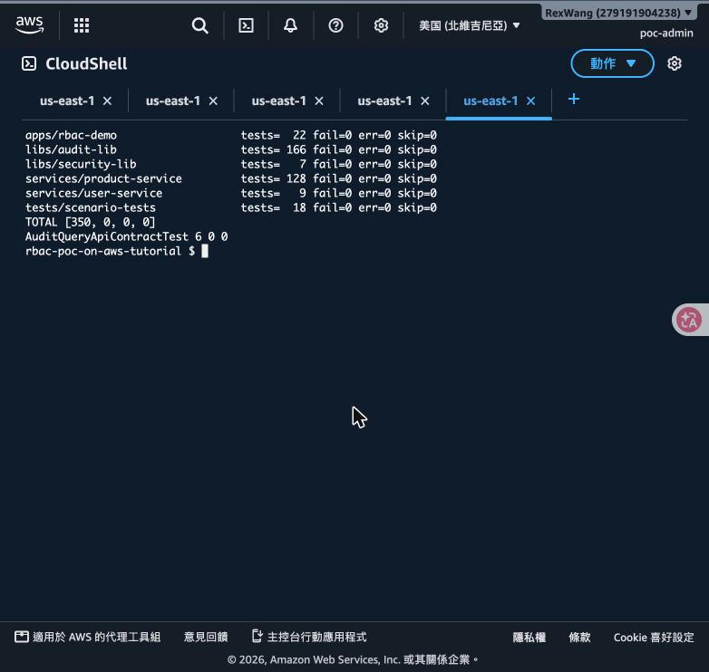

> 這次是在 CloudShell 執行**全部模組**的測試（先前 CodeBuild 只跑 AWS 部署相關的 4 個模組，144 項）。
> **未驗證**：Docker Compose、Kind/K8s、mTLS 等改寫後的部署腳本只做了 `bash -n` 語法檢查與 YAML 解析，**尚未實際執行**；AWS 端也未重新部署（`60-api.yaml` 只移除 CORS，已通過 `cfn-lint`）。


---

## 2. 開源元件 → AWS 服務對照與選型理由

| 原開源元件 | AWS 取代 | 選型理由 / 取捨 |
|---|---|---|
| OpenLDAP（使用者目錄） | **Amazon Cognito User Pool** | 全託管、免維運；`custom:tenant_id` 取代 LDAP 屬性 |
| Keycloak Realm Roles | **Cognito User Pool Groups**（`ADMIN`/`TENANT_ADMIN`/`AUDITOR`/`USER`/`VIEWER`） | Group 名稱直接出現在 token 的 `cognito:groups` |
| Keycloak Protocol Mapper | **Cognito Pre Token Generation Lambda（V2_0）** | 把 `tenant_id`、email、姓名注入 **access token**（Cognito 預設不放 custom 屬性） |
| Keycloak OIDC / SSO 登入頁 | **Cognito Hosted UI + OAuth2 Authorization Code + PKCE** | 瀏覽器端 SSO；測試腳本則用伺服器端 `ADMIN_USER_PASSWORD_AUTH` |
| Spring Cloud Gateway | **Amazon API Gateway HTTP API + JWT Authorizer** | 邊界驗證、節流、存取日誌全託管；細粒度 RBAC 仍留在服務內（縱深防禦） |
| K8s Service / NodePort | **內部 Application Load Balancer**（Path-based routing） | 只能經由 API Gateway VPC Link 進入 |
| Kind / K8s Deployment | **Amazon ECS on AWS Fargate** | 無伺服器容器；不選 EKS 是因 control plane 每月約 US$73 起、POC 不需要 K8s API |
| PostgreSQL / H2 | **Amazon RDS for PostgreSQL 16** | 加密、強制 TLS、密碼由 **Secrets Manager** 託管（`ManageMasterUserPassword`） |
| Docker build / registry | **AWS CodeBuild + Amazon ECR** | 在 AWS 內跑單元測試 → 打包 → 建 image；ECR 不可變 tag + 推送即掃描 |
| docker logs / kubectl logs | **Amazon CloudWatch Logs**、Container Insights、VPC Flow Logs | |
| cert-manager mTLS（東西向） | **未部署**（見 [§13.1](#131-東西向-mtls-與-aws-private-ca-的替代方案)） | AWS Private CA 一般模式 US$400 / CA / 月、short-lived 模式 US$50 / CA / 月；POC 以 Security Group 鏈 + 私有子網路取代 |
| Spring Cloud Gateway 的 CORS | **移除**（見 [§1.3](#13-移除-spring-cloud-元件與-cors2026-11-15)） | 本 POC 沒有瀏覽器前端，用戶端都是 curl / 腳本，不需要 CORS |

### 2.1 AWS 服務詳解

本節逐一說明本 POC 用到的 AWS 服務：**它是什麼、核心概念、本 POC 怎麼用、Console 在哪裡、怎麼計費、要注意什麼**。
服務依「一次部署」的先後順序排列：先有身分與部署工具，再有網路、資料、身分驗證、建置，最後是運算與 API 入口。

> 💲 計費數字取自 2026-11 的 AWS 官方定價頁（連結見 [§2.1.17](#2117-參考資料)），以 **us-east-1** 為準。官方表格沒有直接顯示、只能從範例推算或無法確認的數字，會標註 **（推算）** 或 **（未確認）**，請以 [AWS Pricing Calculator](https://calculator.aws/) 為準。

#### 服務關係總覽

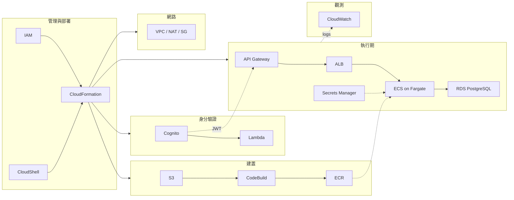

| 類別 | 服務 | 一句話 | 取代原專案的 |
|---|---|---|---|
| 身分與治理 | IAM | 控制「誰能對哪個 AWS 資源做什麼」 | （無，原本在本機跑） |
| 部署 | CloudFormation | AWS 原生 IaC，用 YAML 宣告資源 | `k8s-deploy.sh`、K8s manifests |
| 操作環境 | CloudShell | 瀏覽器裡、已帶身分的 Linux shell | 本機終端機 |
| 網路 | VPC（含 Subnet、NAT、Endpoint、SG、Flow Logs） | 你的私有網路 | Docker network / K8s cluster network |
| 使用者身分 | Cognito | 託管的使用者目錄 + OAuth2/OIDC IdP | Keycloak + OpenLDAP |
| 函式運算 | Lambda | 事件觸發的無伺服器函式 | Keycloak protocol mapper |
| API 入口 | API Gateway（HTTP API） | 託管 API 閘道，驗 JWT、節流、記錄 | Spring Cloud Gateway |
| 負載平衡 | Elastic Load Balancing（ALB） | 第 7 層負載平衡與路徑路由 | K8s Service / NodePort |
| 容器運算 | ECS + Fargate | 不用管主機的容器執行平台 | Kind / K8s Deployment |
| 映像倉庫 | ECR | 私有容器映像倉庫 | 本機 Docker image |
| 建置 | CodeBuild | 託管建置環境（測試、打包、建 image） | 本機 `./gradlew` + `docker build` |
| 物件儲存 | S3 | 物件儲存 | （無） |
| 資料庫 | RDS for PostgreSQL | 託管關聯式資料庫 | PostgreSQL / H2 容器 |
| 祕密管理 | Secrets Manager | 存放並輪換密碼 | K8s Secret（明碼 base64） |
| 觀測 | CloudWatch（Logs、Container Insights） | 日誌與指標 | `docker logs` / `kubectl logs` |

---

#### 2.1.1 AWS IAM（Identity and Access Management）

**是什麼**：AWS 的權限系統。每一個 API 呼叫（包含你在 Console 上按的每個按鈕）都會由 IAM 判斷「這個身分可不可以對這個資源做這件事」。IAM 本身**不收費**。

**核心概念**

| 概念 | 說明 | 本 POC 例子 |
|---|---|---|
| Root user | 建立帳號的 email 身分，權限無法被限制 | 只用來建立 `poc-admin` |
| IAM User | 長期存在的人員身分（密碼 + MFA，或 access key） | `poc-admin`、`rbac-poc-deployer` |
| IAM Group | User 的集合，政策掛在群組上 | `RbacPocDeployers` |
| IAM Role | 沒有長期密碼、由別人「扮演」（AssumeRole）取得暫時憑證的身分 | `RbacPocCfnExecutionRole`、ECS / CodeBuild / Lambda 的角色 |
| Trust policy | 角色上的「誰可以扮演我」 | `cloudformation.amazonaws.com` 才能扮演 CFN 執行角色 |
| Identity policy | 「這個身分可以做什麼」（Allow / Deny、Action、Resource、Condition） | `RbacPocDeployerPolicy` |
| Permissions Boundary | 權限上限：實際權限 = identity policy ∩ boundary | `rbac-poc-workload-boundary` |
| `iam:PassRole` | 把角色「交給」某個 AWS 服務使用的權限 | deployer 只能把 CFN 執行角色交給 CloudFormation |
| AWS managed / Customer managed policy | AWS 維護的政策 vs 自己寫的政策 | `ViewOnlyAccess`（AWS）、`RbacPocDeployerPolicy`（自訂） |

**評估邏輯（簡化）**：明確 Deny > 明確 Allow > 預設拒絕；有 Boundary 時，Allow 必須同時出現在 identity policy 與 boundary 內。

**本 POC 怎麼用**：`00-bootstrap-iam.yaml`，關係圖見 [§4.1](#41-aws-管理平面iam)。

**Console**：IAM → 使用者 / 使用者群組 / 角色 / 政策。

**注意事項**
- 本次驗證中多次遇到 `AccessDeniedException`（讀 CodeBuild 報表、ECR 掃描結果），這正是最小權限生效的表現。正確作法是**評估後只補必要的唯讀權限**（已補在 template），而不是改掛 `AdministratorAccess`。
- Production 建議改用 **IAM Identity Center**（SSO + 短期憑證），而不是 IAM User。

---

#### 2.1.2 AWS CloudFormation — AWS 原生的 IaC

**是什麼**：**AWS 原生的 Infrastructure as Code（IaC）服務**。你用 YAML / JSON **宣告**想要的資源（「要一個 VPC、兩個子網路、一個 RDS」），CloudFormation 負責依相依順序建立、更新、刪除，失敗時自動回滾。CloudFormation 本身管理 AWS 原生資源**不另收費**，只付它建出來的資源費用。

**和其他 IaC 工具的關係**

| 工具 | 類型 | 與 CloudFormation 的關係 |
|---|---|---|
| CloudFormation | 宣告式 YAML / JSON，AWS 託管狀態 | — |
| AWS CDK | 用 TypeScript / Python / Java 寫程式 | **編譯成 CloudFormation template** 再部署 |
| AWS SAM | 無伺服器專用簡寫 | 也是轉成 CloudFormation |
| Terraform / OpenTofu | 宣告式 HCL，自管 state 檔 | 不經過 CloudFormation，直接呼叫 AWS API；可跨雲 |

**核心概念**

| 概念 | 說明 | 本 POC 例子 |
|---|---|---|
| Template | 資源宣告檔：`Parameters`、`Conditions`、`Resources`、`Outputs` | `aws/cloudformation/*.yaml` |
| Stack | 依 template 建出來的一組資源，一起建立、更新、刪除 | `rbac-poc-10-network` … |
| Change set | 部署前的變更預覽（新增 / 修改 / 取代哪些資源） | `aws cloudformation deploy` 內部會先建 change set |
| Export / `Fn::ImportValue` | 跨 stack 傳值 | `rbac-poc-issuer-uri`、`rbac-poc-db-secret-arn` |
| Service role（`--role-arn`） | CloudFormation 用這個角色去建資源，而不是用操作者的權限 | `RbacPocCfnExecutionRole` |
| Rollback | 建立或更新失敗時自動還原 | identity、services stack 失敗時都自動回滾 |
| `DeletionPolicy` | 刪除 stack 時資源要刪除、保留還是留 snapshot | RDS 設 `Delete`（POC）；production 建議 `Snapshot` |
| Drift detection | 偵測有人在 Console 手動改了資源 | 本 POC 未使用 |

**狀態機（本次實際遇到的）**

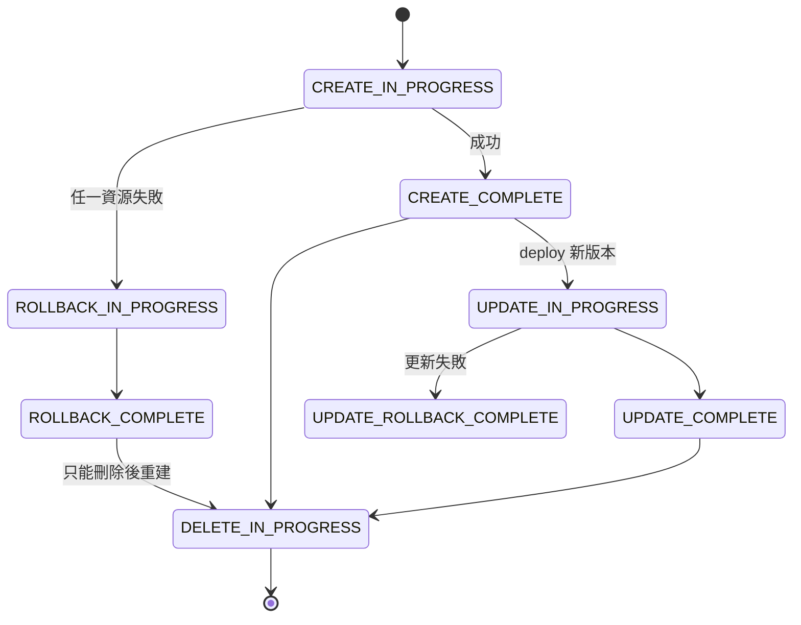

**Console**：CloudFormation → 堆疊 → 選 stack →「事件」分頁看失敗原因、「輸出」分頁看 Outputs。

**注意事項**
- **建立失敗的 stack 會停在 `ROLLBACK_COMPLETE`，不能更新，只能刪除後重建**（§10-1、10-2、10-7）。
- `aws cloudformation wait stack-rollback-complete` 只等 `UPDATE_ROLLBACK_COMPLETE`，**不適用建立失敗**（§10-8）。
- 有 Export 被其他 stack 匯入時，被匯入的 stack 不能先刪除，所以要反向清除（§12）。
- 不要在 Console 手動建立 template 也要建的同名資源（§10-1）。

---

#### 2.1.3 AWS CloudShell

**是什麼**：Console 內建、以目前登入身分自動取得憑證的瀏覽器 Linux shell，已預裝 AWS CLI、git、jq、Python、Node.js、Docker。官方 FAQ 說明 **CloudShell 不另收費**，只付你在裡面操作的其他資源費用。

**核心概念**
- **每個 IAM 身分、每個 Region 各自一個環境**：`poc-admin` 和 `rbac-poc-deployer` 的家目錄互不相通，所以本次每換一個身分都要重新上傳 bundle。
- **持久儲存**：每個 Region 的家目錄有 **1 GB** 持久空間；**最後一次開啟 session 後最多保留 120 天**。家目錄以外的變更（例如 `sudo dnf install`）在環境重啟後會消失，所以 `gh` 裝在 `~/bin`。
- **上傳 / 下載**：「動作 → 上傳檔案 / 下載檔案」；**上傳不會覆寫同名檔案**（§10-5）。

**為什麼用它**：不需要建立 access key，也不需要在本機安裝工具，符合「不使用長期金鑰」的最佳實踐。

**注意事項**：長時間指令執行中如果瀏覽器分頁閒置或重新連線，session 可能中斷，但 **CloudFormation / CodeBuild 在伺服器端會繼續執行**，重新連線後用 `describe-stacks` 查狀態即可。

---

#### 2.1.4 Amazon VPC（含子網路、NAT、Endpoint、Security Group、Flow Logs）

**是什麼**：你在 AWS 上的邏輯隔離網路。VPC、子網路、路由表、Internet Gateway、Security Group 本身**不收費**；收費的是 NAT Gateway、Public IPv4、Interface Endpoint、流量。

**核心概念與本 POC 設定**

| 元件 | 說明 | 本 POC |
|---|---|---|
| VPC | 一段私有 IP 範圍 | `10.20.0.0/16` |
| Subnet | VPC 內的一段 IP，位於**單一 AZ** | 2 AZ × 3 層 = 6 個 |
| Route table | 子網路的路由；有 `0.0.0.0/0 → IGW` 才叫 public subnet | public → IGW；app → NAT；data → 只有 local |
| Internet Gateway（IGW） | VPC 與網際網路的雙向出入口 | 只給 NAT 用 |
| NAT Gateway | 讓私有子網路**只出不進**地連外 | 1 個（參數可改 2 個） |
| Gateway VPC Endpoint（S3） | 私有子網路走 AWS 內網存取 S3 | 讓 ECR image layer 不經 NAT |
| Security Group（SG） | 掛在 ENI 上的**有狀態**防火牆；規則可**引用另一個 SG** | vpclink → alb → app → db 鏈 |
| VPC Flow Logs | 記錄網路流量中繼資料 | 只記 `REJECT`，送 CloudWatch Logs |

**計費（官方）**
- Public IPv4：**US$0.005 / 小時**（使用中或閒置皆同，適用所有商業 Region）。
- Gateway 型 VPC Endpoint：**不收小時費、不收資料處理費**。
- NAT Gateway：官方範例（US East **Ohio**）為 **US$0.045 / 小時 + US$0.045 / GB 處理量**；us-east-1 **（未確認，通常相同）**。

**注意事項**
- NAT Gateway 是本 POC **最貴的單項**之一，而且「放著不用也照算」，POC 結束一定要刪除。
- 本 POC 的 Fargate task 需要連外的原因：拉 ECR image、送 CloudWatch Logs、讀 Secrets Manager、**抓 Cognito 的 JWKS 公鑰**。若改用 Interface Endpoint 可以取代部分 NAT 流量，但每個 endpoint 每 AZ 都有小時費。

---

#### 2.1.5 Amazon Cognito（User Pool）— 取代 Keycloak + OpenLDAP

**是什麼**：託管的使用者目錄與 OAuth 2.0 / OpenID Connect 身分提供者（IdP）。負責註冊、登入、MFA、密碼政策、發 JWT。

**核心概念**

| 概念 | 說明 | 對應 Keycloak | 本 POC |
|---|---|---|---|
| User Pool | 一個使用者目錄 + 一個 OIDC issuer | Realm | `rbac-poc-users` |
| User / Attribute | 使用者與屬性；自訂屬性前綴 `custom:` | LDAP 使用者 / 屬性 | `custom:tenant_id` |
| Group | 使用者分組，名稱進入 token 的 `cognito:groups` | Realm Role | ADMIN、TENANT_ADMIN、AUDITOR、USER、VIEWER |
| App Client | 一個「可以向 User Pool 要 token 的應用程式」，決定允許的登入流程、可讀寫的屬性 | Client | `rbac-poc-web`、`rbac-poc-test-harness` |
| Auth flows | SRP、`ADMIN_USER_PASSWORD_AUTH`、OAuth2 Code + PKCE、Refresh | Grant types | 見 [§4.2](#42-應用程式平面cognito--rbac--多租戶) |
| Token | ID token（使用者是誰）、Access token（可以做什麼）、Refresh token | 同 | API 一律用 **access token** |
| Domain / Managed login | Cognito 代管的登入頁 | Keycloak 登入頁 | `rbac-poc-<帳號ID>.auth.us-east-1.amazoncognito.com` |
| Lambda trigger | 在註冊、登入、發 token 等時點呼叫 Lambda | SPI / Mapper | Pre Token Generation |
| Feature plan | Lite / Essentials / Plus | — | **Essentials** |

**Feature plan 與計費（官方）**
- **新建 User Pool 預設為 Essentials**。
- 直接登入（非 SAML/OIDC 聯合）的使用者：**每月 10,000 MAU 免費**（以帳號或 AWS Organization 計），超過後 Essentials 每 MAU **US$0.015**。
- **Access token 客製化（Pre Token Generation 事件 V2_0 以上）只在 Essentials 與 Plus 提供**，這也是本 POC 指定 `UserPoolTier: ESSENTIALS` 的原因。

**Pre Token Generation 的限制（官方）**
- 可以新增 / 覆寫**自訂 claim**（本 POC 的 `tenant_id`、`email`、`given_name`、`family_name`），也可以調整 `scope` 與 `cognito:groups`。
- **不能修改**：`sub`、`username`、`cognito:username`、`client_id`、`iss`、`exp`、`iat`、`token_use`、`jti`、`auth_time` 等保留 claim，以及其他 `cognito:` 前綴 claim。

**Console**：Amazon Cognito → 使用者集區 → `rbac-poc-users` → 使用者 / 群組 / 應用程式用戶端 / 延伸功能（Lambda 觸發條件）。

**注意事項**
- **必填屬性（email）必須在 App Client 的 WriteAttributes 內**，否則建立 client 失敗（§10-2）。
- 把 `custom:tenant_id` 排除在 WriteAttributes 之外，使用者就**無法自己改租戶**（驗證案例 48）。
- Cognito access token **沒有 `aud`**，改用 `client_id`；API Gateway JWT authorizer 會比對 `client_id`，Spring Security 預設也不檢查 aud。

---

#### 2.1.6 AWS Lambda — Pre Token Generation trigger

**是什麼**：事件觸發、依執行時間計費的無伺服器函式。本 POC 只用它做一件事：Cognito 發 token 前，把 `custom:tenant_id` 等屬性寫進 access token，等同 Keycloak 的 protocol mapper。

**本 POC 設定**：Node.js 22（`nodejs22.x`）、arm64、128 MB、timeout 5 秒；程式碼見 `aws/lambda/pre-token-generation/index.js`（template 內嵌同一份）；執行角色只能寫自己的 log group；以 `AWS::Lambda::Permission` 只允許**這個 User Pool** 呼叫。

**計費**：依請求數與 GB-秒計費；登入次數極少的 POC 實際費用可忽略（**本次未逐項驗證 Lambda 單價**）。

**注意事項**：CloudFormation `ZipFile` 內嵌的程式碼檔名固定是 `index.js`，**要用 CommonJS（`exports.handler`）**，不能用 ESM 的 `export`。

---

#### 2.1.7 Amazon API Gateway（HTTP API）— 取代 Spring Cloud Gateway

**是什麼**：託管的 API 入口。本 POC 用的是 **HTTP API**（另有功能較多、較貴的 REST API，以及 WebSocket API）。

**核心概念**

| 概念 | 說明 | 本 POC |
|---|---|---|
| Route | `METHOD /path` 對應到整合 | `ANY /api/{proxy+}` |
| Integration | 請求轉送到哪裡 | `HTTP_PROXY` → 內部 ALB listener |
| VPC Link | 讓 API Gateway 進到你的私有子網路 | `rbac-poc-vpclink` |
| JWT Authorizer | 在邊界驗證 JWT 的簽章、`iss`、`aud` / `client_id`、`exp` | Cognito issuer + 兩個 App Client ID |
| Stage | 部署環境；`$default` + AutoDeploy | 節流 20 rps / burst 50、JSON access log |

**計費（官方）**：HTTP API 前 3 億次請求 **US$1.00 / 百萬次**（官方範例；下一級 US$0.90）；計量以 **512 KB** 為一個請求單位（由官方範例推算）。VPC Link（HTTP API）的費用頁面未列出 **（未確認）**。

**HTTP API vs REST API（選 HTTP API 的取捨）**

| | HTTP API | REST API |
|---|---|---|
| 價格 | 較便宜 | 較貴 |
| JWT authorizer | ✅ 原生 | 需 Cognito authorizer / Lambda |
| AWS WAF | ❌ 不能直接掛 | ✅ |
| Usage plan / API key | ❌ | ✅ |
| 本 POC 需求 | 足夠 | — |

**注意事項**
- JWT authorizer **只做驗證（authN）**；誰能刪商品這類授權（authZ）仍在 Spring Security 的 `@PreAuthorize`，形成縱深防禦。
- 驗證失敗的請求在 API Gateway 就被擋下（401），**不會進到 VPC**（驗證案例 1–3）。

---

#### 2.1.8 Elastic Load Balancing — Application Load Balancer（ALB）

**是什麼**：第 7 層（HTTP）負載平衡器，依路徑、主機等條件把請求分給不同的 target group。

**核心概念**：Load balancer（`Scheme: internal` 代表只有 VPC 內的 IP）→ Listener（port 80）→ Rule（path-pattern）→ Target group（`TargetType: ip`，Fargate 每個 task 一個 IP）→ Health check（`/actuator/health`）。

**本 POC 路由**

| 優先序 | 路徑 | 目標 |
|---|---|---|
| 10 | `/api/products`、`/api/products/*` | product-service :8081 |
| 20 | `/api/v1/audit-logs`、`/api/v1/audit-logs/*` | product-service :8081 |
| 30 | `/api/users`、`/api/users/*` | user-service :8082 |
| 預設 | 其他 | 固定回應 404 JSON |

**計費（官方，us-east-1）**：**US$0.0225 / 小時 + US$0.008 / LCU-小時**。

**注意事項**
- **`desync_mitigation_mode` 不要設 `strictest`**：API Gateway 轉送的 GET 會被當成不合規而回 400（§10-11）。AWS 預設 `defensive` 已能防護 HTTP desync。
- Target 健康與否完全看 health check。本次 user-service 因 schema 名稱問題讓 `/actuator/health` 回 503，被判定 unhealthy 而觸發回滾（§10-10）。

---

#### 2.1.9 Amazon ECS + AWS Fargate — 取代 Kind / K8s

**是什麼**：ECS 是 AWS 的容器編排服務；Fargate 是它的**無伺服器運算引擎**，不用管 EC2 主機，依 task 的 vCPU / 記憶體按秒計費。

**與 Kubernetes 概念對照**

| ECS | Kubernetes | 本 POC |
|---|---|---|
| Cluster | Cluster | `rbac-poc-cluster` |
| Task Definition | Pod spec | `rbac-poc-product-service`、`rbac-poc-user-service` |
| Container definition | Container | `init-tmp`（init）+ `*-service` |
| Task | Pod | 每個服務 1 個 |
| Service | Deployment + Service | 維持 DesiredCount、接 ALB、滾動更新 |
| Task execution role | kubelet 拉 image / 讀 secret 的權限 | `rbac-poc-ecs-execution-role` |
| Task role | ServiceAccount（IRSA） | `rbac-poc-ecs-task-role`（零權限） |
| `secrets`（valueFrom） | Secret → env | DB 帳密從 Secrets Manager 注入 |
| `dependsOn: SUCCESS` | initContainers | `init-tmp` 先跑 `chmod 1777 /tmp` |
| Deployment circuit breaker | progressDeadline + rollback | 連續失敗就自動回滾 |

**計費（官方，us-east-1 Linux/x86）**：官方以每秒計價，vCPU **US$0.000011244 / 秒**、記憶體 **US$0.000001235 / GB-秒**，換算約 **US$0.0405 / vCPU-小時、US$0.00445 / GB-小時（推算）**。本 POC 每個 task 0.5 vCPU + 1 GB，約 **US$0.025 / 小時（推算）**。每個 task 預設附 **20 GB** ephemeral storage。

**注意事項**
- **Fargate 的 ephemeral bind volume 是 root:root 0755**，非 root 容器寫不進去，需要 init container 開權限（§10-6）。
- Circuit breaker 在**首次建立**時觸發，CloudFormation 會整個 stack 回滾（連 ALB 一起刪），重建約需 10 分鐘（§10-7）。
- Task 啟動約 60 秒（Spring Boot），本 POC 的 `HealthCheckGracePeriodSeconds` 設 240 秒，每次失敗重試間隔較長。

---

#### 2.1.10 Amazon ECR（Elastic Container Registry）

**是什麼**：私有容器映像倉庫，與 IAM 整合，ECS 可直接拉取。

**本 POC 設定**：`rbac-poc/product-service`、`rbac-poc/user-service` 兩個 repo；**不可變 tag**（`IMMUTABLE`，同一個 tag 不能被覆蓋，部署可追溯）；**推送即掃描**（basic scanning）；AES256 加密；lifecycle 保留最近 10 個 image；`EmptyOnDelete: true` 讓刪 stack 時一併清空。Base image 使用 **Amazon ECR Public** 上的 Amazon Corretto，避開 Docker Hub 拉取限制。

**計費（官方）**：儲存 **US$0.10 / GB-月**；新帳號第一年每月 500 MB 私有儲存免費。

---

#### 2.1.11 AWS CodeBuild

**是什麼**：託管的建置環境；依 `buildspec.yml` 執行指令，按建置分鐘計費，不用維護 CI 主機。

**本 POC 流程**：S3 原始碼 zip → `amazonlinux-x86_64-standard:5.0`（Corretto 17）→ 單元測試（輸出 `TEST SUMMARY`）→ `bootJar` → `docker build`（需 **Privileged mode**）→ 推送 ECR。測試失敗就不推 image。JUnit 報表另存成 CodeBuild Report Group。

**計費（官方）**：免費額度為每月 100 分鐘（限 general1.small / arm1.small）；general1.small 為 US$0.005 / 分（官方範例）。本 POC 用 **general1.medium**，其單價官方表格未顯示 **（未確認）**；每次建置約 1.5–3 分鐘。

**注意事項**：buildspec v0.2 的所有指令在**同一個 shell** 執行，`export` 的變數可跨 phase 使用；`exported-variables` 可讓腳本取回 image tag。

---

#### 2.1.12 Amazon S3

**是什麼**：物件儲存。本 POC 只用一個 bucket 放 CodeBuild 的原始碼 zip。

**本 POC 設定**：Block Public Access 全開、`BucketOwnerEnforced`（停用 ACL）、SSE-S3 加密、版本控制、bucket policy **拒絕非 TLS 存取**、lifecycle 30 天過期。

**注意事項**：**開了版本控制的 bucket 要先刪除所有版本與 delete marker 才能刪除 bucket**，`99-cleanup.sh --all` 已處理。

---

#### 2.1.13 Amazon RDS for PostgreSQL

**是什麼**：託管的關聯式資料庫；AWS 負責主機、修補、備份、監控，你負責 schema 與查詢。

**本 POC 設定**：PostgreSQL 16、`db.t4g.micro`（Graviton）、20 GB gp3（自動擴充到 50 GB）、儲存加密、參數群組 `rds.force_ssl=1`、僅在無對外路由的 data subnet、`PubliclyAccessible: false`、只允許 app SG 連 5432、**`ManageMasterUserPassword: true`**（主密碼由 RDS 產生並存進 Secrets Manager）。

**Schema-per-service**：同一個 DB instance、不同 schema：`product`、`user_service`。`audit_logs` 由 `audit-lib` 的 Flyway 建立，商品表由 Hibernate 建立。

**計費**：依 instance 小時、儲存 GB-月、備份與 I/O 計費。官方定價頁的 instance 與 gp3 表格未載出，本文 §11 的 `db.t4g.micro` 約 US$0.016 / 小時為**估算（未確認）**。T4g 若超用 CPU credit，官方標示 **US$0.075 / vCPU-小時**。

**注意事項**
- **`user` 是 PostgreSQL 保留字**，不能直接當 schema 名稱（§10-10）。
- RDS 開啟 log export 時會**自己建立** CloudWatch log group，刪 stack 不會一併刪除（§12.1）。
- Production 建議 Multi-AZ、備份 ≥ 7 天、`DeletionPolicy: Snapshot`、Deletion protection。

---

#### 2.1.14 AWS Secrets Manager

**是什麼**：存放、加密、輪換祕密（密碼、API key）的服務。

**本 POC 用法**：RDS 主密碼由 RDS **託管**（secret 名稱 `rds!db-…`），ECS task definition 以 `secrets.valueFrom: <secretArn>:password::` 在容器啟動時注入環境變數。**template、腳本、git 都沒有密碼**，execution role 只能讀這一個 secret。

**計費（官方）**：**US$0.40 / secret / 月**、**US$0.05 / 1 萬次 API 呼叫**。

**注意事項**：密碼輪換後，**已啟動的 task 仍拿著舊密碼**；production 要讓應用程式在連線失敗時重新取得，或輪換後滾動重啟。

---

#### 2.1.15 Amazon CloudWatch（Logs、Container Insights）

**是什麼**：AWS 的監控與日誌服務。

**本 POC 的 log groups**

| Log group | 來源 | 建立者 |
|---|---|---|
| `/rbac-poc/product-service`、`/rbac-poc/user-service` | ECS `awslogs` driver（含 `init/` 前綴） | CloudFormation |
| `/rbac-poc/api-gateway-access` | API Gateway access log（JSON） | CloudFormation |
| `/rbac-poc/vpc-flow-logs` | VPC Flow Logs（REJECT） | CloudFormation |
| `/aws/codebuild/rbac-poc-build` | CodeBuild | CloudFormation |
| `/aws/lambda/rbac-poc-pre-token-generation` | Lambda | CloudFormation |
| `/aws/rds/instance/rbac-poc-postgres/postgresql` | RDS log export | **RDS 自行建立** |
| `/aws/ecs/containerinsights/rbac-poc-cluster/performance` | Container Insights | **ECS 自行建立** |

**常用指令**：`aws logs tail <group> --since 10m --follow`、`aws logs filter-log-events --filter-pattern '"ERROR"'`。

**計費**：依日誌寫入量、儲存量、Container Insights 指標計費；本 POC 量很小（**本次未逐項驗證 CloudWatch 單價**）。所有 CloudFormation 建立的 log group 都設 **14 天保留**，避免無限累積。

---

#### 2.1.16 服務選擇總結：為什麼是這些服務

| 決策 | 選擇 | 沒選 | 理由 |
|---|---|---|---|
| IdP | Cognito Essentials | 在 EC2 / ECS 自架 Keycloak | 免維運；10,000 MAU 免費；access token 客製化 |
| API 入口 | API Gateway HTTP API | REST API、只用 ALB | 原生 JWT authorizer、便宜；代價是不能直接掛 WAF |
| 運算 | ECS Fargate | EKS、EC2 | 不需 K8s API；EKS control plane 另有固定月費 |
| 資料庫 | RDS PostgreSQL | Aurora、自架 | 與原專案相容、最便宜的託管選項 |
| 建置 | CodeBuild | GitHub Actions、本機 | 在 AWS 內執行、用 IAM role 推 ECR，不需長期金鑰 |
| IaC | CloudFormation | CDK、Terraform | 不需額外安裝或 bootstrap；`--role-arn` 讓職責分離很直接 |

#### 2.1.17 參考資料

- [Amazon Cognito Pricing](https://aws.amazon.com/cognito/pricing/)
- [Cognito — Pre token generation Lambda trigger](https://docs.aws.amazon.com/cognito/latest/developerguide/user-pool-lambda-pre-token-generation.html)
- [Amazon API Gateway Pricing](https://aws.amazon.com/api-gateway/pricing/)
- [AWS Fargate Pricing](https://aws.amazon.com/fargate/pricing/)
- [Amazon VPC Pricing](https://aws.amazon.com/vpc/pricing/)
- [Elastic Load Balancing Pricing](https://aws.amazon.com/elasticloadbalancing/pricing/)
- [Amazon RDS for PostgreSQL Pricing](https://aws.amazon.com/rds/postgresql/pricing/)
- [AWS Secrets Manager Pricing](https://aws.amazon.com/secrets-manager/pricing/)
- [AWS CodeBuild Pricing](https://aws.amazon.com/codebuild/pricing/)
- [Amazon ECR Pricing](https://aws.amazon.com/ecr/pricing/)
- [AWS CloudShell FAQs](https://aws.amazon.com/cloudshell/faqs/)
- [AWS Pricing Calculator](https://calculator.aws/)


---

## 3. 目標架構

### 3.1 整體架構圖

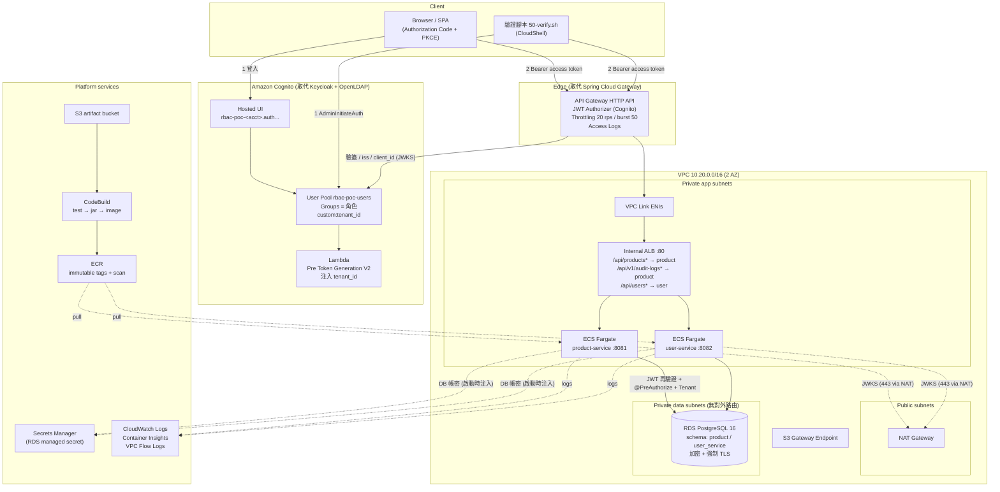

### 3.2 一次 API 請求的完整流程

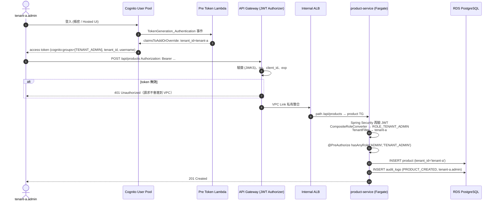

### 3.3 網路與 Security Group 鏈

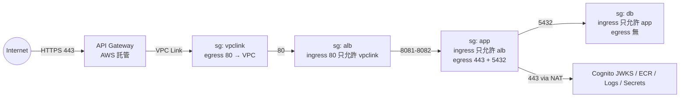

| 子網路 | CIDR | 路由 | 放什麼 |
|---|---|---|---|
| public-a / b | 10.20.0.0/24、10.20.1.0/24 | 0.0.0.0/0 → IGW | 只有 NAT Gateway |
| app-a / b | 10.20.4.0/24、10.20.5.0/24 | 0.0.0.0/0 → NAT、S3 Gateway Endpoint | VPC Link ENI、內部 ALB、Fargate tasks（**無 public IP**） |
| data-a / b | 10.20.8.0/24、10.20.9.0/24 | **只有 local** | RDS |

---

## 4. 身分、群組、角色、權限的關聯與目的

本 POC 有 **兩個完全分離的身分平面**，教學時最容易混淆，務必分清楚：

| 平面 | 管什麼 | 身分來源 | 授權機制 |
|---|---|---|---|
| **A. AWS 管理平面** | 誰能「建置／部署／維運」AWS 資源 | AWS IAM | IAM Policy、Permissions Boundary、Service Role |
| **B. 應用程式平面** | 誰能「呼叫業務 API」（商品、使用者、稽核） | Amazon Cognito | JWT（`cognito:groups`、`tenant_id`）→ Spring Security `@PreAuthorize` + TenantFilter |

### 4.0 帳號規劃與要求

本 POC 刻意把「人」分成三個身分，每個身分只在特定階段使用，用完就收起來。

#### 4.0.1 帳號清單

| 帳號 | 用途 | 權限 | 登入方式 | MFA | 使用階段 | POC 結束後 |
|---|---|---|---|---|---|---|
| **root** | 建立帳號、帳單，以及只有 root 能做的事 | 無法被任何政策限制 | email + 密碼 + MFA；**不留 access key** | **必須** | 只在 Step 0 用一次 | 鎖起來，平時不登入 |
| **`poc-admin`** | 部署 IAM bootstrap（Step 1）、最終清除 `99-cleanup.sh --all` | `AdministratorAccess` + `rbac-poc-admin-force-mfa`（強制 MFA） | 主控台密碼 + MFA；**不發 access key** | **強制**（政策層級） | Step 1、最終清除（§12） | 停用主控台存取或刪除使用者 |
| **`rbac-poc-deployer`** | 日常部署、建置、驗證、清除 workload | `RbacPocDeployers` 群組（`RbacPocDeployerPolicy` + `RbacPocForceMfaPolicy` + `ViewOnlyAccess` + `AWSCloudShellFullAccess`） | 主控台密碼 + MFA；**不發 access key** | **強制**（政策層級） | Step 2 – Step 7、清除 workload | bootstrap 刪除後已無任何權限，建議刪除使用者 |

> 兩個 IAM User 都**只用主控台 + CloudShell**，沒有 access key。CloudShell 會自動帶入登入身分的短期憑證，因此整個 POC 沒有任何長期金鑰。

#### 4.0.2 為什麼三個帳號都要 MFA

| 理由 | 說明 |
|---|---|
| **密碼是唯一的長期憑證** | 沒有 access key，代表密碼一旦被釣魚、撞庫或重複使用而外洩，就能直接登入。MFA 讓「知道密碼」不等於「能登入」。 |
| **CloudShell = 身分的全部權限** | CloudShell 自動取得登入身分的憑證。拿到 `poc-admin` 的主控台 session，就等於拿到 `AdministratorAccess` 的 shell。 |
| **最小權限不能取代身分確認** | `rbac-poc-deployer` 雖然只能操作 `rbac-poc-*` stack，但仍能**刪除整個環境**、讀取 log、建立 Cognito 測試帳號。權限小不代表風險小。 |
| **權限越大越需要** | `poc-admin` 權限最大，MFA 要求不能比 deployer 低（本版已修正為兩者皆強制，見 §4.0.4）。 |
| **合規與稽核** | 金融等受監理產業普遍要求特權帳號使用多因子驗證；AWS Well-Architected 安全支柱亦建議所有人員身分使用 MFA。 |

#### 4.0.3 MFA 是怎麼「強制」的

只在 Console 上綁 MFA 裝置**不等於強制**：使用者仍可能用沒有 MFA 的方式取得 session（例如 access key）。本 POC 用 IAM 政策在授權層強制：

```json
{
  "Sid": "DenyAllExceptMfaSetupIfNoMFA",
  "Effect": "Deny",
  "NotAction": ["iam:CreateVirtualMFADevice", "iam:EnableMFADevice", "iam:ListMFADevices",
                "iam:ResyncMFADevice", "iam:ChangePassword", "iam:GetUser", "..."],
  "Resource": "*",
  "Condition": { "BoolIfExists": { "aws:MultiFactorAuthPresent": "false" } }
}
```

| 重點 | 說明 |
|---|---|
| `aws:MultiFactorAuthPresent` | 以 MFA 登入的 session 會帶 `true`；沒有 MFA 的 session 為 `false` 或不存在 |
| `BoolIfExists` | key 不存在（例如長期 access key 直接呼叫 API）也視為「沒有 MFA」而拒絕 |
| 明確 `Deny` | 優先於任何 `Allow`，**連 `AdministratorAccess` 也蓋不過** |
| `NotAction` 例外 | 沒有 MFA 時仍可設定自己的 MFA、改密碼，避免把自己完全鎖死 |

| 政策 | 掛在 | 由誰建立 |
|---|---|---|
| `RbacPocForceMfaPolicy`（managed） | `RbacPocDeployers` 群組 → `rbac-poc-deployer` | `00-bootstrap-iam.yaml` |
| `rbac-poc-admin-force-mfa`（inline） | `poc-admin` 使用者 | `00-bootstrap-iam.yaml`（參數 `AdminUserName`） |

**防止部署途中把自己鎖死**
- `00-bootstrap-iam.sh` 執行前會檢查呼叫者**已綁 MFA 裝置**，沒有就停止並提示先綁定、重新以 MFA 登入。
- `rbac-poc-admin-force-mfa` 在 template 中 `DependsOn` 所有其他資源：**建立時最後才掛上、刪除時最先移除**。

#### 4.0.4 文件與設定一致性修正

| 項目 | 實際部署時（2026-11-12） | 本版 |
|---|---|---|
| `poc-admin` MFA | 由人手動綁定，**沒有政策強制**；文件寫「建議」 | 由 `rbac-poc-admin-force-mfa` **強制**，文件改為「必須」 |
| `00-bootstrap-iam.sh` | 只檢查不是 root | 另檢查呼叫者已綁 MFA |

> ⚠️ 這項強化是**在 AWS 驗證與清除完成之後**才加入的，目前只通過 `cfn-lint` 與 shell 語法檢查，**尚未在 AWS 上重新部署驗證**。下次依本教學部署時，請確認 Step 1 輸出的 `AdminMfaEnforcedFor` 為 `poc-admin`，並以 `aws iam list-user-policies --user-name poc-admin` 檢查已掛上 `rbac-poc-admin-force-mfa`。

#### 4.0.5 帳號生命週期

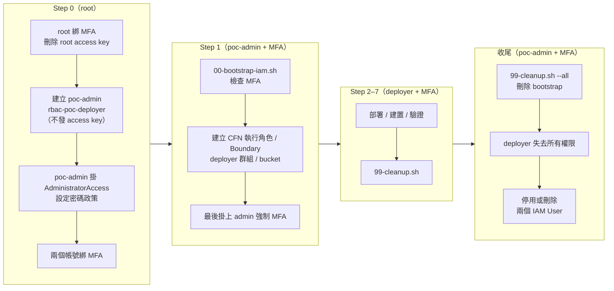

#### 4.0.6 收尾檢查清單

```bash
# 1) 兩個 IAM User 的狀態（政策、群組、MFA、access key）
for u in poc-admin rbac-poc-deployer; do
  printf '%-18s policies=[%s] inline=[%s] groups=[%s] mfa=[%s] keys=[%s]\n' $u \
    "$(aws iam list-attached-user-policies --user-name $u --query 'AttachedPolicies[].PolicyName' --output text)" \
    "$(aws iam list-user-policies --user-name $u --query 'PolicyNames' --output text)" \
    "$(aws iam list-groups-for-user --user-name $u --query 'Groups[].GroupName' --output text)" \
    "$(aws iam list-mfa-devices --user-name $u --query 'length(MFADevices)' --output text)" \
    "$(aws iam list-access-keys --user-name $u --query 'length(AccessKeyMetadata)' --output text)"
done
# 2) root：MFA=1、AccessKeys=0
aws iam get-account-summary --query 'SummaryMap.[AccountMFAEnabled,AccountAccessKeysPresent]' --output text
```

| 檢查 | 期望 |
|---|---|
| root | `MFA=1`、`AccessKeys=0` |
| `rbac-poc-deployer` | 不再使用就刪除（IAM → 使用者 → 刪除）；保留則確認已無群組 |
| `poc-admin` | 不再使用就停用主控台存取或刪除；保留則確認 MFA 已綁定 |
| `rbac-poc-deployer` 的 CloudShell | 刪除 `~/.rbac-poc/`（含測試帳號密碼檔），或「動作 → 刪除」整個環境 |

### 4.1 AWS 管理平面（IAM）

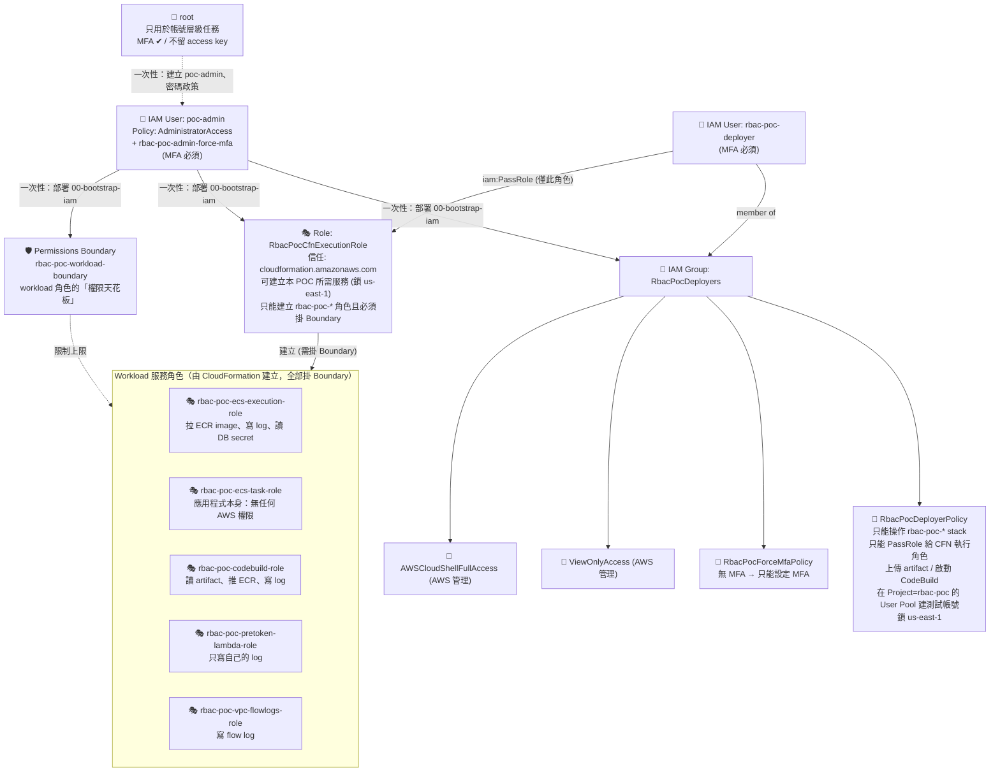

| 身分 / 物件 | 類型 | 目的 | 為什麼這樣設計（最佳實踐） |
|---|---|---|---|
| root | 帳號根使用者 | 只做「必須用 root」的事 | AWS 建議 root 不做日常操作；開 MFA、刪除 access key |
| `poc-admin` | IAM User + `AdministratorAccess` + `rbac-poc-admin-force-mfa` | 一次性部署 IAM bootstrap（建角色、政策、群組）、最終清除 | 讓建立 IAM 這種高權限動作與日常部署分離；權限最大，所以 **MFA 由政策強制**（§4.0.3） |
| `rbac-poc-deployer` | IAM User（無 access key，只用 Console + CloudShell） | 日常部署、驗證、清除 | **最小權限**：本身不能直接建 VPC/RDS/ECS，只能透過 CloudFormation 執行角色 |
| `RbacPocDeployers` | IAM Group | 權限掛在群組而非個人 | 人員異動只要調整群組成員 |
| `RbacPocDeployerPolicy` | Customer managed policy | 限制 stack 名稱、PassRole 對象、Region、Cognito pool tag；可讀取本專案 ECR 掃描結果與 CodeBuild 測試報表 | 避免部署者動到其他專案資源；讀取權限也限定在 `rbac-poc*` 資源 |
| `RbacPocForceMfaPolicy` | Customer managed policy（掛在 deployer 群組） | 沒有 MFA 時拒絕所有動作 | 強制 MFA（§4.0.3） |
| `rbac-poc-admin-force-mfa` | Inline policy（掛在 `poc-admin`） | 同上，對象是管理者 | 權限最大的帳號也必須強制 MFA；明確 Deny 蓋過 `AdministratorAccess` |
| `RbacPocCfnExecutionRole` | Service role（CloudFormation） | 實際建立所有資源 | **職責分離**：人只有「交給 CFN」的權限；所有變更都有 stack 紀錄可追蹤、可回滾 |
| `rbac-poc-workload-boundary` | Permissions Boundary | 所有 workload 角色的權限上限 | 防止「透過建立高權限角色提權」：CFN 執行角色若建立不掛 Boundary 的角色會被 IAM 拒絕 |
| ECS execution role | Service role | ECS agent 拉 image、寫 log、取 DB secret | 與 task role 分離 |
| ECS task role | Service role | 應用程式本身的 AWS 權限 | 本應用不呼叫 AWS API → **零權限** |
| CodeBuild role | Service role | 讀 S3 原始碼、推 ECR | 只能推到兩個 repo |
| Pre-token Lambda role | Service role | 只寫自己的 log group | |

### 4.2 應用程式平面（Cognito → RBAC → 多租戶）

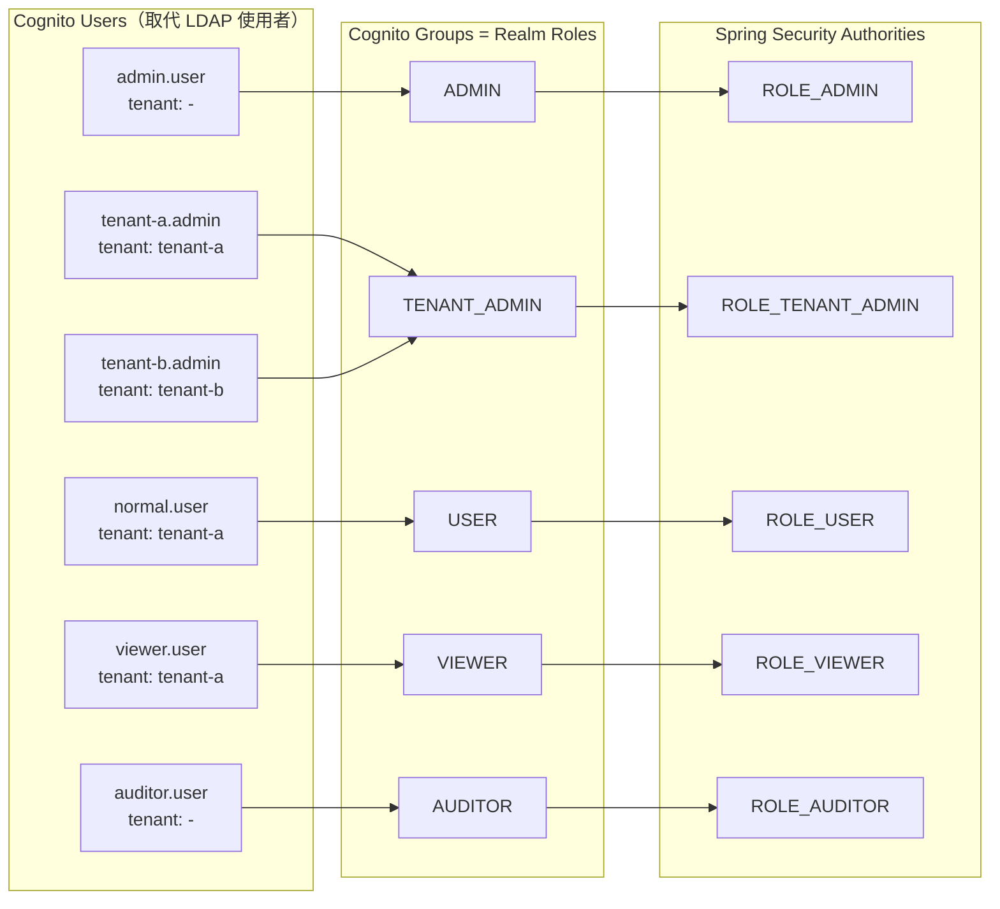

**Token → 權限的轉換鏈**

| 步驟 | 元件 | 輸入 | 輸出 |
|---|---|---|---|
| 1 | Cognito | 使用者所屬 Group | access token `cognito:groups: ["TENANT_ADMIN"]` |
| 2 | Pre Token Lambda | `custom:tenant_id` 屬性 | access token `tenant_id: "tenant-a"` |
| 3 | API Gateway JWT Authorizer | token | 驗簽、`iss`、`client_id`、`exp`；失敗回 401 |
| 4 | `CompositeRoleConverter` | `cognito:groups` / `realm_access` | `ROLE_TENANT_ADMIN` |
| 5 | `SecurityConfig.resolvePrincipalName` | `username` / `preferred_username` / `sub` | `auth.getName() = "tenant-a.admin"`（稽核紀錄用） |
| 6 | `TenantFilter` | `tenant_id`；無 tenant 且為 ADMIN → `system` | `TenantContext = tenant-a` |
| 7 | `@PreAuthorize` | authorities | 允許 / 403 |
| 8 | `ProductQueryService` / `TenantAccessGuard` | TenantContext | 只看得到自己租戶的資料，他租戶 → 404 |

**權限對照表（本次在 AWS 上逐項驗證）**

| 端點 | ADMIN | TENANT_ADMIN | USER | VIEWER | AUDITOR | 無 token |
|---|:-:|:-:|:-:|:-:|:-:|:-:|
| `GET /api/products` | ✅ 全部租戶 | ✅ 本租戶 | ✅ 本租戶 | ✅ 本租戶 | — | 401 |
| `GET /api/products/{id}` | ✅ | ✅ 本租戶（他租戶 404） | ✅ 本租戶 | ✅ 本租戶 | — | 401 |
| `POST /api/products` | ✅ | ✅ | 403 | 403 | — | 401 |
| `PUT /api/products/{id}` | ✅ | ✅ 本租戶 | 403 | 403 | — | 401 |
| `DELETE /api/products/{id}` | ✅ | 403 | 403 | 403 | — | 401 |
| `GET /api/users/me` | ✅ | ✅ | ✅ | ✅ | ✅ | 401 |
| `GET /api/v1/audit-logs` | ✅ | 403 | 403 | 403 | ✅ | 401 |

**兩個 App Client 的目的**

| App Client | 允許的流程 | 用途 | 為什麼 |
|---|---|---|---|
| `rbac-poc-web` | SRP、Refresh、OAuth2 Code + PKCE、Hosted UI | 瀏覽器 / 行動 App | 公開 client 不放 secret；密碼不以明文送出（SRP） |
| `rbac-poc-test-harness` | `ADMIN_USER_PASSWORD_AUTH`、Refresh | 自動化驗證腳本 | `AdminInitiateAuth` **需要 IAM 權限**，網際網路上的人無法用這個 client 暴力猜密碼 |

> `custom:tenant_id` **不在任何 App Client 的 WriteAttributes 內**：使用者無法自行把自己改到別的租戶（驗證案例 G1）。


---

## 5. AWS 最佳實踐對照

依 AWS Well-Architected Framework（以安全支柱為主）逐項對照本 POC 的做法：

| 面向 | 最佳實踐 | 本 POC 做法 | 對應檔案 |
|---|---|---|---|
| 身分 | 不使用 root 做日常操作、root 開 MFA、不留 root access key | root 只用來建立 `poc-admin` 與密碼政策；建議刪除 root access key | §8 Step 0 |
| 身分 | 人員使用最小權限、強制 MFA | `rbac-poc-deployer` 只拿到 `RbacPocDeployerPolicy` + `RbacPocForceMfaPolicy`；`poc-admin` 由 `rbac-poc-admin-force-mfa` 強制 MFA（§4.0） | `00-bootstrap-iam.yaml` |
| 身分 | 職責分離、可稽核的變更 | 所有資源只透過 `RbacPocCfnExecutionRole` 由 CloudFormation 建立 | `env.sh::cfn_deploy` |
| 身分 | 防止透過建立角色提權 | Permissions Boundary + `iam:PermissionsBoundary` 條件 | `00-bootstrap-iam.yaml` |
| 身分 | 不使用長期金鑰 | 部署者沒有 access key（只用 Console + CloudShell）；workload 全部用 IAM Role | |
| 身分 | 密碼政策 | 14 碼、大小寫數字符號、90 天、不可重用 12 次 | §8 Step 0 |
| 偵測 | 集中日誌、保存期限 | API GW access log、ECS log、CodeBuild log、Lambda log、VPC Flow Logs（REJECT），保留 14 天 | 10/40/50/60 |
| 偵測 | 應用層稽核 | `audit-lib` 寫入 RDS `audit_logs`，帳號為 Cognito `username` | `audit-lib` |
| 基礎設施 | HTTP desync 防護 | ALB `desync_mitigation_mode=defensive`、丟棄無效 header | `50-services.yaml` |
| 基礎設施 | 分層網路、最小暴露面 | 3 層子網路；ALB 為 internal；Fargate 無 public IP；RDS 子網路無對外路由 | `10-network.yaml` |
| 基礎設施 | Security Group 鏈（以 SG 參照而非 CIDR） | vpclink → alb → app → db | `10-network.yaml` |
| 基礎設施 | 邊界驗證 + 縱深防禦 | API GW JWT Authorizer 擋未驗證流量，服務內仍再驗 JWT 並做 RBAC | `60-api.yaml`、`security-lib` |
| 基礎設施 | 節流 | API GW 20 rps / burst 50 | `60-api.yaml` |
| 資料 | 靜態加密 | RDS `StorageEncrypted`、ECR AES256、S3 SSE | 20/40/00 |
| 資料 | 傳輸加密 | RDS `rds.force_ssl=1` + JDBC `sslmode=require`；S3 bucket policy 拒絕非 TLS | 20、`application-aws.yml` |
| 資料 | 祕密管理 | RDS 主密碼由 Secrets Manager 產生與託管，ECS 以 `secrets` 注入，template / 腳本 / git 皆無密碼 | 20、50 |
| 資料 | 租戶隔離 | token `tenant_id` + 服務層過濾 + by-id 存取檢查 | `TenantAccessGuard` |
| 應用 | 容器強化 | 非 root（UID 65532）、唯讀 root filesystem、`/tmp` 為 ephemeral volume | `Dockerfile.*`、`50-services.yaml` |
| 應用 | 供應鏈 | Base image 來自 Amazon ECR Public（Corretto）；ECR 不可變 tag + 推送即掃描；CodeBuild 先跑單元測試才推 image | `buildspec.yml` |
| 可靠性 | 部署保護 | ECS Deployment Circuit Breaker + 自動 rollback；ALB health check | `50-services.yaml` |
| 成本 | POC 成本最佳化 | 單一 NAT（參數可切 2 個）、`db.t4g.micro`、Fargate 0.5 vCPU、S3 Gateway Endpoint 省 NAT 流量費、log 保留 14 天、ECR 保留 10 個 image | 各 template |
| 成本 | 用完即清 | `99-cleanup.sh` 依相依順序刪除所有 stack | §12 |

---

## 6. 程式碼改造說明

> 原則：**同一份程式碼同時支援 Keycloak（本地 / Docker / K8s）與 Cognito（AWS）**，以 Spring Profile 切換，不破壞原有部署方式。

| 檔案 | 類型 | 變更 |
|---|---|---|
| `libs/security-lib/.../converter/CognitoGroupsRoleConverter.java` | 新增 | `cognito:groups` → `ROLE_*` |
| `libs/security-lib/.../converter/CompositeRoleConverter.java` | 新增 | 合併 Keycloak 與 Cognito 角色 |
| `libs/security-lib/.../config/SecurityConfig.java` | 修改 | 使用 Composite converter；principal 名稱依序取 `username` → `preferred_username` → `sub` |
| `libs/tenant-lib/.../filter/TenantFilter.java` | 修改 | ADMIN 判斷支援 `cognito:groups` |
| `services/user-service/.../UserProfileService.java` | 修改 | `groups` 為空時改讀 `cognito:groups` |
| `services/product-service/.../TenantAccessGuard.java` | 新增 | **修正 F1**：by-id 操作檢查租戶 |
| `services/product-service/.../GlobalExceptionHandler.java` | 新增 | **修正 F2**：404 / 400 / 409 |
| `services/*/src/main/resources/application-aws.yml` | 新增 | RDS PostgreSQL（schema-per-service）、Cognito issuer、關閉 H2 console |
| 測試 | 新增 | `CognitoGroupsRoleConverterTest`、`SecurityConfigPrincipalTest`、跨租戶 / fail-closed / 404 測試 |

### 6.1 角色轉換（重點程式碼）

```java
// SecurityConfig.java
@Bean
public Converter<Jwt, AbstractAuthenticationToken> jwtAuthenticationConverter() {
    JwtAuthenticationConverter delegate = new JwtAuthenticationConverter();
    delegate.setJwtGrantedAuthoritiesConverter(
        new CompositeRoleConverter(new KeycloakRoleConverter(), new CognitoGroupsRoleConverter()));
    return jwt -> {
        AbstractAuthenticationToken token = delegate.convert(jwt);
        return new JwtAuthenticationToken(jwt, token.getAuthorities(), resolvePrincipalName(jwt));
    };
}
```

> 為什麼要處理 principal 名稱？Cognito access token 的 `sub` 是 UUID，若不處理，稽核紀錄的使用者會變成一串 UUID。

### 6.2 租戶存取檢查（修正 F1）

```java
static Product requireAccessible(Product product, UUID requestedId) {
    String currentTenant = TenantContext.getCurrentTenant();
    if ("system".equals(currentTenant)) return product;                       // ADMIN
    if (currentTenant == null || !currentTenant.equals(product.getTenantId()))
        throw new ResourceNotFoundException("Product", requestedId);          // 404, fail-closed
    return product;
}
```

### 6.3 AWS Profile

```yaml
spring:
  datasource:
    url: jdbc:postgresql://${DB_HOST}:${DB_PORT:5432}/${DB_NAME:rbacpoc}?currentSchema=product&sslmode=require
    username: ${DB_USERNAME}     # ECS 從 Secrets Manager 注入
    password: ${DB_PASSWORD}
  flyway: { schemas: product, create-schemas: true }     # audit_logs 由 audit-lib 的 Flyway 建立
  security.oauth2.resourceserver.jwt.issuer-uri: ${COGNITO_ISSUER_URI}
```

---

## 7. 基礎設施即程式碼（CloudFormation 00–60）

| Stack | 檔案 | 部署者 | 主要資源 | 時間 |
|---|---|---|---|---|
| `rbac-poc-00-bootstrap-iam` | `00-bootstrap-iam.yaml` | **poc-admin**（一次性） | CFN 執行角色、Boundary、部署者群組 / 政策、artifact bucket、`poc-admin` 強制 MFA | ~1 分 |
| `rbac-poc-10-network` | `10-network.yaml` | deployer | VPC、6 子網路、NAT、S3 endpoint、4 個 SG、Flow Logs | ~3 分 |
| `rbac-poc-20-data` | `20-data.yaml` | deployer | RDS PostgreSQL 16、參數群組（force_ssl） | ~10 分 |
| `rbac-poc-30-identity` | `30-identity.yaml` | deployer | User Pool、5 Groups、2 App Clients、Hosted UI domain、Pre-token Lambda | ~1 分 |
| `rbac-poc-40-build` | `40-build.yaml` | deployer | 2 ECR repo、CodeBuild project | ~1 分 |
| `rbac-poc-50-services` | `50-services.yaml` | deployer | ECS cluster、2 task def / service、internal ALB、listener rules | ~5 分 |
| `rbac-poc-60-api` | `60-api.yaml` | deployer | HTTP API、VPC Link、JWT Authorizer、route、stage | ~2 分 |

Stack 之間以 **CloudFormation Exports / ImportValue** 串接（例如 `rbac-poc-issuer-uri`、`rbac-poc-db-secret-arn`），刪除時需反向順序。

### 7.1 腳本

| 腳本 | 執行身分 | 作用 |
|---|---|---|
| `aws/scripts/env.sh` | — | 共用設定；`cfn_deploy` 一律帶 `--role-arn RbacPocCfnExecutionRole` |
| `00-bootstrap-iam.sh` | poc-admin | 部署 IAM bootstrap；拒絕 root 執行；**呼叫者未綁 MFA 就停止**；偵測到 deployer user 已存在時只加入群組；對呼叫者掛上強制 MFA |
| `01-preflight.sh` | deployer | 身分、region、bootstrap 輸出、template 驗證 |
| `10-deploy-foundation.sh` | deployer | network → (data ∥ identity → build) |
| `20-build-images.sh` | deployer | 打包原始碼 → S3 → CodeBuild（單元測試 + image）→ 取得 image tag |
| `30-deploy-services.sh` | deployer | ECS + ALB → API Gateway → 等待 service stable |
| `40-seed-users.sh` | deployer | 建立 6 個測試帳號；**隨機密碼只存在 CloudShell `~/.rbac-poc/test-users.env`（600）** |
| `50-verify.sh` | deployer | 端到端驗證並輸出 Markdown 報告 |
| `99-cleanup.sh [--all]` | deployer / poc-admin | 反向刪除 stack；`--all` 另刪 artifact bucket 與 IAM bootstrap |
| `deploy-all.sh` | deployer | 01 → 50 一次跑完 |


---

## 8. Step-by-Step 部署（含截圖）

> 全程在瀏覽器裡完成：**AWS Console + CloudShell**，本機不需要安裝 AWS CLI、JDK 或 Docker，也不需要建立任何 access key。
> 截圖都在 [`docs/images/`](docs/images/)，完整時間軸見 [`docs/deployment-log.md`](docs/deployment-log.md)。

### Step 0：帳號準備（root，一次性）

**為什麼**：root 擁有無法被限制的權限。AWS 建議 root 只做帳號層級任務，日常改用 IAM 身分。

1. 以 root 登入，開啟 CloudShell（右上角 `>_` 圖示）。

   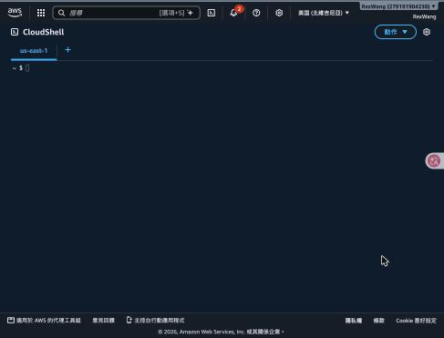

2. 在 IAM Console 建立兩個 IAM User（都啟用主控台存取、**不要**建立 access key）：
   - `poc-admin`：之後掛 `AdministratorAccess`
   - `rbac-poc-deployer`：**不要掛任何權限**，由 Step 1 的 bootstrap 加入群組

   > ⚠️ 不要手動建立 `RbacPocDeployers` 群組，否則 Step 1 會因同名衝突失敗（見 §10-1）。

3. 檢查目前狀態（唯讀）：

   ```bash
   for u in poc-admin rbac-poc-deployer; do
     printf '%-18s policies=[%s] groups=[%s] mfa=[%s] keys=[%s]\n' $u \
       "$(aws iam list-attached-user-policies --user-name $u --query 'AttachedPolicies[].PolicyName' --output text)" \
       "$(aws iam list-groups-for-user --user-name $u --query 'Groups[].GroupName' --output text)" \
       "$(aws iam list-mfa-devices --user-name $u --query 'length(MFADevices)' --output text)" \
       "$(aws iam list-access-keys --user-name $u --query 'length(AccessKeyMetadata)' --output text)"
   done
   echo "root: MFA=$(aws iam get-account-summary --query SummaryMap.AccountMFAEnabled --output text) AccessKeys=$(aws iam get-account-summary --query SummaryMap.AccountAccessKeysPresent --output text)"
   ```

   

4. 給 `poc-admin` 管理權限、設定帳號密碼政策：

   ```bash
   aws iam attach-user-policy --user-name poc-admin --policy-arn arn:aws:iam::aws:policy/AdministratorAccess
   aws iam update-account-password-policy --minimum-password-length 14 --require-symbols --require-numbers \
     --require-uppercase-characters --require-lowercase-characters --allow-users-to-change-password \
     --max-password-age 90 --password-reuse-prevention 12
   ```

   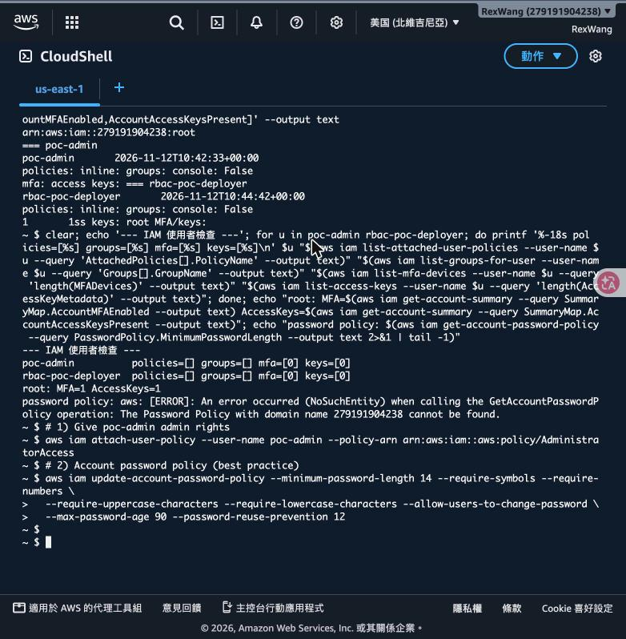
   

5. **替 `poc-admin`、`rbac-poc-deployer` 指派 MFA 裝置**（IAM → 使用者 → 安全憑證 → 指派 MFA）。**這一步不能省**：
   - Step 1 的 bootstrap 會對 `poc-admin` 與 deployer 群組掛上「沒有 MFA 就拒絕一切」的政策，沒綁 MFA 的帳號登入後只能設定 MFA。
   - `00-bootstrap-iam.sh` 會先檢查呼叫者已綁 MFA，沒有就停止。
   - 原因與機制見 [§4.0](#40-帳號規劃與要求)。
6. 若 root 有 access key：先「停用」，確認沒有程式依賴後再「刪除」：

   ```bash
   K=$(aws iam list-access-keys --query 'AccessKeyMetadata[0].AccessKeyId' --output text)
   aws iam get-access-key-last-used --access-key-id $K --output table
   aws iam update-access-key --access-key-id $K --status Inactive
   aws iam delete-access-key --access-key-id $K      # 不可復原
   ```

7. 登出 root，使用 `https://<帳號ID>.signin.aws.amazon.com/console` 以 `poc-admin` **搭配 MFA** 登入。

### Step 1：IAM Bootstrap（poc-admin）

1. 把程式碼放進 CloudShell：
   - 方法 A：`git clone https://github.com/ChunPingWang/rbac-poc-on-aws-tutorial.git`
   - 方法 B（離線 / 私有 repo）：本機 `git bundle create rbac-poc.bundle main`，CloudShell「動作 → 上傳檔案」上傳後 `git clone rbac-poc.bundle rbac-poc-on-aws-tutorial`

   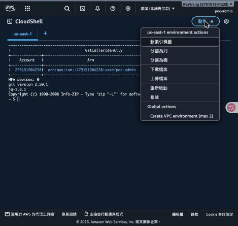
   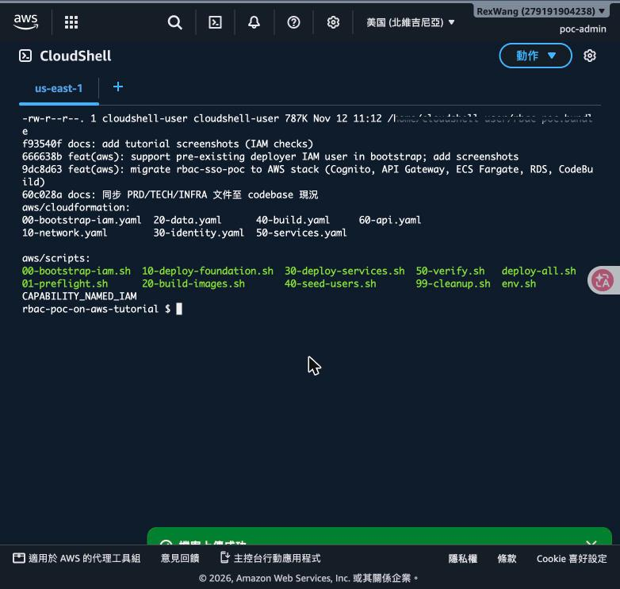

2. 執行 bootstrap：

   ```bash
   cd ~/rbac-poc-on-aws-tutorial
   ./aws/scripts/00-bootstrap-iam.sh
   ```

   腳本會：拒絕 root 執行 → **檢查呼叫者已綁 MFA** → 偵測 `rbac-poc-deployer` 是否已存在（已存在則只加入群組）→ 部署 `rbac-poc-00-bootstrap-iam`（最後一步對 `poc-admin` 掛上 `rbac-poc-admin-force-mfa`）。

   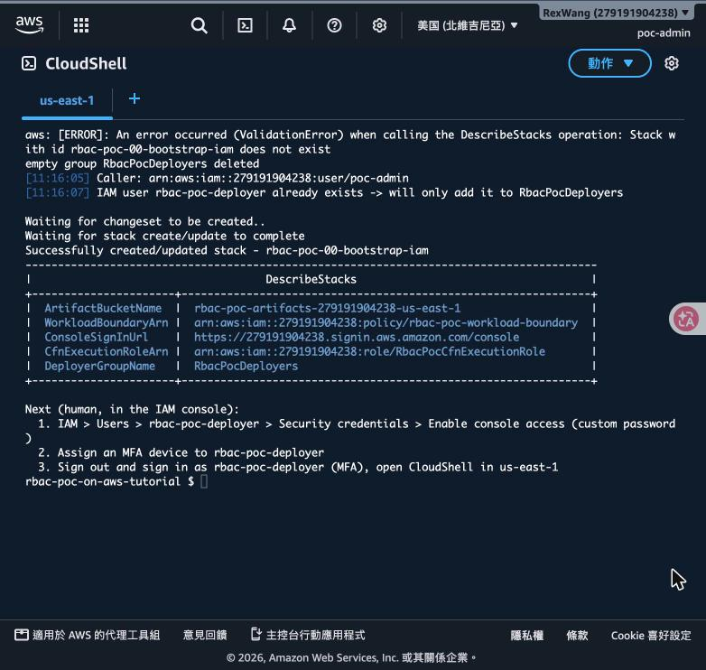

3. 驗證群組與政策：

   

### Step 2：以 deployer 登入並 preflight

```bash
# 以 rbac-poc-deployer（含 MFA）登入 → us-east-1 → CloudShell
# 每個 IAM User 的 CloudShell 家目錄是獨立的，需重新 clone / 上傳
./aws/scripts/01-preflight.sh
```

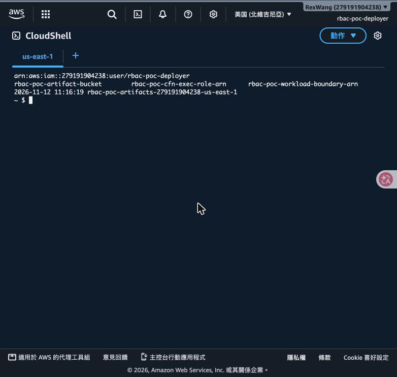
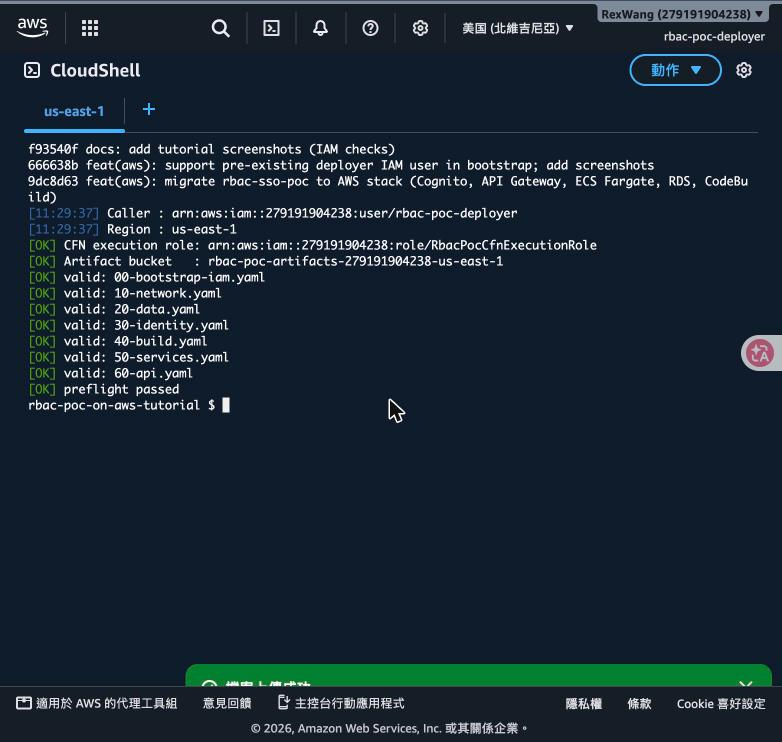

### Step 3：基礎設施（network → data ∥ identity → build）

```bash
./aws/scripts/10-deploy-foundation.sh
```

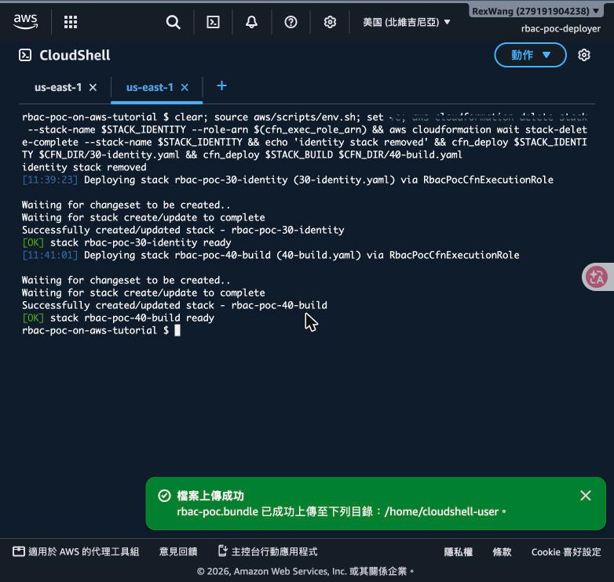

### Step 4：在 CodeBuild 測試、建置、推送 image

```bash
./aws/scripts/20-build-images.sh
```

CodeBuild 依序執行：`security-lib` / `tenant-lib` / `product-service` / `user-service` 單元測試 → `bootJar` → `docker build`（Corretto 17 from ECR Public）→ 推送 ECR（不可變 tag，例如 `20261112114918-3`）。測試失敗不會推送 image。


### Step 5：部署 ECS、ALB、API Gateway

```bash
./aws/scripts/30-deploy-services.sh
```

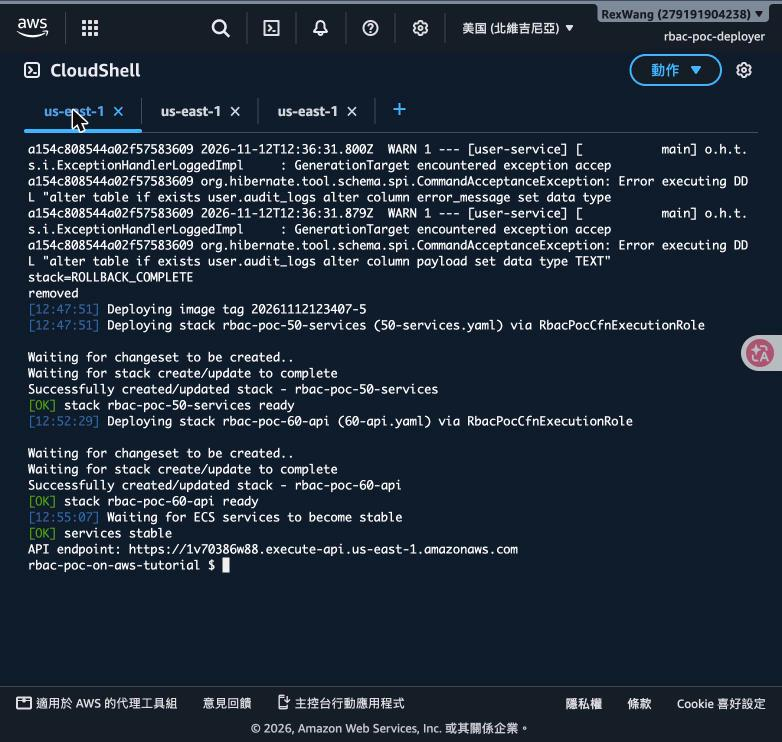
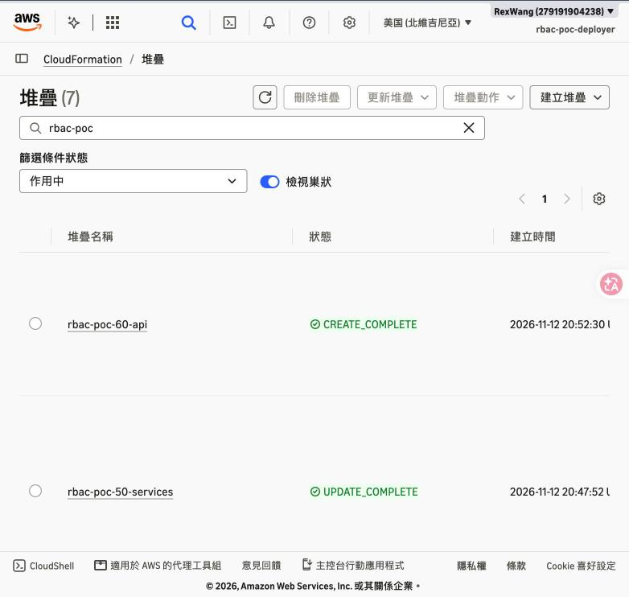
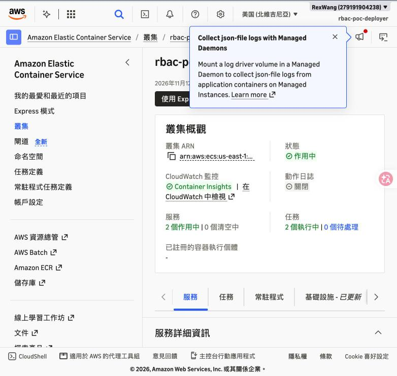

### Step 6：建立測試帳號

```bash
./aws/scripts/40-seed-users.sh
```

密碼由腳本以 `openssl rand` 產生，只存在 CloudShell 的 `~/.rbac-poc/test-users.env`（權限 600），不會進 git、不會印在畫面上。


### Step 7：端到端驗證

```bash
./aws/scripts/50-verify.sh
```


---

## 9. 驗證結果

最終結果：**52 passed, 0 failed, 1 skipped**（2026-11-12 13:00 UTC，`rbac-poc-deployer` 於 CloudShell 執行）。完整報告見 [`docs/verify-report.md`](docs/verify-report.md)。

| 區塊 | 驗證內容 | 案例數 | 結果 |
|---|---|:-:|:-:|
| A. 邊界驗證 | 無 token / 亂碼 token / **竄改 payload（USER→ADMIN）** 皆被 API Gateway 以 401 擋下；未定義路徑 404 | 4 | ✅ |
| B. Token 內容 | `token_use=access`、`cognito:groups`、Lambda 注入的 `tenant_id` / email、issuer | 6 | ✅ |
| C. RBAC 矩陣 | ADMIN 全 CRUD；TENANT_ADMIN 不能刪；USER / VIEWER 只能讀；輸入驗證 400 | 15 | ✅ |
| D. user-service | `/api/users/me` 的 username、tenant、roles、groups、firstName 皆來自 Cognito token | 6 | ✅ |
| E. 多租戶隔離 | 列表只見本租戶；**他租戶 by-id GET / PUT 回 404**（F1 修正生效）；ADMIN 跨租戶可見；tenant_id 寫入 RDS | 11 | ✅ |
| F. 稽核 | `audit_logs` 記錄 PRODUCT_CREATED / PRODUCT_DELETED 與 Cognito 使用者名稱；只有 ADMIN / AUDITOR 可查 | 5 | ✅ |
| G. 安全態勢 | 使用者**無法自行修改 `custom:tenant_id`**；ALB 為 internal；RDS 非公開且加密；Fargate task 無 public IP | 5 | ✅ |
| G. ECR 掃描 | deployer 當時沒有讀取掃描結果的權限 → SKIP（`00-bootstrap-iam.yaml` 已補上唯讀權限） | 1 | ⏭️ |

> **驗證的意義**：A 證明未驗證流量根本進不了 VPC；C + E 證明授權在服務內仍然生效（縱深防禦，不只靠 API Gateway）；E-37/38 證明本次修正的跨租戶漏洞在雲端環境確實被堵住；G-48 證明「租戶身分」無法被使用者自行竄改。


---

## 10. 疑難排解（實際踩到的坑）

以下都是本次實際部署時遇到、已修正並寫回 template / 程式的問題，依發生順序排列：

| # | 階段 | 症狀 | 根因 | 修正 |
|---|---|---|---|---|
| 10-1 | Step 1 bootstrap | `AWS::IAM::Group 'RbacPocDeployers' already exists` → ROLLBACK_COMPLETE | 事先在 Console 手動建立了同名空群組 | 刪除空的 stack 與空群組後重跑；**IAM 資源一律交給 IaC 建立** |
| 10-2 | Step 3 identity | `Invalid write attributes specified while creating a client` | User Pool 的**必填屬性（email）必須在 App Client 的 WriteAttributes 內** | WriteAttributes 改為 `[email, given_name, family_name]`；`custom:tenant_id` 仍不可寫 |
| 10-3 | Step 4 CodeBuild | product-service 128 個測試中 22 個失敗，`NoSuchBeanDefinitionException` | 原專案在 `@SpringBootApplication` 類別上加了 `@EnableJpaRepositories`，所有 `@WebMvcTest` slice 都被迫建立 JPA Repository（**原專案既有回歸**，由 git 歷史確認：該註解晚於 Controller 測試加入） | 移到獨立的 `config/JpaConfig` |
| 10-4 | Step 4 CodeBuild | deployer 執行 `describe-test-cases` 被拒 | 最小權限：`RbacPocDeployerPolicy` 未授權讀取 CodeBuild 報表 | 不放寬權限，改由 buildspec 在 log 中輸出 `TEST SUMMARY` 與失敗細節 |
| 10-5 | Step 4 CloudShell | 上傳同名檔案失敗：「已存在於環境中，不會被覆寫」 | CloudShell 上傳不覆寫既有檔案 | 每次用不同檔名（`rbac-poc-v3.bundle`），或先 `rm` |
| 10-6 | Step 5 ECS | Task 反覆重啟：`Unable to create tempDir. java.io.tmpdir is set to /tmp` / `AccessDeniedException` | Fargate 的 ephemeral bind volume 為 `root:root 0755`，非 root（UID 65532）容器無法寫入 | 加入 **init container**（以 root 執行 `chmod 1777 /tmp` 後結束），app 容器 `DependsOn: SUCCESS`；仍維持非 root + 唯讀 root FS |
| 10-7 | Step 5 ECS | 失敗後 stack 進入 ROLLBACK_COMPLETE | ECS Deployment Circuit Breaker 在 3 個 task 失敗後判定部署失敗，CloudFormation 回滾（**這正是預期的保護機制**） | `delete-stack` 後重新部署 |
| 10-8 | 重新部署前 | `aws cloudformation wait stack-rollback-complete` 一直等不到 | 該 waiter 只認 `UPDATE_ROLLBACK_COMPLETE`；**建立失敗**的回滾狀態是 `ROLLBACK_COMPLETE` | 直接 `describe-stacks` 檢查狀態後 `delete-stack` |
| 10-9 | Step 5 ECS | init container 成功（`tmp-ready`）後，app 啟動失敗：`Unable to determine source type <S> and target type <T> for your Converter` | **本次改造引入的錯誤**：把 JWT converter 寫成 lambda `@Bean`；Spring MVC 會把所有 `Converter` bean 註冊進 conversion service，lambda 的泛型無法解析。slice 測試不載入 SecurityConfig，所以單元測試沒抓到 | 改為具名類別 `PrincipalAwareJwtAuthenticationConverter`，並新增「可註冊進 conversion service」的回歸測試 |
| 10-10 | Step 5 ECS | user-service log：`syntax error at or near "user"`（`alter table if exists user.audit_logs ...`） | schema-per-service 把 user-service 的 schema 取名為 `user`，**`user` 是 PostgreSQL 保留字**，Hibernate 產生的 DDL / SQL 沒有加引號 | schema 改名為 `user_service`。連帶影響：`audit-lib` 的 `AuditHealthIndicator` 查詢 `user.audit_logs` 失敗 → `/actuator/health` 回 DOWN(503) → ALB 判定 unhealthy → Circuit Breaker 回滾 |
| 10-11 | Step 7 驗證 | 所有 **GET** 回 `400 Bad Request`，回應 header 為 `server: awselb/2.0`；POST/PUT/DELETE 正常 | ALB 設了 `routing.http.desync_mitigation_mode=strictest`：API Gateway 轉送的 GET 被 ALB 歸類為「acceptable」而非「compliant」，strictest 模式只放行 compliant | 改回 AWS 預設 `defensive`（仍會防護 HTTP desync） |
| 10-12 | Step 7 驗證 | 驗證腳本 curl 出現 `option -X: blank argument` | **腳本 bug**：`local m="$1" ... args=(... -X "$m")` 寫在同一行時，`$m` 在賦值前就被展開 | 拆成兩個 `local` 宣告 |


**通用除錯指令**

```bash
# 某個 stack 失敗的原因
aws cloudformation describe-stack-events --stack-name <stack> \
  --query "StackEvents[?contains(ResourceStatus,'FAILED')].[LogicalResourceId,ResourceStatusReason]" --output text
# ECS 部署狀態
aws ecs describe-services --cluster rbac-poc-cluster --services rbac-poc-product-service rbac-poc-user-service \
  --query 'services[].[serviceName,runningCount,deployments[0].rolloutState,deployments[0].failedTasks]' --output text
# 應用程式 log
aws logs tail /rbac-poc/product-service --since 10m --follow
# API Gateway access log（含 JWT authorizer 錯誤）
aws logs tail /rbac-poc/api-gateway-access --since 10m
```

---

## 11. 成本估算

> ⚠️ 單價出處與確認程度見 [§2.1](#21-aws-服務詳解)：ALB、Fargate（由官方每秒費率推算）、Public IPv4、Secrets Manager、ECR、Cognito 已對照官方定價頁；NAT（官方範例為 Ohio）、RDS、CodeBuild general1.medium 為**未確認估算**。實際以帳單與 AWS Pricing Calculator 為準。

| 資源 | 規格 | 約略單價 | 每日約 |
|---|---|---|---|
| NAT Gateway | 1 個 | ~US$0.045 / 小時 + 流量 | ~US$1.1 |
| NAT 的 Public IPv4 | 1 個 | ~US$0.005 / 小時 | ~US$0.12 |
| Internal ALB | 1 個 | ~US$0.0225 / 小時 + LCU | ~US$0.55 |
| ECS Fargate | 2 task × 0.5 vCPU / 1 GB | ~US$0.025 / task-小時 | ~US$1.2 |
| RDS PostgreSQL | db.t4g.micro + 20 GB gp3 | ~US$0.016 / 小時 | ~US$0.45 |
| API Gateway HTTP API | 測試流量 | ~US$1 / 百萬次 | ≈ 0 |
| Cognito Essentials | 6 個測試使用者 | 免費額度內 | ≈ 0 |
| CodeBuild | general1.medium，每次約 3 分鐘 | ~US$0.01 / 分 | 每次 ~US$0.03 |
| CloudWatch Logs / Container Insights / Secrets Manager / ECR | 少量 | | < US$0.3 |
| **合計** | | | **約 US$3.5 / 天** |

**最大宗是 NAT Gateway 與 Fargate**。POC 結束務必執行 [§12](#12-清除所有計費資源)。

---

## 12. 清除所有計費資源

```bash
# (1) deployer：反向刪除 60 → 10（ECR 設 EmptyOnDelete，image 一併刪除）
./aws/scripts/99-cleanup.sh

# (2) poc-admin：清空並刪除 artifact bucket（含所有版本）、刪除 IAM bootstrap
./aws/scripts/99-cleanup.sh --all
```

刪除順序與原因：

| 順序 | Stack | 為什麼要這個順序 |
|---|---|---|
| 1 | 60-api | 參照 ALB listener、Cognito、子網路 |
| 2 | 50-services | 參照 ECR、RDS、Cognito、網路 |
| 3 | 40-build | ECR repo（`EmptyOnDelete: true`） |
| 4 | 30-identity | User Pool、Lambda |
| 5 | 20-data | RDS（`DeletionPolicy: Delete`，POC 不留 snapshot） |
| 6 | 10-network | NAT、EIP、VPC |
| 7 | 00-bootstrap-iam | 需 admin；先清空 versioned bucket |

清除後的確認清單（全部應為空）：

```bash
aws cloudformation list-stacks --stack-status-filter CREATE_COMPLETE UPDATE_COMPLETE ROLLBACK_COMPLETE \
  --query "StackSummaries[?starts_with(StackName,'rbac-poc')].StackName" --output text
aws ec2 describe-nat-gateways --filter Name=state,Values=available,pending --query 'NatGateways[].NatGatewayId' --output text
aws ec2 describe-addresses --query 'Addresses[].PublicIp' --output text
aws rds describe-db-instances --query "DBInstances[?starts_with(DBInstanceIdentifier,'rbac-poc')].DBInstanceIdentifier" --output text
aws elbv2 describe-load-balancers --query "LoadBalancers[?starts_with(LoadBalancerName,'rbac-poc')].LoadBalancerName" --output text
aws ecs list-clusters --query "clusterArns[?contains(@,'rbac-poc')]" --output text
aws ecr describe-repositories --query "repositories[?starts_with(repositoryName,'rbac-poc')].repositoryName" --output text
aws logs describe-log-groups --log-group-name-prefix /rbac-poc --query 'logGroups[].logGroupName' --output text
```

> IAM User（`poc-admin`、`rbac-poc-deployer`）與帳號密碼政策**不計費**，由帳號擁有者決定是否保留。`--all` 刪除 bootstrap 後，deployer 已無任何權限、`poc-admin` 的強制 MFA 政策也會一併移除；帳號收尾請依 [§4.0.6](#406-收尾檢查清單)。

### 12.1 本次實際清除結果（2026-11-12）

| 階段 | 身分 | 時間 (UTC) | 結果 |
|---|---|---|---|
| `99-cleanup.sh` | rbac-poc-deployer | 13:02 – 13:12 | 60 → 10 共 6 個 stack 刪除完成 |
| 殘留檢查 | rbac-poc-deployer | 13:13 | 剩 bootstrap stack、artifact bucket、兩個 **由 AWS 服務自行建立** 的 log group（`/aws/rds/instance/rbac-poc-postgres/postgresql`、`/aws/ecs/containerinsights/rbac-poc-cluster/performance`）—— 不屬於任何 stack，刪 stack 不會帶走 |
| `99-cleanup.sh --all` | poc-admin | 13:21 – 13:22 | 清空 versioned bucket、刪除兩個 log group、刪除 IAM bootstrap |
| 最終檢查 | poc-admin | 13:23 | stacks / NAT / EIP / VPC / RDS / RDS snapshots / ALB / ECS / ECR / Cognito / API Gateway / Lambda / CodeBuild / S3 / Secrets / Log groups / IAM roles **全部為空** |


> 保留項目（不計費）：IAM User `poc-admin`、`rbac-poc-deployer`，以及帳號密碼政策。

---

## 13. 走向 Production 的強化建議

| 項目 | POC 現況 | Production 建議 |
|---|---|---|
| 人員身分 | IAM User + MFA | **IAM Identity Center**（SSO、短期憑證、Permission Set）；多帳號 Landing Zone（Control Tower） |
| API → ALB | VPC Link 後為 HTTP | ALB 掛 ACM 憑證改 HTTPS（需自有網域） |
| WAF | HTTP API 不支援直接掛 WAF | 前置 CloudFront + WAF，或改用 REST API + WAF |
| 東西向 mTLS | 未部署（SG 鏈取代） | 見 [§13.1](#131-東西向-mtls-與-aws-private-ca-的替代方案)：ECS 建議 Service Connect TLS + Private CA **short-lived 模式** |
| Token 型別 | 服務端接受任何同 issuer token | 加 `token_use == access` 驗證（自訂 `JwtDecoder` validator） |
| 威脅防護 | Cognito Essentials | Cognito Plus：threat protection（自適應驗證、外洩密碼偵測） |
| 資料庫 | 單 AZ、備份 1 天、DeletionPolicy Delete | Multi-AZ 或 Aurora、備份 ≥ 7 天、Snapshot / Retain、Deletion protection、IAM DB auth |
| 秘密輪換 | RDS 託管（預設 7 天自動輪換） | 應用程式支援連線重建；監控輪換失敗 |
| 網路 | 單一 NAT | 每 AZ 一個 NAT（參數 `NatGatewayCount=2`）或 VPC Endpoints |
| 偵測 | CloudWatch Logs | GuardDuty、Security Hub、CloudTrail（多 Region、log file validation）、AWS Config |
| CI/CD | 手動執行腳本 | CodePipeline / GitHub Actions + OIDC（不使用長期金鑰）、image 簽章 |
| 擴展 | DesiredCount 1 | ECS Service Auto Scaling、多 AZ task 分散 |

### 13.1 東西向 mTLS 與 AWS Private CA 的替代方案

原專案以 **cert-manager + Spring Boot SSL Bundle** 做服務間 mTLS（見 [`docs/original/README.md`](docs/original/README.md) 的 mTLS 章節）。搬到 ECS 後沒有 Kubernetes，cert-manager 不能直接沿用。本 POC 先以「私有子網路 + Security Group 鏈（只允許 ALB → app）」降低風險，但這**不等於** mTLS：SG 只限制網路來源，不驗證服務身分，流量也沒有加密。

#### AWS Private CA 的兩種模式（官方定價）

| 模式 | CA 月費 | 憑證費用 | 憑證效期 | 適合 |
|---|---|---|---|---|
| General-purpose | **US$400 / CA / 月** | 前 1,000 張 US$0.75 / 張（1,001–10,000 張 US$0.35；10,001 張以上 US$0.001） | 可自訂、可長效 | 需要長效憑證、對外 / 跨組織的 PKI |
| **Short-lived** | **US$50 / CA / 月** | US$0.058 / 張 | 最長 7 天 | 自動輪換的服務間 mTLS（**ECS Service Connect 建議**） |

- 每個帳號、每個 Region 的**第一個 Private CA 前 30 天免 CA 月費**（簽發的憑證仍要付費）。試用後不再使用請刪除 CA，否則開始計月費。
- 若啟用 OCSP，另有 US$0.06 / 憑證 / 月 + US$0.20 / 10 萬次查詢。

#### 替代方案比較

| # | 方案 | 約略成本 | 運作方式 | 優點 | 缺點 / 注意 |
|---|---|---|---|---|---|
| A | **ECS Service Connect TLS + Private CA（short-lived）** | US$50 / 月 + 每張 US$0.058 | 把 ECS service 指向 Private CA，ECS 自動簽發憑證並在 sidecar 代理加密；官方預設每 5 天輪換 | 全託管、自動輪換、程式不用改 | 需要 Private CA（CA 需加 tag `AmazonECSManaged: true`）；私鑰由 Service Connect 存於 Secrets Manager |
| B | **自建 CA + Secrets Manager**（OpenSSL / smallstep `step-ca` / HashiCorp Vault PKI） | 無 CA 費用；每個 secret US$0.40 / 月 | 自己簽發服務憑證，存進 Secrets Manager，以 init container 或 `secrets` 掛進容器 | 幾乎零成本；**可直接沿用原專案的 Spring Boot SSL Bundle mTLS 程式** | 簽發、輪換、撤銷、CA 金鑰保護都要自己負責；`step-ca` / Vault 本身也要部署與維運 |
| C | **cert-manager**（原專案做法） | 免費（EKS 叢集另計） | K8s 內自動簽發與輪換 | 原專案已驗證 | **需要 Kubernetes**，只適合改用 EKS 時 |
| D | **Istio / service mesh 內建 CA**（如 istiod） | 免費（EKS 另計） | Sidecar 自動 mTLS | 透明、功能完整 | 需要 EKS，mesh 維運成本高 |
| E | **服務 Token（OAuth2 client credentials）+ 一般 TLS** | 極低（Cognito M2M 依用量計費） | 服務以 Cognito 發的 access token 互相驗證身分；傳輸用一般 TLS | 原 `audit-lib` 已有 `ServiceTokenProvider` / `ServiceAuthInterceptor` | 只做身分驗證，**不是 mTLS**；仍需處理傳輸加密 |
| F | **VPC Lattice + IAM auth policy** | 依服務小時、流量與請求數計費 | 以 IAM 簽章控制服務間存取，不需管理客戶端憑證 | 不用 PKI 也能做服務級授權 | 是否需要 Private CA、TLS 由誰終結，**本次未從官方文件確認**；導入前請查閱 Lattice 文件 |

> **AWS App Mesh 不建議採用**：依目前所知 App Mesh 已排定於 2026-09-30 終止支援，**撰寫本文時未再次確認其現況**；新專案請改用 Service Connect 或 VPC Lattice。

#### 選擇建議

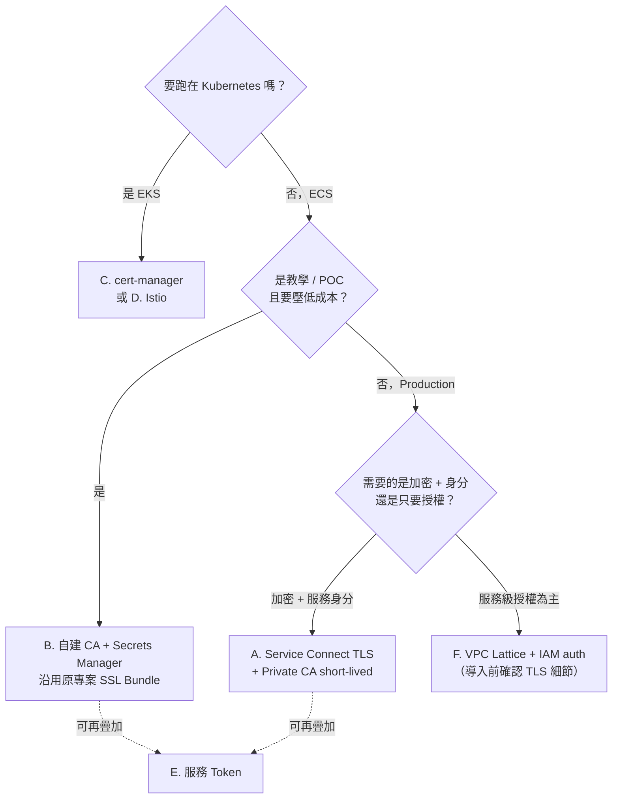

| 情境 | 建議 | 每月約略 CA 相關成本 |
|---|---|---|
| 本教學 / 個人 POC | **B. 自建 CA + Secrets Manager** | 每個服務憑證 secret US$0.40 |
| 企業 POC（短期驗證 Private CA） | **A**，善用首個 CA 的 30 天免月費 | 憑證費 US$0.058 / 張；試用後務必刪除 CA |
| Production on ECS | **A. Service Connect TLS + Private CA short-lived** | US$50 / CA + 憑證費 |
| Production on EKS | **C. cert-manager**（可搭配 Private CA 當上游 issuer）或 **D** | 依是否使用 Private CA |
| 銀行 / 金融合規（需完整 PKI、稽核、撤銷） | **Private CA general-purpose** 作為 root / subordinate，搭配 A 或 C | US$400 / CA 起 |

參考：[AWS Private CA Pricing](https://aws.amazon.com/private-ca/pricing/)、[Amazon ECS Service Connect TLS](https://docs.aws.amazon.com/AmazonECS/latest/developerguide/service-connect-tls.html)、[Amazon VPC Lattice Pricing](https://aws.amazon.com/vpc/lattice/pricing/)

---

## 14. Repo 結構

```
rbac-poc-on-aws-tutorial/
├── README.md                      ← 本教學
├── aws/                           ← ★ AWS 版本新增
│   ├── cloudformation/            00-bootstrap-iam … 60-api
│   ├── codebuild/buildspec.yml
│   ├── docker/Dockerfile.{product,user}-service
│   ├── lambda/pre-token-generation/index.js
│   └── scripts/                   env / 00 / 01 / 10 / 20 / 30 / 40 / 50 / 99 / deploy-all
├── docs/
│   ├── images/                    ← 部署過程截圖
│   ├── deployment-log.md          ← 實際部署時間軸
│   ├── verify-report.md           ← 驗證報告（自動產生）
│   └── original/                  ← 原專案 README / PRD / TECH / INFRA
├── libs/                          security-lib / tenant-lib / audit-lib / common-lib
├── services/                      product-service / user-service（gateway-service 已移除，見 §1.3）
├── apps/rbac-demo/                （保留）
├── deploy/                        docker / k8s / scripts（原專案；已移除 gateway 相關設定）
├── specs/                         原專案 spec-kit
└── tests/scenario-tests/          Cucumber BDD（保留）
```


